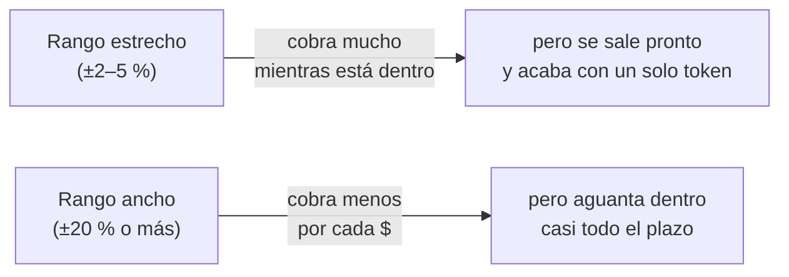
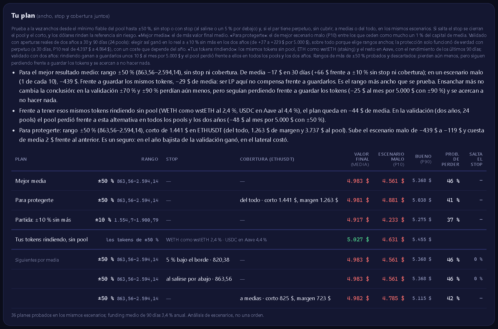
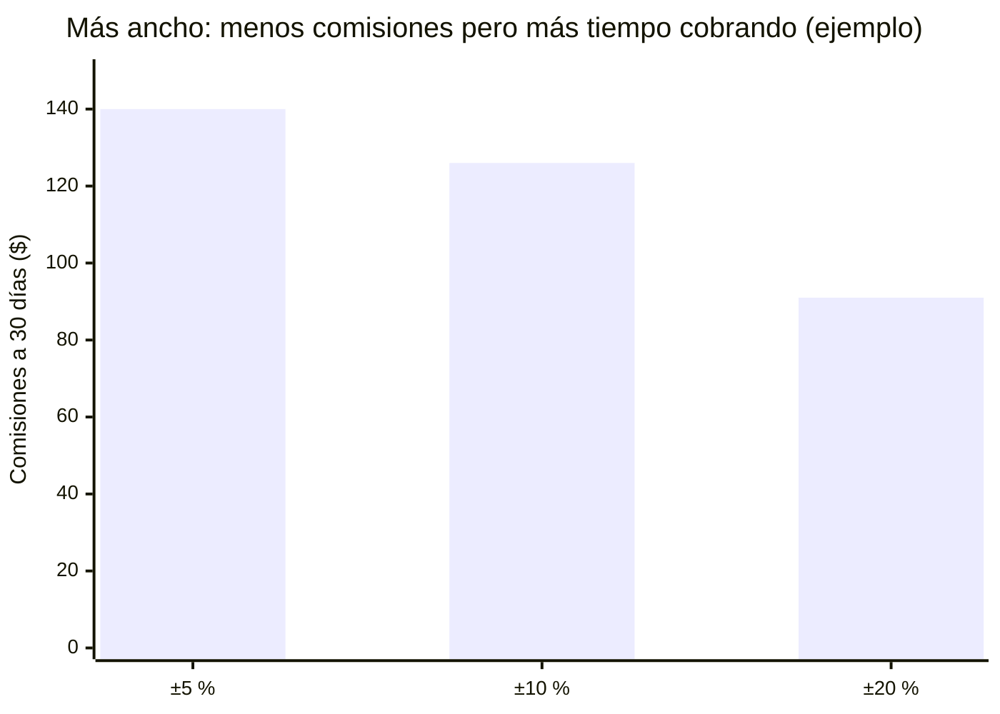
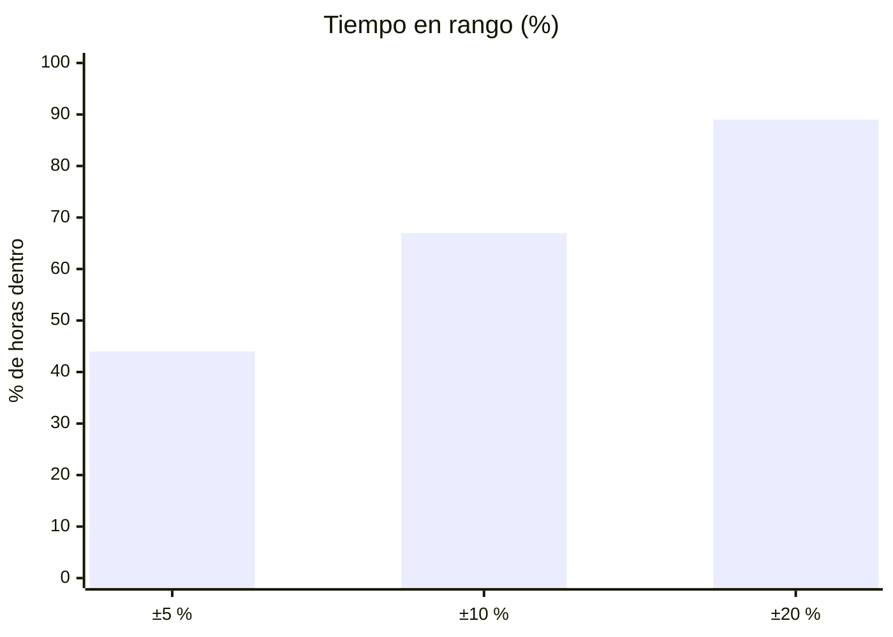
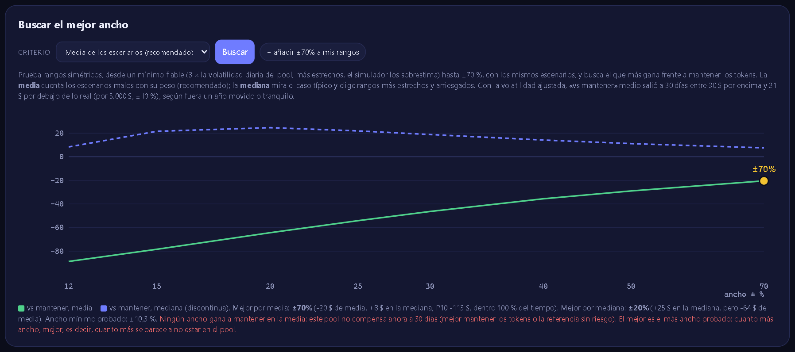
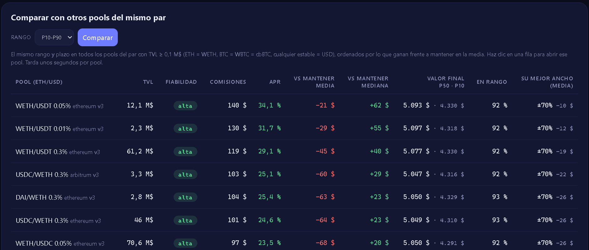
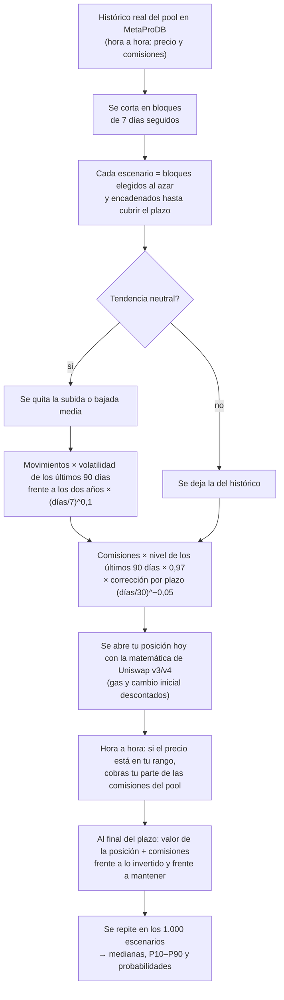
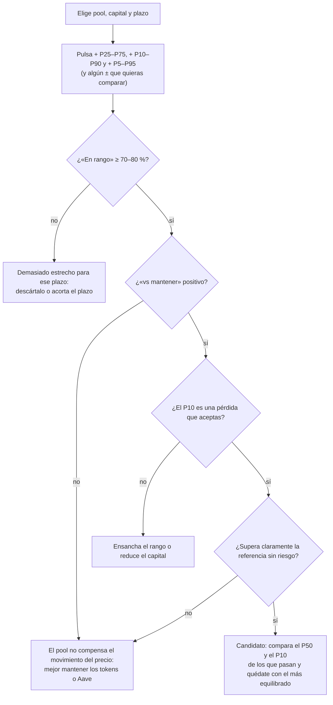
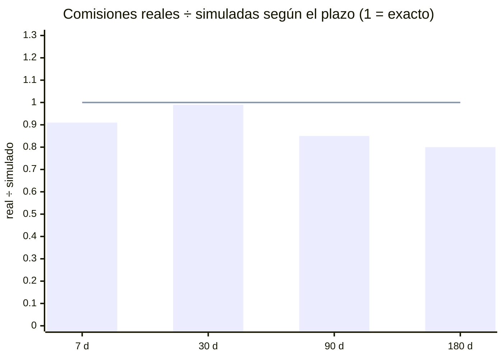

# Guía del Simulador de pools

Manual de uso de la pantalla **Simulador de pools**: qué hace, qué significa cada campo y cada columna, y
cómo leer los resultados para elegir un rango.

> **En una frase:** eliges un pool de MetaProDB, un capital y uno o varios rangos de precio; el simulador
> inventa 1.000 futuros posibles con el comportamiento real de ese pool y te dice qué habría pasado con tu
> posición en cada uno (comisiones, valor final, tiempo en rango, probabilidad de perder).
> Es **análisis de escenarios, no una predicción** ni una recomendación de inversión.

> **Lo que dicen dos años de validación (nov-2026, 24 pools de referencia, miles de aperturas reales):**
> - Ser LP **perdió frente a guardar los mismos tokens** de media, y más aún frente a tenerlos rindiendo
>   (ETH como wstETH, el resto en Aave): −48 $ al mes por 5.000 $ con ±50 %, en todos los pools y años.
> - Cuanto **más ancho** el rango, menos pierde (sin un ancho que gane); ninguna condición al abrir
>   (comisiones altas, volatilidad baja, etapa lateral…) hizo ganar al LP de forma fiable.
> - Lo que sí funciona: elegir dónde y cómo perder menos (ranking, ancho, plan) y **protegerse con un corto
>   en el perpetuo**, que sube de verdad el escenario malo.
> - Las cifras del simulador están calibradas (comisiones, horquilla P10–P90, stop, perpetuo) y una tarea
>   mensual comprueba que lo sigan estando.

**Índice**

1. [Cómo abrirlo](#1-cómo-abrirlo)
2. [La pantalla de un vistazo](#2-la-pantalla-de-un-vistazo)
   - [2 a. ¿En qué pool añade más ser LP? (ranking)](#2-a-en-qué-pool-añade-más-ser-lp-ranking)
   - [2 b. Mis posiciones abiertas (Revert)](#2-b-mis-posiciones-abiertas-revert), con «Tu plan» para cada una
3. [Campos de entrada](#3-campos-de-entrada)
4. [Los rangos](#4-los-rangos)
5. [La línea de datos](#5-la-línea-de-datos)
   - [5 b. En resumen: conclusión y semáforo de fiabilidad](#5-b-en-resumen-conclusión-y-semáforo-de-fiabilidad)
   - [5 c. Tu plan (ancho, stop y cobertura juntos)](#5-c-tu-plan-ancho-stop-y-cobertura-juntos), con «tus tokens rindiendo»
6. [Gráfico 1: precio en los escenarios](#6-gráfico-1-precio-en-los-escenarios-y-tus-rangos)
7. [Gráfico 2: resultado frente a lo invertido](#7-gráfico-2-resultado-frente-a-lo-invertido)
   - [7 b. Gráfico 3: de dónde sale el resultado](#7-b-gráfico-3-de-dónde-sale-el-resultado)
8. [La tabla de detalle, columna a columna](#8-la-tabla-de-detalle-columna-a-columna)
   - [8 a. ¿Y si lo reajustas cuando se sale?](#8-a-y-si-lo-reajustas-cuando-se-sale)
   - [8 a b. ¿Y si sale mal? (casos de estrés)](#8-a-b-y-si-sale-mal-casos-de-estrés)
   - [8 a b b. ¿Y si pones un stop?](#8-a-b-b-y-si-pones-un-stop)
   - [8 a c. Cubrirlo con un préstamo en Aave](#8-a-c-cubrirlo-con-un-préstamo-en-aave)
   - [8 a c b. Cubrirlo con un corto en un perpetuo](#8-a-c-b-cubrirlo-con-un-corto-en-un-perpetuo)
   - [8 b. Buscar el mejor ancho](#8-b-buscar-el-mejor-ancho)
   - [8 c. Comparar con otros pools del mismo par](#8-c-comparar-con-otros-pools-del-mismo-par)
   - [8 d. Recomendación](#8-d-recomendación), y si hay momentos en que ser LP compensa
   - [8 e. ¿Cómo ha acertado con tus simulaciones?](#8-e-cómo-ha-acertado-con-tus-simulaciones)
9. [Cómo funciona por dentro](#9-cómo-funciona-por-dentro)
10. [Cómo elegir un rango (receta)](#10-cómo-elegir-un-rango-receta)
11. [Fiabilidad y límites](#11-fiabilidad-y-límites)
12. [Problemas frecuentes](#12-problemas-frecuentes)
13. [Desde la consola](#13-desde-la-consola)
14. [Apéndice técnico (para quien toca el código)](#14-apéndice-técnico-para-quien-toca-el-código)

---

## 1. Cómo abrirlo

| Dónde | Cómo |
|---|---|
| En el navegador del PC | **http://localhost:8768** |
| Desde el panel Power4 | https://caiico1.github.io/power4-panel/ → pestaña **Simulador** |

- **Arranca solo** al iniciar sesión en Windows (tarea programada «Simulador web», unos 30 s después de entrar).
- **Solo funciona en el PC** donde corre, porque lee MetaProDB del disco `D:`. En el móvil o en otro
  ordenador la sección del panel sale vacía.
- Si no responde, arráncalo a mano desde la carpeta del proyecto y deja la ventana abierta:

```powershell
cd C:\Users\javie\Proyectos\etapas-weinstein
python -m etapas.simulador_web
```

---

## 2. La pantalla de un vistazo

La pantalla tiene estos bloques, de arriba abajo:

```mermaid
flowchart TB
    A["① Controles<br/>pool, capital, plazo, histórico,<br/>escenarios, tendencia, comisiones"] --> B["② Rangos<br/>uno o varios, cada uno con su color"]
    B --> RK["¿En qué pool añade más ser LP?<br/>ranking de MetaProDB (botón Calcular ranking)"]
    RK --> M["Mis posiciones abiertas (Revert)<br/>(botón Cargar y simular)"]
    M --> R["③ En resumen<br/>conclusión en frases + semáforo de fiabilidad"]
    R --> PL["Tu plan<br/>ancho, stop y cobertura juntos + tus tokens rindiendo"]
    PL --> C["④ Gráfico de precio<br/>abanico de escenarios y tus rangos"]
    C --> D["⑤ Gráfico de resultado<br/>ganancia o pérdida de cada rango"]
    D --> G["⑥ De dónde sale el resultado<br/>precio, pérdida impermanente, comisiones, costes"]
    G --> E["⑦ Tabla de detalle<br/>todas las cifras + referencia sin riesgo"]
    E --> RJ["¿Y si lo reajustas?<br/>dejarlo fijo frente a recentrarlo al salirse"]
    RJ --> ES["¿Y si sale mal?<br/>casos de estrés y dónde deja de cobrar"]
    ES --> SL["¿Y si pones un stop?<br/>sin stop frente a cerrar a dólares bajo el borde"]
    SL --> CB["Cubrirlo con un préstamo en Aave<br/>sin cubrir, a medias, del todo"]
    CB --> CP["Cubrirlo con un corto en un perpetuo<br/>Bybit: sin cubrir, a medias, del todo"]
    CP --> O["⑧ Buscar el mejor ancho<br/>(botón Buscar)"]
    O --> P["⑨ Comparar con otros pools del mismo par<br/>(botón Comparar)"]
    P --> Q["⑩ Recomendación<br/>qué haría, qué no y cómo mejorarlo, en lenguaje llano"]
    Q --> HI["¿Cómo ha acertado con tus simulaciones?<br/>lo que dijo frente a lo que pasó"]
```



Los dos últimos y «Mis posiciones» no se calculan solos: pulsa su botón. Para abrir la página con ellos ya
lanzados: **http://localhost:8768/#ranking,posiciones,buscar,comparar** (o solo los que quieras).

Empieza por **③ En resumen**: dice en tres o cuatro frases lo que hay en los gráficos y en la tabla, y
cuánto fiarte. Justo debajo, **Tu plan** junta en una decisión el ancho, el stop y la cobertura, y lo
compara con tener los mismos tokens rindiendo sin pool.

Cada vez que cambias un campo o un rango, **vuelve a simular solo** (en menos de medio segundo). El
botón **Simular** fuerza una nueva simulación. Mientras calcula, la pantalla se atenúa.

---

## 2 a. ¿En qué pool añade más ser LP? (ranking)

Pulsa **Calcular ranking** (menos de un minuto; el último calculado se muestra al abrir la página). El
simulador:

1. Toma **todos los pools de MetaProDB** con datos recientes, **TVL ≥ 0,5 M$** y **≥ 1 año de histórico**,
   sin pares de dos estables ni los pools con comisiones anómalas.
2. Simula cada uno al plazo y capital de arriba con **su mejor ancho** (el del buscador, sección 8 b).
3. Los ordena por **«vs mantener» medio**: lo que añade la posición (comisiones − pérdida impermanente −
   costes) frente a guardar los mismos tokens.

| Columna | Qué es |
|---|---|
| **Mejor ancho** | El rango que más gana de media frente a mantener en ese pool. |
| **vs mantener** | La puntuación del ranking. |
| **Comisiones, En rango** | Lo que cobra de media y el tiempo dentro. |
| **Valor final, Escenario malo** | Media y P10 de lo que acabarías teniendo, con el precio incluido. |
| **vs sin riesgo** | Valor final medio frente a la referencia sin riesgo de su red. |
| **Ver en detalle** | Carga ese pool con su mejor ancho arriba, con el stop y las coberturas. |

**Por qué no ordena por lo que ganarás en total.** El resultado total depende sobre todo de hacia dónde va
el precio, y el simulador no lo predice. En la validación, ordenar por resultado total no acertó más que el
azar (correlación ≈ 0). Ordenar por «vs mantener» algo ayuda, poco:

**Validación (26-nov-2026, con los datos corregidos y comprobados contra Revert):** 61 pools, 53 fechas
cada 14 días de los dos últimos años, a 30 días, con datos solo de antes de cada fecha y el resultado real
del mejor ancho de cada pool:

| Por 5.000 $ a 30 días, «vs mantener» real | Ranking del simulador | Ordenar por comisiones/TVL de 7 días |
|---|---|---|
| Los 10 primeros | **−10 $** | −17 $ |
| Todos (media) | −23 $ | −23 $ |
| Los 10 últimos | −39 $ | −36 $ |
| Fechas en que los 10 primeros ganan a la media | **66 %** | 60 % |
| Solo pools con TVL ≥ 2 M$: los 10 primeros / la media | **−11 / −24 $ (70 %; 69 % y 70 % cada año)** | −26 / −24 $ (53 %) |

Por quintiles del ranking, lo real sube con la puntuación: −41, −27, −24, −14 y −8 $. **Lectura honesta:**
en estos dos años, ser LP perdió de media 23 $ al mes por cada 5.000 $ frente a guardar los tokens, y ni los
mejores del ranking ganaron de media. El ranking sirve para **perder menos** (unos 13 $ al mes por cada
5.000 $ frente a la media), no para encontrar pools que ganen. Ordenar por las comisiones recientes no lo
consigue, porque los pools que más cobran suelen ser los que más pérdida impermanente tienen.

Las validaciones anteriores (+14 $ con los datos sin limpiar, 0 $ quitando los pares pegados) estaban
contaminadas por las comisiones fantasma, que aparecían a la vez en lo simulado y en lo «real».

**Datos de MetaProDB que se limpian o excluyen (26-nov-2026):**

- **Horas con el pool vacío** (liquidez activa 0, precio en el tick extremo o, en v3, menos de 1.000 $ de
  TVL): 175.745 horas en 84 pools. Pasa al nacer el pool o cuando un gestor retira toda la liquidez y la
  vuelve a poner; el precio salta a ×e^±78 y vuelve, y hacía explotar los escenarios (SKY, VIRTUAL, PENDLE).
  Se quitan al leer el histórico (`backtest.load_hours`, también para el backtest); si el vacío dura más de
  6 horas, cuenta como hueco y se usa el tramo más reciente.
- **Comisiones concentradas en unas pocas horas:** en los pools grandes, el 0,1 % de horas con más
  comisiones reúne el 3,5–10 % del total; en los pares pegados al 0,01 %, el 30–93 %. Son excursiones del
  precio, dentro de la hora, a ticks casi vacíos: `feeGrowthGlobal` se dispara (wstETH/WETH de Arbitrum,
  18-abr-2026 18:00: 595.592 $ de comisiones y 7.941 M$ de volumen con 0,9 M$ de TVL), pero un LP con un
  rango normal no las cobra. En esos pools (más del 30 %) el simulador **anula las horas con más de 1.000
  veces la mediana** (`quitar_picos`) y avisa en el semáforo (fiabilidad media como mínimo).
- **Contraste con Revert, la verdad externa (26-nov-2026).** Todas las validaciones comparan lo simulado
  con un replay hecho con los mismos datos de MetaProDB: si los datos están mal, no lo ven. Por eso se
  comparan las comisiones de los LP de cada pool en el último año según Revert (calculadas con sus propios
  eventos) con las de MetaProDB en la misma ventana:

  | Pools | MetaProDB ÷ Revert |
  |---|---|
  | Grandes y limpios (WETH/USDC, WBTC/USDT, LINK…) | ×0,77–0,95 (MetaProDB mide lo que cobra un LP pasivo; Revert suma también a los LP *just-in-time*: el factor de ajuste de comisiones ya lo recoge) |
  | Pares pegados, tal cual | ×20–270 (tBTC/WBTC ×22, wstETH/WETH ×38, USDC/USDT ×270) |
  | Pares pegados, sin las horas pico | ×0,8–1,3 |
  | Todos (163 pools con dato) | mediana ×0,94; 67 % dentro de ×0,67–1,5; 16 % fuera de ×0,5–2, sobre todo pools v4 |

  El contraste entra en el **semáforo**: fuera de ×0,5–2, fiabilidad baja («sus comisiones no son
  fiables»); fuera de ×0,67–1,5, media. Se guarda en `out/contraste_revert.json` y lo refresca la tarea
  mensual de calibración. Desde la consola: `python -m etapas.contraste_revert`.
- **El último mes también (H3, 27-nov-2026).** El contraste guarda también las comisiones del último mes.
  Si un pool cuadra en el año pero en el último mes sale fuera de ×0,5–2, el semáforo baja a fiabilidad
  media («algo reciente no cuadra»): el simulador usa el nivel de comisiones de los últimos 90 días, así
  que una hora fantasma reciente lo infla. Y si MetaProDB le cuenta más del doble que Revert en el último
  mes, sale del ranking. Primer caso: ENA/WETH 0,3 % de Ethereum, que encabezaba el ranking, tenía en
  noviembre de 2026 **una sola hora con 420.122 $ de comisiones de 525.000 $ en todo el mes** (×2,30 de
  Revert en el mes, ×1,34 en el año). El 27-nov había 7 pools así (UNI/USDC, ONDO/WETH, USDC/USDT 0,01 %,
  ENA/WETH, USDe/USDC v4, cbBTC/WBTC de Arbitrum y RLUSD/USDC).
- **Datos sospechosos que queden:** el ranking también excluye los pools cuyo mejor rango cobraría más de un
  15 % al mes o cuyo «vs mantener» supera el capital.

Desde la consola: `python -m etapas.ranking --dias 30` (guarda `out/ranking.json`).

---

## 2 b. Mis posiciones abiertas (Revert)

Pulsa **Cargar y simular**. El simulador:

1. **Lee tus posiciones abiertas de Revert**, solo lectura, con su MCP público. Usa las carteras de tu
   configuración local (`~/.cripto-renta/config.json`, «carteras»), que nunca se suben al repositorio.
2. **Busca su pool en MetaProDB.** Si no está, la fila lo dice.
3. **Simula lo que queda desde hoy** al plazo de arriba, con **su rango exacto** (sus ticks) y **su valor
   real**, sin gas ni cambio inicial, porque ya está abierta.

| Columna | Qué es |
|---|---|
| **Posición** | Número, pool, red, versión y días desde que se abrió. Debajo, la **lectura**: si mantenerla compensa frente a cerrarla. |
| **Valor / pendiente** | Lo que vale hoy según Revert y, debajo, las comisiones pendientes de cobrar. |
| **Rango · hoy** | Su rango en precios y el precio de hoy, en verde si está dentro y en rojo («FUERA») si no. |
| **Stop vigilado** | El stop de esa posición: el que sugiere el simulador (sección 8 a b b, con su valor y sin gas de apertura), el que elijas tú o, si no sugiere ninguno, el borde de abajo. Debajo, su precio y si el precio de hoy está **lejos**, **CERCA** (a menos de un 3 %) o lo ha **CRUZADO**. Pasa el ratón para ver cuánto mejora el escenario malo. |
| **Fiabilidad** | El semáforo del simulador para ese pool y ese plazo. |
| **Se sale alguna vez** | % de escenarios en que el precio sale del rango en algún momento del plazo. |
| **En rango** | % medio del tiempo dentro, es decir, cobrando. |
| **Acaba ↓ · = · ↑** | Dónde acaba el precio: por debajo, dentro o por encima del rango. |
| **Comisiones** | Lo que cabe esperar cobrar en el plazo (mediana), con su % sobre el valor. |
| **vs cerrar (media / mediana)** | Lo que gana o pierde **mantenerla** frente a **cerrarla hoy y guardar los tokens que tiene ahora**. La media cuenta los escenarios malos con su peso. |
| **Ver en detalle** | Carga ese pool y ese rango arriba, con el P10–P90 al lado para comparar. El capital mínimo de la pantalla es 100 $: las cifras escalan. |

**La lectura** sale de esas cifras:
- «Mantenerla compensa…»: gana a cerrar en la media.
- «Dudosa…»: gana en el caso típico pero pierde en la media (riesgo de que el precio se escape).
- «No compensa…»: pierde en la media y en el caso típico.
- «Fuera de rango: no cobra…»: solo recupera si el precio vuelve a entrar.

**Avisos de vigilancia:** cruza Revert con tu `posiciones.txt`, por número o, si la línea no lo lleva,
por rango de precios. Avisa si una posición abierta no está vigilada por la rutina, o si una vigilada ya no
está abierta.

**El vigilante del stop.** Uniswap no tiene órdenes stop: si el precio cruza el nivel de madrugada, nadie
lo ejecuta. La tarea de Windows **«Vigilante stop»** (cada hora, también con el portátil a batería; si el
PC estaba apagado, en cuanto se enciende) lee en Revert el tick del pool de cada posición abierta y avisa
**solo cuando empeora**: de lejos a cerca y de cerca a cruzado.

- **Notificación de Windows** con el detalle: qué posición, a qué precio está, su stop y qué hacer
  (cerrar y pasar a dólares en Revert o Uniswap, o decidir si no había stop sugerido).
- **Issue de GitHub «Vigilante del stop: revisa tus posiciones»** (etiqueta `stop-posicion`), que llega
  por correo y al móvil. Solo dice **cuántas** posiciones están cerca o han cruzado: sin pares, precios,
  importes ni números, porque el repositorio es público. Cada nuevo empeoramiento añade un comentario y se
  cierra sola cuando ninguna está cerca.
- **No cierra nada.** Revert es solo lectura; el vigilante solo avisa.

El nivel se recalcula una vez al día o si cambia el rango. Para fijar tú el stop de una posición, crea
`~/.cripto-renta/stops.json` (local, nunca en el repositorio) con su número y la regla:
`{"123456": "5 % bajo el borde"}` (reglas: «al salirse por abajo», «5 % bajo el borde», «10 % bajo el
borde»).

**Comprobado con dos años de histórico real** (16 pools, 19.845 casos de 30 días con ±5, ±10 y ±20 % y los
tres stops): el vigilante avisa en la misma hora en que salta el stop simulado el 99,1 % de las veces; el
resto, una hora antes (redondeo de un tick), nunca después. El aviso «cerca» llega una mediana de **16
horas** antes del cruce (23 h con el stop en el borde, 7 h con el del 10 %); solo en el 8,5 % de los casos
el precio pasa de lejos a cruzado en una misma hora.

Desde la consola: `python -m etapas.vigilante_stop --simular` (qué haría, sin avisar) o `--probar` (una
notificación de prueba). El registro queda en `out/vigilante_stop.log`.

Desde la consola: `python -m etapas.posiciones_lp --dias 30`.

> El simulador y el vigilante no preparan ni envían ninguna transacción: solo leen, simulan y avisan. Cerrar, reajustar o abrir es
> cosa tuya, en Revert o en Uniswap.

---

### Tu plan para cada posición abierta (G2, 27-nov-2026)

Debajo de la lectura de cada posición, una frase «Tu plan» compara, en los mismos escenarios y al plazo de
arriba, qué hacer con ella:

- mantenerla tal cual, o con stop (al salirse por abajo o un 5 % por debajo);
- cubrirla a medias o del todo con un corto en el perpetuo (si el par lo tiene), poniendo el margen aparte;
- cerrarla y dejar sus tokens rindiendo (ETH como wstETH, el resto en Aave);
- cerrarla y pasar a USDC en Aave.

Da la mejor de media (y cuánto gana frente a mantenerla) y, si alguna sube el escenario malo al menos un
2 % del valor sin ceder más del 1 % de media, la que protege. Todas las piezas están validadas por
separado (stop, perpetuo, tokens rindiendo); el resultado se mide frente a lo puesto (valor de hoy más el
margen, si se cubre), y cerrar paga el gas y, para pasar a USDC, el cambio de la parte que no es estable.
Ejemplo (una posición de 1.000 $ con ±10 % en WETH/USDC de Base, 30 días, nov-2026): mantenerla, −17 $ de
media y −157 $ en el escenario malo; con stop al salirse, −16 $ y −75 $; cubierta del todo, −17 $ y −94 $;
cerrarla y dejar sus tokens rindiendo o pasar a USDC en Aave, +3 $ de media (con USDC, sin riesgo de precio).

## 3. Campos de entrada


| Campo | Valor por defecto | Qué es | Cuándo cambiarlo |
|---|---|---|---|
| **Pool** | WETH/USDC 0,05 % de Base | El pool donde abrirías la posición. La lista trae los pools de MetaProDB con datos de los últimos 3 días, agrupados por red y ordenados por TVL. Cada opción muestra par, comisión, versión (v3/v4) y TVL. | Siempre que quieras mirar otro pool. Solo están los de MetaProDB. |
| **Capital ($)** | 5.000 | Dinero que metes, en dólares (mínimo 100). El simulador reparte ese capital entre los dos tokens en la proporción que exige el rango. | Para ver tu caso real. Las cifras escalan casi en proporción; solo el gas pesa más con capitales pequeños. |
| **Plazo (días)** | 30 | Cuánto tiempo mantienes la posición **abierta sin tocarla**. Opciones: 7, 14, 30, 60, 90, 180. | Ajusta a tu marco: 7 semanal, 30 mensual, 90 trimestral. Ver [sección 10](#10-cómo-elegir-un-rango-receta). |
| **Histórico (días)** | 730 | Cuántos días del pasado del pool se usan como «material» para construir los escenarios. Opciones: 90, 180, 365, 730, 1.095. | Déjalo en 730 **para cualquier plazo**. Se comparó con 365 y 1.095 a 7, 60, 90 y 180 días (17–20 pools): 730 acertó igual o mejor en todos. Más histórico no ayuda: mete épocas que ya no se parecen al pool de hoy. |
| **Escenarios** | 1.000 | Cuántos futuros posibles se simulan. | 300 para probar rápido; 3.000 para una decisión final (afina los extremos, tarda ~3 veces más). No hace la simulación más «acertada», solo menos ruidosa. |
| **Tendencia** | Neutral | **Neutral:** quita la subida o bajada media del histórico; el simulador no apuesta por la dirección del precio, solo por cuánto se mueve. **La del histórico:** mantiene la tendencia que tuvo el pasado. | Déjalo en Neutral. «La del histórico» solo para ver qué pasaría si se repitiera la tendencia de los últimos años. |
| **Nivel comisiones** | Últimos 90 días | Reescala las comisiones de los escenarios al nivel reciente del pool. Si en los últimos 90 días el pool ha cobrado la mitad que su media, los escenarios cobran la mitad. Opciones: todo el histórico, 30 días, 90 días. | Déjalo en 90 días (es lo validado). 30 días reacciona más rápido pero es más ruidoso. «Todo el histórico» ignora si el pool se ha enfriado. |
| **Ajuste comisiones** | 0,97 | Factor común que multiplica todas las comisiones. Corrige que el reparto por horas tiende a sobrestimar algo lo cobrado. Sale de la validación con datos reales. | No lo toques salvo que el aviso mensual proponga otro valor; aquí puedes probarlo antes de cambiarlo en el código. |

Además, el simulador aplica solo dos correcciones que no se eligen en pantalla (ver
[sección 11](#11-fiabilidad-y-límites)):

- **Comisiones por plazo:** ×1,08 a 7 días, ×1 a 30, ×0,95 a 90 y ×0,91 a 180.
- **Volatilidad:** los movimientos del precio se escalan a la volatilidad de los **últimos 90 días** del
  pool frente a sus dos años, y se ensanchan con el plazo: ×1 a 7 días, ×1,16 a 30 y ×1,29 a partir de 90.

> **El efecto conjunto** aparece en la línea de datos: por ejemplo «comisiones ×0,54 (nivel 90 d ×0,55,
> ajuste 0,97, plazo ×1)» significa que los escenarios cobran el 54 % de la media histórica:
> 0,55 por el nivel reciente × 0,97 por el ajuste × 1 por el plazo de 30 días.

---

## 4. Los rangos

Puedes comparar **varios rangos del mismo pool a la vez**. Cada uno tiene un color que se repite en los
gráficos y en la tabla.

**Cómo se escriben:**

| Formato | Ejemplo | Significa |
|---|---|---|
| Porcentaje simétrico | `±10%` | De un 10 % por debajo a un 10 % por encima del precio de hoy |
| Porcentaje asimétrico | `-5/+15` | De un 5 % por debajo a un 15 % por encima |
| Precios | `1500-1900` | Entre esos dos precios exactos (decimales con punto: `1539.5-1883`) |
| Percentiles | `P10-P90` | Entre los precios en los que acaba el 10 % y el 90 % de los escenarios al final del plazo: el precio acaba dentro en 8 de cada 10. Se recalcula solo al cambiar el pool, el plazo o el histórico. |

- **Botones rápidos:** `+ ±2 %`, `+ ±5 %`, `+ ±10 %`, `+ ±20 %`, `+ −5/+15 %` añaden ese rango.
  **`+ rango en precio`** añade uno de ±10 % escrito en precios, para que lo edites.
- **Botones por percentil:** `+ P25–P75` (estrecho: cobra más y se sale más), **`+ P10–P90`** (el punto
  de partida más equilibrado) y `+ P5–P95` (ancho y prudente). Salen asimétricos (por ejemplo −24/+27 %),
  porque en porcentaje el precio puede subir más de lo que puede bajar.

> **Por qué P10–P90 como punto de partida.** Simulado en ETH y BTC a 7, 30 y 180 días (22-nov-2026):
> el precio está dentro ~90 % del tiempo, su «vs mantener» mediano está entre los mejores y su caso malo
> (P10) es bastante menos malo que el del P25–P75, que cobra un 30–40 % más de comisiones pero pierde
> más cuando el precio se escapa. No arregla un pool que cobra poco: ahí ningún ancho supera a mantener.
- **Editar:** haz clic en el texto del rango, cámbialo y pulsa Intro o sal del campo.
- **Quitar:** la ✕ de cada rango.
- **Ajuste a ticks:** Uniswap solo admite ciertos precios (los *ticks* del pool). El simulador mueve cada
  límite **hacia fuera** al tick válido más cercano, así que el rango real puede ser un poco más ancho que el
  escrito. La tabla muestra siempre los precios reales.
- Los precios se muestran como el par «natural» (ETH en USDC, BTC en USDC…), aunque el pool guarde los tokens
  al revés.



---

## 5. La línea de datos

Debajo de los rangos aparece una línea con el contexto de la simulación:

| Dato | Ejemplo | Significa |
|---|---|---|
| Precio de hoy | ETH/USDC hoy **1.711,05** | Último precio del pool en MetaProDB. Es el punto de partida de todos los escenarios. |
| Datos hasta | **2026-11-22 15:00** | Última hora registrada (UTC). Si es de hace más de un día, MetaProDB no se está actualizando. |
| Histórico desde | **2024-11-22** | Primer día usado para construir escenarios (según el campo Histórico). |
| Escenarios y plazo | **1000** escenarios a **30** días | Lo elegido arriba. |
| Comisiones | ×**0,54** (nivel 90 d ×0,55, ajuste 0,97, plazo ×1) | Cuánto cobran los escenarios frente a la media histórica del pool: nivel reciente × ajuste × corrección por plazo. Por debajo de 1: el pool cobra ahora menos que de media. |
| Volatilidad | ×**0,89** (últimos 90 d ×0,77, plazo ×1,16) | Cuánto se amplían los movimientos del precio de los escenarios frente al histórico: volatilidad de los últimos 90 días frente a la de los dos años × ensanche por plazo. Por encima de 1: escenarios más movidos. |
| Etapa | etapa **1** (Inicio (base)) de ETH/USDC en mensual · **apta** | La etapa de Weinstein del par, la misma lectura que usan `/pool`, el cribado y la rutina, en el marco que corresponde al plazo: **semanal** hasta 14 días y **mensual** desde 30. «Apta» o **«precaución»**: la etapa 2 (alcista), o la transición hacia ella, pide precaución en semanal y mensual. Pasa el ratón por encima para ver el motivo. |
| Gas | **0.05 $** | Coste de abrir la posición: 5 $ en Ethereum y 0,05 $ en Base y Arbitrum. Se resta al abrir. |
| Cambio inicial | **0,05 %** | Comisión del intercambio para repartir el capital entre los dos tokens (la del propio pool, aplicada a la parte que hay que cambiar). |
| Aviso (en rojo) | «hay huecos en el histórico…» | Solo si el pool tiene horas sin datos: se usa el tramo continuo más reciente. |

---

## 5 b. En resumen: conclusión y semáforo de fiabilidad


**La conclusión** son tres o cuatro frases calculadas a partir de la tabla:

| Frase | Cuándo sale | Qué responde |
|---|---|---|
| «El mejor frente a mantener es…» o «Ningún rango supera a mantener…» | Siempre | ¿Compensa el pool frente a guardar los tokens? Usa la mediana de «vs mantener». |
| «USDC en Aave da… más que cualquier rango» o «… supera a USDC en Aave, pero en el escenario malo…» | Si hay referencia sin riesgo | ¿Compensa el riesgo frente a no arriesgar? |
| «Ojo con ±5 %: la mediana gana…, pero la media pierde…» | Si la mediana gana y la media pierde | Riesgo de cola (ver [7 b](#7-b-gráfico-3-de-dónde-sale-el-resultado)). |
| «±5 %: dentro menos del 60 % del tiempo…» | Si algún rango se sale mucho | Rango demasiado estrecho para el plazo. |
| «Fiabilidad media: …» | Si la fiabilidad no es alta | Por qué fiarse menos. |

**El semáforo de fiabilidad** (junto al título) dice cuánto fiarte de las cifras **de este pool a este
plazo**. Debajo, en gris, aparecen los motivos (⚠ en contra, ✓ a favor):

| Nivel | Cuándo |
|---|---|
| 🟢 **Alta** | Pool como los validados (≥ 1 año de histórico y TVL > 2 M$), plazo de hasta 90 días y, si el pool está en la calibración mensual, con un resultado razonable (comisiones reales entre ×0,75 y ×1,33 de las simuladas y al menos el 60 % de los casos reales dentro del P10–P90). |
| 🟡 **Media** | Algo se sale de lo validado: comisiones de MetaProDB a ×0,5–0,67 o ×1,5–2 de las de Revert, horas de comisiones fantasma anuladas, entre 180 días y 1 año de histórico, TVL de 0,5 a 2 M$, plazo de 180 días, o su calibración algo desviada. |
| 🔴 **Baja** | Menos de 180 días de histórico, TVL < 0,5 M$, comisiones anómalas en MetaProDB o que no cuadran con Revert (fuera de ×0,5–2, ver sección 2 a), o su calibración muy desviada (comisiones fuera de ×0,5–×2 o menos del 40 % dentro del P10–P90). |

**¿Y los pools con poco histórico? (probado, nov-2026).** Se probó completar el histórico de un pool joven
con los días que le faltan de otro pool del mismo par: los movimientos del precio en dólares y el ritmo de
comisiones, reescalado al nivel del pool joven. Para medirlo se recortaron 13 pools veteranos a 180 y a 365
días y se compararon con su histórico completo de 730 días, en 901 aperturas reales del último año, a 7 y a
30 días. **Completar no mejoró nada, y recortar tampoco empeoró:** a 30 días, lo real cayó dentro del
P10–P90 el 67–69 % de las veces en todas las variantes, con el mismo error medio (242–246 $ por 5.000 $).
Por eso no se completa nada, y el semáforo ya no baja a «media» con un año o más de histórico. Entre 180 y
365 días baja a «media», porque cubre menos rachas distintas del mercado, y por debajo de 180, a «baja».

La calibración de cada pool la deja la tarea mensual en un archivo local
(`out/simulador_calibracion.jsonl`, no se sube a GitHub). Solo los ~21 pools de referencia la tienen;
los demás se juzgan por su histórico, su TVL y el plazo.

---

## 5 c. Tu plan (ancho, stop y cobertura juntos)



Justo debajo de «En resumen». Las secciones de más abajo responden por separado qué ancho, si poner stop y
si cubrirse con el perpetuo; aquí se prueban **a la vez**, en los mismos escenarios, y se dan dos planes:

- **Mejor media:** el de más valor final medio.
- **Para protegerte:** el de mejor escenario malo (P10) entre los que ceden como mucho un 1 % del capital de
  media. Solo se propone si sube el P10 al menos un 2 % del capital; si no, la pantalla dice que protegerse
  no compensa.

Se prueban los anchos desde el mínimo fiable del pool hasta ±50 % (±0,2, 0,5, 1, 1,5, 2, 3, 5, 10, 15, 20, 30 y
50 %; los estrechos solo entran en pools de poca volatilidad, como los pares pegados o de divisas), sin stop, con
stop al salirse por abajo o un 5 % por debajo, y, si el par tiene perpetuo en Bybit, sin cubrir, a medias o
del todo. Si salta el stop, se cierran a la vez el pool (a dólares) y el corto; después los dólares rinden
la referencia sin riesgo. La tabla enseña los dos planes, el de partida (±10 % sin stop ni cobertura) y los
tres siguientes por media; la Recomendación empieza por estas dos frases.

**Ejemplo (WETH/USDC de Base, 5.000 $, 30 días, nov-2026):** mejor media, ±50 % sin stop ni cobertura:
−22 $ de media (+82 $ frente a ±10 %), −475 $ en el escenario malo. Para protegerte, el mismo ±50 % con un
corto de 1.440 $ en ETHUSDT (1.262 $ de margen y 3.738 $ al pool): el escenario malo pasa a −130 $ y cuesta
5 $ de media.

**Validación (27-nov-2026):** 24 pools de referencia, aperturas de dos años a 30 y 90 días. En cada fecha se
simularon todos los planes con los datos de antes y se calculó lo real de cada uno (con el funding real hora
a hora):

| Por 5.000 $, plan elegido frente a ±10 % sin más (real) | 30 d sin perpetuo | 30 d con perpetuo | 90 d sin perpetuo | 90 d con perpetuo |
|---|---|---|---|---|
| Mejor media: de media / año lateral / año bajista | +37 / +48 / +26 $ | +68 / +41 / +86 $ | +106 / +150 / +37 $ | +229 / +173 / +272 $ |
| Para protegerte: de media | +15 $ | +80 $ | +96 $ | +274 $ |
| P10 real: partida → mejor media → para protegerte | 3.830 → 3.898 → 3.889 $ | 3.943 → 4.397 → 4.864 $ | 3.146 → 3.408 → 3.409 $ | 3.800 → 4.222 → 4.520 $ |
| Real dentro del P10–P90 del plan | 76–77 % | 79–82 % | 84 % | 87–90 % |

**Lectura honesta:**
- El plan de mejor media gana al punto de partida en los dos años, pero casi todo viene del **ancho**: en el
  70–77 % de las fechas elige el rango más ancho sin nada más, y la regla fija «el más ancho» da lo mismo.
  Es la misma lección del buscador: ser LP perdió frente a guardar los tokens y cuanto más ancho, menos.
- **Protegerse solo funciona de verdad con perpetuo.** Con él, el escenario malo real sube unos 470 $ a
  30 días; lo que cuesta depende del año (a 30 días, −68 $ frente a la mejor media en el lateral, +62 $ en
  el bajista). Sin perpetuo, los stops cuestan casi lo que protegen y el P10 apenas se mueve.
- Validado de 30 a 90 días; en otros plazos la pantalla avisa.

**Tus tokens rindiendo, sin pool (J1, 27-nov-2026).** Una fila más en la tabla del plan y una frase: los
mismos tokens que pide el rango del plan, sin meterlos en el pool, cada uno a su mejor rendimiento simple:
ETH como wstETH (staking de Lido; el rendimiento sale de cómo sube el precio wstETH/WETH en MetaProDB) y el
resto en Aave V3 de la misma red (estables al 3–5 %, WBTC, cbBTC, LINK… casi a 0 %). En los escenarios, el
rendimiento de los últimos 90 días, fijo.

**Validación:** 24 pools de referencia, 3.331 aperturas de dos años, con el rendimiento real de cada plazo,
por 5.000 $:

| | 30 días | 90 días |
|---|---|---|
| Tokens rindiendo frente a guardarlos | +9 a +11 $ | +29 a +32 $ |
| Pool ±50 % frente a los tokens rindiendo | −48 $ | −139 $ |
| Pool ±30 % / ±10 % frente a los tokens rindiendo | −66 / −102 $ | −209 / −291 $ |
| Error de lo simulado de los tokens rindiendo | ±3 $ | ±8 $ |

El pool perdió frente a los tokens rindiendo **en todos los pools y en los dos años**. Riesgos de esta
alternativa: el contrato de Aave (y la liquidez para retirar cuando el uso es muy alto) y, con wstETH, que
cotice con descuento frente a ETH al deshacer.

**Rangos de más de ±50 %, probados y descartados (F3, 27-nov-2026).** Como el plan elegía casi siempre ±50 %,
se probaron ±70 % y ±90 % con las mismas aperturas. Frente a guardar los mismos tokens, en lo real y por
5.000 $:

| Ancho (sin stop ni cobertura) | ±10 % | ±30 % | ±50 % | ±70 % | ±90 % |
|---|---|---|---|---|---|
| 30 días | −101 $ | −60 $ | −41 $ | −32 $ | −25 $ |
| 90 días | −267 $ | −183 $ | −110 $ | −81 $ | −62 $ |
| Comisiones cobradas a 30 días | 166 $ | 113 $ | 75 $ | 53 $ | 38 $ |

Cuanto más ancho, menos pierde, sin un punto óptimo: ninguno gana a guardar los tokens en ninguno de los
dos años. Ensanchar solo acerca a no hacer nada. Ampliar el plan hasta ±90 % mejoró lo real apenas 5–40 $
y no en los dos años en todos los casos, así que el plan se queda en ±50 %. Desde entonces la frase del plan
dice también cuánto gana o pierde frente a guardar los mismos tokens.

## 6. Gráfico 1: precio en los escenarios y tus rangos


Muestra **por dónde puede ir el precio** durante el plazo y **dónde quedan tus rangos**.

| Elemento | Qué es |
|---|---|
| **Línea blanca** | Precio mediano: la mitad de los escenarios va por encima y la otra mitad por debajo. Con tendencia neutral, es casi plana. |
| **Banda oscura** | La mitad central de los escenarios (del P25 al P75). |
| **Banda clara** | El 90 % de los escenarios (del P5 al P95). Solo 1 de cada 20 acaba por encima y 1 de cada 20 por debajo. |
| **Franjas de color con líneas discontinuas** | Tus rangos, cada uno con su color. |
| **Eje horizontal** | Días desde hoy. |

**Cómo leerlo:** si el abanico se sale de la franja de un rango pronto, ese rango pasará mucho tiempo fuera.
En el ejemplo, el abanico supera el ±5 % (amarillo) en pocos días, mientras que el ±20 % (verde) contiene casi
toda la banda oscura hasta el final.

---

## 7. Gráfico 2: resultado frente a lo invertido


Una fila por rango. Todo en dólares **respecto a lo invertido** (el 0 es «acabo con lo mismo que metí»).

| Elemento | Qué es |
|---|---|
| **Barra** | Resultado mediano (P50): lo que ganas o pierdes en el escenario de en medio. La cifra encima es ese valor. |
| **Línea fina** | Del escenario malo (P10, a la izquierda) al bueno (P90, a la derecha). |
| **Texto a la izquierda** | Número de rango, cómo lo escribiste y sus precios reales. |

**Cómo leerlo:** la barra dice lo típico, la línea dice el riesgo. Una línea muy larga hacia la izquierda
avisa de que en un mal escenario puedes perder bastante, aunque el mediano sea positivo.

> Ojo: el resultado incluye **lo que cambia el precio de los tokens**. Si ETH cae, pierdes aunque cobres
> comisiones. Para separar el efecto del pool del efecto del precio, mira la columna «vs mantener» o el
> gráfico siguiente.

---

## 7 b. Gráfico 3: de dónde sale el resultado


Descompone el resultado de cada rango en sus cuatro piezas. Las piezas suman exactamente el resultado:

| Pieza | Color | Qué es |
|---|---|---|
| **Precio de los tokens** | gris | Lo que habrían ganado o perdido los tokens que depositas si los hubieras guardado sin abrir posición. Con tendencia neutral, ronda el 0. |
| **Pérdida impermanente** | rojo | Lo que la posición vale **menos** que esos mismos tokens guardados. Siempre es ≤ 0: cuando el precio se mueve, el pool te deja con más del token que baja y menos del que sube. Cuanto más estrecho el rango y más se mueve el precio, mayor. |
| **Comisiones** | verde | Lo que cobras. |
| **Costes** | naranja | Gas y comisión del cambio inicial (casi invisible en Base y Arbitrum). |
| **Rombo blanco** | — | El resultado: la suma de las cuatro piezas. |

**«vs mantener» = pérdida impermanente + comisiones + costes.** Si la barra verde no llega a tapar la
roja, el pool no compensa frente a guardar los tokens.

> **Es una media, no la mediana de la tabla.** La media cuenta con su peso los escenarios malos, y en un
> pool los malos son muy malos: si el precio se escapa mucho, la pérdida impermanente crece sin límite
> mientras las comisiones se paran. En el ejemplo, el ±5 % gana 98 $ en la mediana, pero **pierde 123 $
> de media**. Cuando el rombo sale mucho peor que la mediana de la tabla, el rango tiene riesgo de cola:
> el resumen lo avisa con un «Ojo con…».

---

## 8. La tabla de detalle, columna a columna


Todas las cifras se calculan **en cada escenario** y luego se resumen. «Mediana» o «P50» es el valor del
escenario de en medio.

| Columna | Qué mide | Cómo se calcula | Cómo leerla |
|---|---|---|---|
| **Estrategia** | El rango | «Fijo» + precios reales tras ajustar a ticks + lo que escribiste. Si aparece **«· fuera de rango hoy»** en rojo, el precio actual no está dentro: abrirías con un solo token y no cobrarías nada hasta que el precio entre. | Comprueba que los precios son los que querías. |
| **Invertido** | Tu capital | El campo Capital. | — |
| **Valor final (mediana)** | Cuánto tienes al final del plazo en el escenario de en medio | Mediana de (valor de la posición + comisiones cobradas), con los precios del último día del escenario. Verde si supera lo invertido, rojo si no. | Lo «típico» que te quedaría. Puede salir verde aunque pierdas de media: las ganancias son pequeñas y frecuentes; las pérdidas, grandes y menos frecuentes. |
| **Valor final (media)** | Lo mismo, en la media de todos los escenarios | Media de los 1.000 valores finales: cuenta los escenarios malos con su peso. Es lo invertido + el «resultado» del gráfico «De dónde sale el resultado». | Lo que te quedaría «a la larga», si abrieras esta posición muchas veces. **Si está en rojo, la posición pierde dinero de media**, aunque la mediana salga verde. |
| **P10 – P90** | La horquilla de resultados | Valor final en el escenario malo (solo 1 de cada 10 sale peor) y en el bueno (solo 1 de cada 10 sale mejor). | Cuanto más ancha, más incertidumbre. Mira sobre todo el P10: ¿podrías asumir esa pérdida? |
| **vs mantener** | Si el pool compensa frente a no hacer nada | Mediana de (valor final − valor de **los mismos tokens que depositas**, guardados en la cartera sin abrir posición). Incluye el gas y el cambio inicial como coste. | **Es la columna clave.** Positivo: el pool te deja mejor que tener los tokens quietos. Negativo: las comisiones no compensan la pérdida por el movimiento del precio (la llamada pérdida impermanente). |
| **Comisiones** | Lo que cobras | Mediana de las comisiones cobradas en el plazo, en dólares, ya con nivel reciente, ajuste y la dilución por tu propia liquidez. | Lo que gana el pool en sí. Los rangos estrechos cobran más mientras están dentro. |
| **APR** | Comisiones anualizadas | Comisiones medianas ÷ capital × (365 ÷ días). Interés simple. | Comparable con el APR que muestran Uniswap, Revert o DefiLlama, pero **realista**: ya cuenta el tiempo fuera de rango. |
| **Rent** | Rentabilidad total del plazo | Mediana de (valor final ÷ capital − 1). Entre paréntesis, anualizada: × (365 ÷ días). | Incluye comisiones **y** el cambio de precio de los tokens. La anualización de plazos cortos exagera; úsala solo para comparar rangos entre sí. |
| **En rango** | Tiempo cobrando | Media, en todos los escenarios, de la fracción de horas con el precio dentro del rango. | Por debajo de 70–80 % el rango es estrecho para ese plazo. |
| **P(pérdida)** | Probabilidad de perder dinero | % de escenarios en los que el valor final es menor que lo invertido. En rojo si pasa del 50 %. | Con tendencia neutral, en pares volátiles suele rondar el 40–50 %: el precio puede caer, y eso pesa más que las comisiones. |
| **Acaba ↓ · = · ↑** | Dónde acaba el precio | % de escenarios que terminan **por debajo** del rango · **dentro** · **por encima**. | Por debajo: acabas con todo en el token volátil (p. ej. todo ETH). Por encima: todo en el estable (vendiste ETH por el camino). |

**Debajo de la tabla:**

- **Referencia en dólares:** lo que darían los mismos dólares en **USDC en Aave** de la misma red, con el
  interés de hoy y sin riesgo de precio (ejemplo: 5,21 % → 5.021 $ en 30 días, +21 $). Si el pool no supera
  claramente esta cifra en el escenario típico, no compensa el riesgo.
- **«Cómo se calcula y sus límites»:** resumen técnico desplegable.

### Ejemplo leído (WETH/USDC 0,05 % de Base, 5.000 $, 30 días)

| | ±5 % | ±10 % | ±20 % |
|---|---|---|---|
| Valor final (mediana) | 5.098 $ | 5.127 $ | 5.070 $ |
| Malo (P10) | 4.110 $ | 4.161 $ | 4.301 $ |
| vs mantener | −84 $ | −29 $ | +16 $ |
| Comisiones | 140 $ | 126 $ | 91 $ |
| En rango | 44 % | 67 % | 89 % |





**Lectura:** el ±5 % cobra más comisiones, pero solo está dentro el 44 % del tiempo y pierde 84 $ frente a
mantener los tokens. El ±20 % cobra menos, pero está dentro el 89 % del tiempo y gana algo a mantener
(+16 $). Con las comisiones actuales de este pool (×0,54 de su media) y unos últimos 90 días tranquilos
(volatilidad ×0,77), solo el rango ancho compensa el movimiento del precio a 30 días, y por poco. Si buscas solo renta en dólares, la
referencia de Aave (+21 $ sin riesgo) es competitiva.

---

## 8 a. ¿Y si lo reajustas cuando se sale?

Debajo de la tabla, cada rango aparece cuatro veces: **dejarlo fijo** (lo de la tabla) y **reajustarlo**
con tres reglas. Reajustar es recentrar el rango en el precio del momento, con el mismo ancho (y la misma
asimetría), cuando el precio lleva fuera:

| Regla | Cuándo recentra |
|---|---|
| **al salirse** | En cuanto pasa una hora fuera. |
| **fuera 24 h** | Si sigue fuera un día entero (no persigue los picos). |
| **fuera 72 h** | Si sigue fuera tres días. |

En cada reajuste se retira todo (posición y comisiones cobradas), se cambia lo necesario pagando la
comisión del pool y se vuelve a abrir, con un gas por reajuste. Es la misma mecánica que
`python -m etapas.backtest … --reajuste fuera`, y sobre el histórico real da lo mismo que el backtest (1–2 %).

| Columna | Qué es |
|---|---|
| **Frente a fijo (media)** | Lo que gana (+) o pierde (−) de media esa regla frente a no tocar el rango, en los mismos escenarios. Es la cifra que decide. |
| **Mejor que fijo** | En qué parte de los escenarios acaba mejor que fijo. Suele estar por debajo del 50 %: reajustar gana poco muchas veces y pierde mucho alguna. |
| **Reajustes (media)** | Cuántas veces recentra de media en el plazo. |
| **Gas y cambios** | Lo que cuestan esos reajustes en total. |
| **Comisiones, En rango** | Reajustar pasa más tiempo en rango y cobra más comisiones… |
| **Valor final (media)** | …pero cada reajuste **fija la pérdida impermanente**: vendes lo que ha subido o compras lo que ha bajado justo después del movimiento. Por eso, aunque cobre más, suele acabar valiendo menos. |

La regla con **«· mejor»** es la que más gana frente a fijo, solo si gana más del 0,5 % del capital. Si
ninguna llega, sale «Dejarlo fijo · mejor» y la Recomendación dice **«No persigas el precio»**.

**Por qué usa sus propios escenarios.** Los de la tabla principal ensanchan la volatilidad con el plazo
(×1,16 a 30 días) para acertar en el valor final. Eso hace los caminos más «rugosos», y el precio sale del
rango más veces de lo real. Se validó (24-nov-2026) con 16 pools de referencia, 1.113 aperturas reales del
último año, a ±5 % y ±10 %, comparando con lo que habría pasado de verdad con cada regla:

| 30 días, por 5.000 $ | Reajustes simulados / reales (±5 %) | Reajustar al salirse frente a fijo: simulado / real (±10 %) |
|---|---:|---:|
| Escenarios de la tabla | 8,4 / 6,0 | −79 $ / +20 $ |
| **Bloques de 14 días, sin ensanche (los que usa)** | **6,5 / 6,0** | **−14 $ / +20 $** |

A 7 días los dos coinciden: 1,4 reajustes simulados frente a 1,3 reales, a ±5 %. Aun así, la comparación
sale **algo prudente con el reajuste** (unos 20–35 $ por 5.000 $ peor que lo real a 30 días). Y a más de
30 días no está validada: la pantalla lo avisa.

**Qué dijo la historia del último año:** a 7 días, reajustar siempre fue peor que dejarlo fijo. A 30 días,
las diferencias fueron pequeñas: entre −23 $ y +28 $ por 5.000 $, según el ancho y la regla. Reajustar
no convierte en ganador un rango que pierde frente a mantener.

---

## 8 a b. ¿Y si sale mal? (casos de estrés)

Los escenarios no apuestan por una dirección y salen al azar de dos años de histórico. Por eso una caída
fuerte y sostenida aparece poco y repartida entre muchos escenarios normales. Esta sección la pone con
nombre y cifra. **No son previsiones**: son caminos fijos para ver la cola.

**Primero, dónde deja de cobrar cada rango.** Una línea por rango con el precio del borde de abajo y el de
arriba, y cuánto valdría la posición justo ahí: resultado y diferencia frente a guardar los tokens, sin
contar comisiones. **El precio de abajo es un buen sitio para el stop**: ahí la posición ya es todo
activo y deja de cobrar.

**Después, cuatro casos para cada rango:**

| Caso | Qué pasa |
|---|---|
| **Cae 30 %** | El precio del activo baja un 30 % de forma continua hasta el final del plazo. |
| **Sube 30 %** | Sube un 30 % de forma continua. Ganas, pero menos que guardando los tokens: la posición se queda en dólares al salir por arriba. |
| **Latigazo −20 %** | Cae un 20 % hasta la mitad del plazo y vuelve al precio de hoy. La pérdida impermanente se deshace; cuenta lo que dejó de cobrar mientras estaba fuera. |
| **Peor tramo real** | El peor tramo de ese plazo del **histórico del propio pool**, con sus movimientos y sus comisiones de verdad. Entre paréntesis, la fecha en que empezó. |

En los tres primeros cobra las comisiones medias del pool, con el mismo ajuste que la tabla. En pares de
dos activos volátiles (ETH/BTC…), el movimiento es en la moneda de cotización.

| Columna | Qué es |
|---|---|
| **Precio al final** | Donde acaba el precio en ese caso. |
| **Resultado** | Ganancia o pérdida frente a lo invertido (entre paréntesis, el valor final). |
| **vs mantener** | Frente a guardar los mismos tokens. |
| **Comisiones, En rango** | Lo que cobra y el tiempo que pasa dentro. |
| **Se sale** | El día y el precio en que sale del rango por primera vez (o «no se sale»). |

**Ejemplo (WETH/USDC de Base, 5.000 $, 30 días, nov-2026):** con ±20 %, deja de cobrar si ETH baja a
1.353 $, y la posición valdría 4.256 $ (−744 $). Si ETH cae un 30 %, el resultado es −1.213 $. En el peor
tramo real del pool (ETH −45 % desde el 7-ene-2026) sería −2.007 $.

La Recomendación lo resume en **«Ten clara tu salida»**: el precio del stop y lo que perderías en la caída
del 30 % y en el peor tramo real.

---

## 8 a b b. ¿Y si pones un stop?

Cada rango sin stop frente a tres reglas de salida, en los mismos escenarios que la tabla principal:
**cerrar y pasar todo a dólares** la primera hora en que el precio del activo cierra por debajo del nivel
del stop, y quedarse en dólares hasta el final del plazo, **rindiendo lo de la referencia sin riesgo**
(USDC en Aave, la misma de la tabla). Salir paga la comisión del pool sobre lo que no es estable y un gas.

| Stop | Nivel |
|---|---|
| **Al salirse por abajo** | El borde de abajo del rango. |
| **5 % bajo el borde** | Un 5 % por debajo del borde de abajo. |
| **10 % bajo el borde** | Un 10 % por debajo. |

| Columna | Qué es |
|---|---|
| **Precio del stop** | El precio que lo dispara. |
| **Salta** | En qué parte de los escenarios llega a saltar. |
| **Frente a sin stop** | Lo que gana o pierde de media frente a no poner stop. |
| **Escenario malo (P10), Muy malo (P5)** | El resultado en el 10 % y el 5 % de escenarios peores: lo que el stop mejora. |
| **Prob. de perder** | **Sube con el stop**: fija pérdidas pequeñas que sin stop a veces se recuperan; lo que evita son las grandes. |

Se **sugiere** (fila verde) el stop que más sube el P10, si lo sube al menos un 2 % del capital y cuesta de
media menos del 1 %. La Recomendación lo añade a «Ten clara tu salida»; si ninguno cumple, dice que es
mejor vigilar y decidir al salirse.

**Ejemplo (WETH/USDC de Base, 5.000 $, 30 días, nov-2026):** con ±10 %, el stop al salirse por abajo
(1.486 $) salta en el 53 % de los escenarios, sube el P10 de 4.168 $ a 4.606 $ y gana +13 $ de media; la
probabilidad de perder pasa del 40 % al 55 %. Con ±20 % ningún stop compensa: el rango ya aguanta más y
el stop solo salta en caídas que luego se recuperan a menudo.

**Validación (27-nov-2026, con los datos corregidos):** 17 pools de referencia, aperturas de dos años,
7, 30 y 90 días, ±10 % y ±20 %, con los datos de antes de cada apertura:

| ±10 %, por 5.000 $ | 30 días | 90 días |
|---|---|---|
| Salta (stop al salirse), simulado / real | 52 % / 49 % | 75 % / 72 % |
| P10 real de las aperturas, sin stop → con stop | 3.906 → 4.351 $ | 3.450 → 4.318 $ |
| Frente a sin stop, año lateral (hasta oct-2025), simulado / real | −43 / −46 $ | −107 / −112 $ |
| Frente a sin stop, año bajista (desde oct-2025), simulado / real | −24 / +68 $ | −62 / +214 $ |
| Real dentro del P10–P90 con stop | 80 % | 85 % |

(La validación del 25-nov, con los datos sin corregir, daba lo mismo: 52 % / 46 % y P10 de 3.881 a
4.453 $. Los pools de referencia son grandes y apenas tenían horas vacías o picos.)

Las veces que salta y el recorte de la cola salen como en la realidad. Lo que cuesta de media depende de
la tendencia, que el simulador no apuesta: en el año lateral coincidió; en el bajista, el stop ganó. A
7 días casi nunca compensa (salta poco y cuesta el cambio). Validado hasta 90 días; a 180 la pantalla
avisa.

**Volver a entrar después del stop, probado y descartado (25-nov-2026).** Reabrir el mismo rango en cuanto
el precio vuelve a entrar (con el stop en el borde o un 5 % por debajo) salió en la realidad **peor que el
stop solo en todos los casos**: a 30 días con ±10 %, −12 $ frente a +29 $ de media; a 90 días, −77 $
frente a +44 $. Y perdía casi toda la protección: P10 real 4.148 $ frente a 4.453 $. El precio ronda el
borde y la posición entra y sale una y otra vez (2,1 salidas de media a 30 días, 5,7 a 90), pagando
cambio y gas en cada vuelta. Si salta el stop, mejor quedarse fuera y decidir con calma si abrir otro
rango.

---

## 8 a c. Cubrirlo con un préstamo en Aave

Solo para pares de un activo con una estable (ETH/USDC, BTC/USDC…). La idea: no comprar el ETH que
pide el rango, sino **pedirlo prestado en Aave**. Si ETH cae, la deuda vale menos y compensa lo que pierde
la posición.

> **Hoy no se puede abrir.** Desde el 29-oct-2026, USDC y USDT tienen **LTV 0** en Aave (Ethereum, Base
> y Arbitrum): siguen contando para no ser liquidado, pero no dejan pedir prestado con ellas. Comprobado en
> la blockchain y en MetaProDB. La sección lo avisa en rojo y sus cifras dicen **si compensaría si Aave lo
> vuelve a permitir**.

**Cómo se monta.** Con el capital en la estable, una parte se deposita en Aave como garantía, se pide
prestado el activo que pide el rango y va al pool con el resto de la estable. Tres opciones:

| Opción | Qué es |
|---|---|
| **Sin cubrir** | El pool de la tabla, tal cual. |
| **Cubierto a medias** | Se pide prestada la mitad del activo; la otra mitad se compra. |
| **Cubierto del todo** | Se pide prestado todo el activo que pide el rango. |

Al cubrir, una parte del capital queda de garantía, así que la posición en el pool es más pequeña (con
5.000 $ y ±10 %: unos 2.870 $ en el pool, 3.550 $ de garantía y 1.385 $ de deuda).

**Factor de salud al abrir:** el de tu perfil para liquidez cubierta (≥ 2), o el que habría aguantado la
mayor subida del activo en ese plazo de todo el histórico del pool, más 0,1, el mayor de los dos. Tipos de
Aave: los de hoy (MetaProDB), fijos todo el plazo. Liquidación como en Aave V3.

| Columna | Qué es |
|---|---|
| **Valor final (media), P10–P90** | Como en la tabla. Al cubrir, la horquilla se estrecha mucho: menos riesgo de precio. |
| **vs sin cubrir** | Lo que gana o pierde de media frente a no cubrirlo. |
| **vs USDC en Aave** | Frente a dejar todo el capital depositado, sin riesgo de precio. Es la vara que decide. |
| **Cae 30 % / Sube 30 %** | Los casos de estrés de la sección anterior, ahora con la cobertura. Al subir, la deuda crece: cubierto, se gana menos o se pierde. |
| **HF mínimo (5 % peor)** | El factor de salud más bajo que se alcanza en el 5 % de escenarios peores. |
| **Liquidación** | En qué parte de los escenarios te liquidarían. |
| **Pool · garantía · deuda** | Cómo se reparte el capital al abrir. |

**Comprobado:**
- **Misma mecánica que el backtest de liquidez cubierta** (`aave_backtest cubierta`): sobre el histórico
  real coinciden a pocos dólares, también con liquidación.
- **Validado con 10 pools activo/estable y unas 680 aperturas reales** del último año a 7 y 30 días (con los
  tipos de Aave de la semana anterior). Cubierto del todo, el valor medio simulado quedó a ±4 $ del real y
  lo real cayó dentro del P10–P90 el 78–84 % de las veces. Con HF 2 no hubo ninguna liquidación real (el
  simulador daba un 0,2 %).
- **Lo que hace la cobertura de verdad:** a 30 días y ±10 %, la dispersión real del resultado bajó de
  712 $ a 239 $ por 5.000 $. En el último año, que fue bajista para ETH, cubrirse ganó de media unos
  110 $ en el primer semestre y entre 7 y 24 $ en el segundo. El simulador, que no apuesta por la dirección,
  esperaba entre −40 $ y 0 $.

**Ejemplo (WETH/USDC de Base, 5.000 $, 30 días, ±20 %, nov-2026):** cubierto del todo, de media +26 $ frente
a no cubrirlo. El escenario malo (P10) pasa de −682 $ a −247 $, y si ETH cae un 30 %, de −1.213 $ a −302 $.
Aun así, queda 60 $ por debajo de dejar el dinero en USDC en Aave.

---

## 8 a c b. Cubrirlo con un corto en un perpetuo

La alternativa que **sí se puede abrir hoy** (la de Aave no: USDC y USDT tienen LTV 0). En pares
activo/estable cuyo activo tiene perpetuo en Bybit (ETH, BTC y algunos más), con el capital en la estable:

1. Una parte va al pool y otra, de **margen aislado en USDT**, a un **corto** del activo en el perpetuo por lo
   que el pool tiene en activo al abrir: todo («cubierto del todo») o la mitad.
2. Si el activo cae, el corto gana y compensa lo que pierde la posición; si sube, el corto pierde y la
   posición, que va soltando activo, no lo compensa.
3. El corto **cobra el funding** si es positivo (lo normal) y lo paga si es negativo. En los escenarios se
   usa el medio de los últimos 90 días de Bybit, fijo todo el plazo. Comisión de taker (0,055 %) al abrir y
   al cerrar.
4. El **margen** se elige para aguantar la mayor subida del activo en un tramo de este plazo del histórico
   del pool, más 10 puntos (como el HF de Aave). Si aun así no basta, **liquidación**: se pierde el margen y
   el corto desaparece.

| Columna | Qué es |
|---|---|
| **vs sin cubrir** | Lo que gana o pierde de media frente a no cubrirlo. |
| **Funding** | Lo que cobra (o paga) el corto en el plazo. |
| **Cae 30 %, Sube 30 %** | El resultado en esos casos de estrés. |
| **Liquidación** | En qué parte de los escenarios se liquidaría el corto. |
| **Pool · margen · corto** | Cuánto va al pool, cuánto de margen y de cuánto es el corto. |

**Ejemplo (WETH/USDC de Base, 5.000 $, 30 días, ±10 %, nov-2026):** funding al 3,4 % anual, margen del 88 %
del corto (apalancamiento 1,14x, porque ETH llegó a subir un 77 % en 30 días). Cubierto del todo: 3.529 $ al
pool y 1.471 $ de margen. De media +12 $ frente a no cubrirlo; el escenario malo (P10) pasa de 4.157 $ a
4.606 $; si ETH cae un 30 %, de −1.297 $ a −409 $; si sube un 30 %, de +289 $ a −296 $.

**Validación (25-nov-2026, revisada el 27-nov):** 10 pools activo/estable de ETH y BTC, aperturas de dos años, 30 y 90 días,
±10 % y ±20 %; los escenarios con el funding medio de 90 días antes de cada apertura y lo real con el
funding real de Bybit hora a hora:

| Por 5.000 $, ±10 % | 30 días | 90 días |
|---|---|---|
| Error de la media, sin cubrir / cubierto del todo | −40 / 0 $ | −122 / −11 $ |
| Real dentro del P10–P90, cubierto del todo | 76 % | 91 % |
| Dispersión real (desviación), sin cubrir → cubierto | 563 → 274 $ | 773 → 365 $ |
| P10 real, sin cubrir → cubierto | 3.943 → 4.544 $ | 3.800 → 4.302 $ |
| Liquidaciones, simuladas / reales | 0,9 % / 0 % | 4,7 % / 3,3 % |
| Funding, simulado / real | 6,6 / 5,5 $ | 16,5 / 13,6 $ |

(Revalidado el 27-nov-2026 con los datos corregidos; el 25-nov daba sesgo −4 $ y dispersión 565 → 295 $.)

Acierta la media y reduce de verdad el riesgo: la dispersión real baja a la mitad. Las liquidaciones salen
prudentes y el funding algo optimista (un 20 %, pocos dólares).

**Ojo:** necesita cuenta en el exchange, mover USDT allí y vigilar el margen; si el activo sube mucho, el
corto pierde más de lo que gana el pool. El histórico de funding se descarga de la API pública de Bybit y se
guarda en `out/` (local).

---

## 8 b. Buscar el mejor ancho



Pulsa **Buscar**. Prueba rangos simétricos (±% del precio de hoy) con los mismos escenarios y dibuja
cuánto gana o pierde cada uno **frente a mantener los tokens**:

| Elemento | Qué es |
|---|---|
| **Línea verde** | «vs mantener» en la **media** de los escenarios: cuenta los malos con su peso. Es el criterio recomendado. |
| **Línea azul discontinua** | «vs mantener» en la **mediana**: el caso típico. Suele preferir rangos más estrechos, que en la media salen peor. |
| **Punto amarillo** | El mejor ancho según el criterio elegido. El botón **«+ añadir ±X % a mis rangos»** lo añade arriba para verlo en detalle. |
| **Eje horizontal** | Ancho del rango, de un **mínimo fiable** a ±70 %. |

**El ancho mínimo** es 3 × la volatilidad diaria del pool (unos ±10 % en ETH/USDC y ±0,1 % en un par de
estables). Con datos hora a hora el simulador sobrestima los rangos más estrechos. Sin ese mínimo, el
buscador elegía ±0,1 %, y en la realidad esos rangos perdían más que ninguno.

**Mensajes que puede dar:**
- «Ningún ancho gana a mantener en la media»: el pool no compensa ahora a ese plazo; mejor guardar los
  tokens o la referencia sin riesgo.
- «El mejor es el más ancho probado»: cuanto más ancho, mejor, es decir, cuanto más se parece a no estar
  en el pool. Es otra forma de decir que no compensa.

> **Qué dice la validación** (23-nov-2026; 15 pools, 3.587 aperturas de los dos últimos años, eligiendo el
> ancho con los datos de antes de cada fecha y midiendo lo que pasó después): en ese periodo **ninguna
> posición ganó de media a mantener los tokens**, y cuanto más ancha, menos perdió (a 30 días, −104 $ con
> ±5 % frente a −29 $ con ±70 %, por cada 5.000 $). El buscador acierta esa dirección. Úsalo para saber si
> un pool compensa y cuánto ancho necesita, no para exprimir un rango estrecho.

---

## 8 c. Comparar con otros pools del mismo par



Elige un rango (por defecto `P10-P90` o cualquiera de los tuyos) y pulsa **Comparar**. Simula **la misma
estrategia y el mismo plazo** en todos los pools del mismo par con TVL ≥ 0,1 M$:

- **Mismo par:** ETH = WETH, BTC = WBTC = cbBTC, y cualquier estable cuenta como USD. Así, WETH/USDC,
  WETH/USDT y DAI/WETH de Ethereum, Base y Arbitrum salen juntos.
- **Orden:** de más a menos «vs mantener» en la media. La fila de tu pool aparece marcada como «este».
- **Columnas:** TVL, semáforo de fiabilidad, comisiones, APR, «vs mantener» (media y mediana), valor final
  (P50 y P10), tiempo en rango y **su mejor ancho** según el buscador.
- **Haz clic en una fila** para abrir ese pool arriba.

Tarda unos 2 segundos por pool (unos 25 segundos para ETH/USD, con 14 pools).

**Cómo leerla:** con el mismo precio, lo que cambia entre pools son las comisiones por unidad de
liquidez, que dependen de su volumen, su comisión y cuánta liquidez compite. El pool más grande no
siempre es el mejor. En el ejemplo, con P10–P90 a 30 días, WETH/USDT 0,05 % de Ethereum queda primero
(140 $ de comisiones, −21 $ frente a mantener en la media) y WETH/USDC 0,05 % de Ethereum, con 70 M$ de
TVL, cobra 97 $ (−68 $).

---

## 8 d. Recomendación


Es la última sección de la pantalla y está escrita **para quien no quiere interpretar la tabla**. Traduce las
cifras a una decisión, con un sello: **compensa** (verde) o **no compensa** (rojo).

**Cómo decide:** mira la **media** de los escenarios, no la mediana, porque la media cuenta los escenarios
malos con su peso. Un rango «compensa» solo si cumple las dos cosas a la vez:

1. de media gana a **guardar los tokens** (no estar en el pool);
2. de media gana más que la **referencia sin riesgo** (USDC en Aave en la misma red).

En un **par sin estable** (cbBTC/WBTC, CLANKER/WETH, WBTC/WETH…) el resultado total lo mueve sobre todo el
precio de los dos tokens, así que no sirve compararlo con USDC. Ahí «compensa» solo si **lo que añade el pool
frente a guardar los tokens** supera lo que esos tokens rendirían sin pool (staking o Aave) y, como mínimo, la
referencia sin riesgo. En los pares pegados (cbBTC/WBTC, wstETH/WETH…) los textos hablan del par y no del
activo, y no usan el caso «cae un 30 %», que no tiene sentido para la relación entre los dos.

| Bloque | Qué dice |
|---|---|
| **Tu plan** (primeras frases) | El plan de mejor media, frente a tener los mismos tokens rindiendo sin pool, y el plan para protegerte si lo hay (sección 5 c). |
| **Frase principal** | El veredicto con sus números. Si compensa: qué rango abrir y cuánto ganaría de media. Si no: lo que pasa en el caso típico, lo que se pierde en un escenario malo y lo que se pierde de media. |
| **✅ Qué haría** | Si compensa: abrir ese rango con dinero que puedas ver caer (dice cuánto se pierde en un escenario malo) y vigilarlo con `posiciones.txt` y «Mis posiciones», con la advertencia de que en la validación las veces que el simulador daba ganancia la realidad siguió perdiendo (léelo como «de los menos malos»). Si no compensa: las alternativas, que son guardar el token si lo que quieres es tenerlo, la renta sin riesgo en dólares si lo que buscas es renta, y, si aun así quieres probar, el rango menos malo con poco dinero. |
| **⛔ Qué no recomiendo** | Los rangos que pasan mucho tiempo fuera, elegir por el APR más alto, fiarse solo del «Valor final (mediana)», abrir un rango que ya está fuera de rango hoy, y tomar las cifras al pie de la letra si la fiabilidad no es alta. |
| **🔧 Para intentar mejorarlo** | Probar el ancho que propone el buscador (o avisar de que ni el más ancho compensa), comparar el mismo par en otros pools, avisar si las comisiones están por debajo de su media (sin sugerir esperar: abrir con comisiones altas ganó un año y perdió el otro), acortar el plazo si es largo, y volver a simular antes de abrir si los últimos meses han sido tranquilos. |

**Ejemplo** (WETH/USDC 0,05 % de Base, 5.000 $, 30 días, 24-nov-2026): «no compensa». Lo normal es ganar un
poco (+130 $ con ±10 % en el escenario de en medio), pero en un escenario malo se pierden unos 831 $ y de
media se acaba perdiendo 105 $. Recomienda guardar ETH si lo que quieres es tenerlo, o USDC en Aave (+17 $ sin
riesgo) si lo que buscas es renta. Desaconseja ±5 %, que está fuera de rango el 57 % del tiempo y tiene el APR
más alto con el peor resultado. Como mejora, propone comparar otros pools y esperar, porque las comisiones
están al 56 % de su media.

**La etapa también cuenta.** Los escenarios no apuestan por una dirección, así que el riesgo propio de
una tendencia no está en sus cifras. Por eso la Recomendación añade la etapa del par:
- **Etapa 2 (alcista) o transición hacia ella, en marco semanal o mensual («precaución»):** desaconseja
  un rango estrecho y centrado. En el histórico (unas 8.400 aperturas reales, oct-2026), los rangos abiertos
  en etapa 2 pasaron dentro solo el 70 % (semanal) y el 63 % (mensual) de los ciclos, frente al 85–97 % en
  las demás etapas, y perdieron más frente a mantener. Propone ensancharlo o desplazarlo hacia arriba
  (asimétrico, por ejemplo `-5/+15`). Si los números salen favorables, pide usar menos capital.
- **Etapa 1 o 3 (lateral), con números favorables:** lo dice como punto a favor; es la etapa en la que un
  rango cobra más sin salirse.
- **Sin datos de precio:** pide comprobar la etapa con `/pool` antes de abrir.

**¿Y si los escenarios se construyeran solo con semanas de la misma etapa?** Se probó (nov-2026) con 15
pools de referencia y 1.060 aperturas reales del último año a 7 y a 30 días. Se compararon cinco variantes:
semanas de la misma etapa semanal o mensual, con o sin su tendencia, y una mezcla al 50 %. **Ninguna mejora
al modelo actual.** A 30 días, lo real cae dentro del P10–P90 el 64–68 % de las veces, frente al 71 % del
modelo actual, y el error por cuantiles es un 6–15 % mayor. A 7 días pasa lo mismo, aunque con
menos diferencia (un 2–5 % más de error). Y se repite en las dos mitades del año: el modelo actual gana en
10–15 de los 15 pools según la variante. El motivo es que cada etapa deja pocas semanas en dos años de histórico:
los escenarios se repiten y la horquilla se estrecha justo cuando la etapa cambia. Solo en etapa 2 semanal a
30 días la mezcla al 50 % acertó algo más (un 3–5 %). Es demasiado poco, y está elegido después de ver los
datos, así que no se aplica. La etapa se queda como aviso en la Recomendación, no dentro de las cifras.

> Es un análisis de escenarios con el histórico real del pool, no una recomendación de inversión
> personalizada: el simulador no conoce tu situación ni sabe hacia dónde irá el precio.

---

### ¿Hay momentos en que ser LP sí compensa? (I1, 27-nov-2026)

Se buscaron condiciones, conocidas el día de abrir, en que ser LP hubiera ganado a guardar los mismos
tokens: 24 pools de referencia, 3.331 aperturas de dos años a 30 y 90 días, con ±10, ±30 y ±50 %. Se
probaron 14 condiciones y sus combinaciones de dos: comisiones recientes altas (≥ ×1,2 de su media),
volatilidad baja, precio lateral en los últimos 30 días, etapa de Weinstein lateral (semanal o mensual),
simulador positivo y TVL ≥ 10 M$. Se eligió con un año y se comprobó con el otro.

**Ninguna ganó en los dos años.** Las mejores de un año perdieron en el otro, a menudo con fuerza:

| Condición (30 días, ±10 %, por 5.000 $, frente a guardar los tokens) | Un año | El otro |
|---|---|---|
| Todas las aperturas | −142 $ | −74 $ |
| Comisiones de 30 días ≥ ×1,2 de su media | +86 $ | −143 $ |
| Volatilidad ≤ media y etapa mensual lateral | +48 $ | −143 $ |
| El simulador daba «vs mantener» positivo (solo 2–6 % de las aperturas) | −119 $ | −56 $ |

**Qué cambia en la Recomendación:**
- Cuando el veredicto es «compensa», lleva una advertencia: en la validación, las pocas veces que el
  simulador daba ganancia frente a guardar los tokens, la realidad siguió perdiendo. Léelo como «de los
  menos malos», no como una ganancia esperada.
- «Vuelve a mirarlo cuando suban las comisiones» pasa a «esperar a que suban no basta»: abrir con
  comisiones altas ganó un año y perdió el otro.
- La etapa lateral sigue siendo la que más tiempo deja el precio dentro del rango, pero frente a guardar
  los tokens no ganó de forma fiable.

**Conclusión de todo lo validado:** en estos pools y estos dos años, ser LP perdió frente a guardar los
tokens, y no hubo una señal fiable de cuándo no. El simulador sirve para perder menos (ancho, pool,
cobertura con perpetuo) y para medir el riesgo, no para encontrar el momento de ganar. Si lo que buscas es
renta sin riesgo de precio, la alternativa es la referencia sin riesgo (USDC en Aave, Letras o T-bills).

## 8 e. ¿Cómo ha acertado con tus simulaciones?

La validación del simulador se hizo con aperturas «de laboratorio»: ±10 %, cada 7 días, en los pools de
referencia. Esta sección lo mide con **tus** consultas: tus pools, tus rangos, tus plazos y los días en que
de verdad te planteas abrir.

**Qué se guarda y dónde.** Cada rango que simulas en la pantalla se guarda **solo en este PC**, en la
carpeta `out` del proyecto, que no se sube a GitHub:

| Archivo | Qué contiene |
|---|---|
| `out\simulador_historial.jsonl` | Una línea por pool, plazo, capital, rango y día: el rango exacto (ticks), lo que dijo el simulador (media, P10, mediana, P90, frente a mantener) y el veredicto «compensa» / «no compensa». Si repites la misma simulación el mismo día, se sustituye. |
| `out\simulador_historial_res.jsonl` | Lo que pasó de verdad con cada una, cuando vence su plazo. |

**Cómo se evalúa.** Cuando vence el plazo, se rehace la posición con las horas reales del pool desde el día
en que simulaste (la misma matemática y la liquidez del pool de aquel día) y se compara. Se evalúa al abrir
la página y cada mes con la tarea de calibración.

**Qué muestra:**
- En cuántas simulaciones vencidas lo real cayó **dentro del P10–P90** (lo ideal, ~80 %).
- El **error medio**: lo real menos la media simulada, en % del capital.
- Si el **veredicto acertó**, por separado para «compensa» y para «no compensa». «Compensa» es el criterio de
  la Recomendación: gana de media a guardar los tokens y a la referencia sin riesgo.
- Las últimas, una a una, con «acertó» o «falló».

Al principio no hay nada que evaluar: la primera vence a los 7–30 días. Con pocas, el porcentaje bailará
mucho; empieza a significar algo a partir de unas 20.

**Aviso mensual.** Con 20 o más vencidas, si lo real cae dentro del P10–P90 menos del 65 % o más del 92 % de
las veces, la tarea «Simulador calibración» abre la issue de aviso. En la issue (el repositorio es público)
solo van el número de simulaciones y el porcentaje, nunca pools, rangos ni capital.

Desde la consola: `python -m etapas.simulador_historial` (evalúa las vencidas y da el resumen).

---

## 9. Cómo funciona por dentro



Claves:

- **Precio y comisiones van juntos.** Cada bloque trae el precio y las comisiones de la misma semana real,
  así que las semanas movidas traen su volumen y las tranquilas, el suyo.
- **Bloques de 7 días** para conservar rachas (días de mucha volatilidad seguidos, el ciclo de fin de semana).
- **Tu parte de las comisiones:** liquidez de tu posición × lo que el pool cobra por unidad de liquidez cada
  hora (`fee_growth` leído de la blockchain). Si el precio entra o sale del rango durante la hora, cuenta
  media hora.
- **Dilución:** tu liquidez se suma a la del pool, así que cobras un poco menos que si no estuvieras.
  Importa en pools pequeños.
- **Rango fijo:** nunca reajusta ni cierra antes. Si el precio se sale, la posición se queda parada
  esperando a que vuelva.
- **Misma matemática que el backtest** (`etapas.backtest`): sobre el histórico real dan el mismo resultado
  (comprobado en las pruebas automáticas).

---

## 10. Cómo elegir un rango (receta)

**Atajo validado:** mira primero **Tu plan** (sección 5 c). Con dos años de datos, el plan de mejor media
suele ser un rango ancho (±30–50 %), porque cuanto más ancho menos se pierde frente a guardar los tokens;
y si el par tiene perpetuo, «para protegerte» es la forma de subir el escenario malo que de verdad
funcionó. Compáralo siempre con la fila «Tus tokens rindiendo»: en la validación ganó al pool en todos los
pools. La receta de abajo sirve para entender y comparar tus propios rangos.



**Rangos para comparar** (pares volátiles tipo ETH/USDC). Los estrechos cobran más comisiones, pero en la
validación perdieron más frente a guardar los tokens (a 30 días: ±10 % −101 $, ±30 % −60 $, ±50 % −41 $ por
5.000 $); úsalos para ver la diferencia, no como punto de partida:

| Marco | Plazo | Rangos para comparar |
|---|---|---|
| Semanal | 7 | ±3 %, ±5 %, ±8 % |
| Quincenal | 14 | ±5 %, ±8 %, ±12 % |
| Mensual | 30 | ±10 %, ±20 %, ±30 %, ±50 % |
| Trimestral | 90 | ±20 %, ±30 %, ±50 % |

- **Si crees que el precio subirá**, prueba un rango asimétrico hacia arriba (`-5/+15`), pero deja la
  tendencia en **neutral**: el simulador no debe confirmar tu opinión, solo medir el riesgo.
- **Pares de dos estables** (USDC/USDT…): el precio apenas se mueve, así que manda la columna Comisiones; usa
  rangos muy estrechos.
- El ciclo **diario** no está cubierto: el plazo mínimo es 7 días. Para ver si te compensa recentrar el rango
  cuando se sale, mira la sección «¿Y si lo reajustas?» (8 a).

---

## 11. Fiabilidad y límites

**Cómo se ha comprobado:** se simularon aperturas reales del pasado y se compararon con lo que ocurrió de
verdad, en 23 pools y dos años, calculando el ajuste con un año y aplicándolo al otro (fuera de muestra).

| Método de comisiones | Real ÷ simulado | Pools dentro de ±20 % |
|---|---|---|
| Ajuste fijo 0,85 (primera versión) | 0,86–1,05 | 52–70 % |
| Nivel de 90 días × 0,88 (segunda versión, solo a 30 días) | 0,94–1,07 | 83–87 % |

**La corrección por plazo.** Con un factor igual para todos los plazos, las comisiones salían bajas a
7 días y muy altas a 90–180 días: el nivel de los últimos 90 días se arrastraba todo el plazo. Ahora
se multiplican por **(días / 30)^−e**. Se eligió probando cuatro modelos en 17 pools y 6.273 aperturas de
dos años (ajustando con un año y midiendo en el otro). Volver a la media del histórico empeoraba, porque
las comisiones no rebotan, y prolongar su tendencia no aportaba nada. El exponente salió 0,15 el 22-nov;
el 23-nov, al ajustar la volatilidad (abajo), se recuadró junto con el factor común: **e = 0,05 y 0,97**.

**La volatilidad (23-nov-2026).** Al validar el buscador apareció que «vs mantener» fallaba según el año:
en uno movido (nov-24 a nov-25) salía optimista y en uno tranquilo (nov-25 a nov-26), pesimista. La
volatilidad va por rachas, y al encadenar semanas al azar se pierden las tendencias que duran varias
semanas. Ahora los movimientos del precio se escalan a la **volatilidad de los últimos 90 días** frente a
la de los dos años (medida con rendimientos de 4 horas, para que el ruido horario de cada pool no
cuente), y se ensanchan con el plazo **× (días / 7)^0,1** (×1,16 a 30 días, ×1,29 desde 90).
Se probaron 18 variantes en 17 pools y 3.587 aperturas:

| «vs mantener» real − simulado, ±10 %, por 5.000 $ (año movido / tranquilo) | Antes | **Ahora** |
|---|---|---|
| 7 días | −15 / +15 $ | **−5 / −1 $** |
| 30 días | −107 / +26 $ | **−30 / +21 $** |
| 90 días | −323 / +59 $ | **−24 / +155 $** |
| Precio real dentro del P10–P90 a 30 días | 63 % / 82 % | **75 % / 79 %** |

A 90 días, en el año tranquilo, el simulador peca de prudente: es preferible a lo contrario.

**Calibración real** (aperturas del último año, 18–21 pools, 23-nov-2026):

| Plazo | Comisiones real ÷ simulado | Pools dentro de ±20 % | Real dentro del P10–P90 (ideal 80 %) |
|---|---|---|---|
| 7 días | 0,91 | 95 % | 80 % |
| 30 días | 0,99 | 95 % | 71 % |
| 90 días | 0,85 | 65 % | 91 % |
| 180 días | 0,80 | 39 % | 89 % |



**Conclusión:** de 7 a 90 días, el riesgo de precio y las comisiones son fiables, con un error típico del
±10 %. A 90–180 días el precio sale prudente, pero las comisiones salen un 15–20 % altas en este último año
(en el anterior salieron bajas) y a 180 días más de la mitad de los pools se desvían más de un 20 %: tómalo como orientación (el semáforo lo marca como fiabilidad media).

- **Vigilancia mensual:** el día 1 de cada mes una tarea de Windows («Simulador calibracion») repite la
  comprobación a **7, 30, 90 y 180 días**. Si algún plazo se desvía de su banda, abre una issue en
  GitHub, que llega por correo, con lo que hay que mirar: a 30 días, el ajuste propuesto; a los demás
  plazos, revisar el exponente de la corrección por plazo. Desde el 27-nov-2026 vigila también, con las aperturas del último
  año a 30 días, las piezas que se validaron una sola vez:

  | Pieza | Avisa si | Primera medida (27-nov-2026) |
  |---|---|---|
  | Stop: veces que salta, simulado / real | La diferencia pasa de 10 puntos | 50 % / 42 % |
  | Funding del corto, simulado ÷ real | Sale de ×0,6–1,4 | ×0,99 |
  | Cubierto del todo con perpetuo: error de la media | Más de ±100 $ por 5.000 $ | +17 $ |
  | Plan de mejor media frente a ±10 % sin más (real) | Pierde (menos de 0 $) | +59 $ |
  | Pools que dejan de cuadrar con Revert desde el mes anterior | Más de 2 | — (primera vez) |

  Si alguna se sale, la misma issue lleva su tabla (solo cifras agregadas) y qué revisar.
- **Revisión con los datos corregidos (H2, 27-nov-2026).** Tras quitar las horas de pool vacío y los
  picos de comisiones, se rehicieron con el mismo método las validaciones de comisiones, horquilla, stop y
  cobertura con perpetuo (24 pools de referencia, dos años de aperturas). Ninguna constante se sale de su
  banda y no se cambia nada: comisiones reales ÷ simuladas, mediana por pool ×0,95–1,02 en todos los plazos
  (total ×0,90–0,97; a 7 días es lo que más baja, ×0,90–0,91, por las semanas recientes de comisiones bajas);
  real dentro del P10–P90 el 77–81 % a 7–30 días, 87 % a 90 y 91 % a 180. Los pools de referencia son
  grandes: solo dos tenían picos anulados (6 horas y 1 hora) y quitar sus horas vacías apenas mueve las
  cifras, así que las validaciones anteriores apenas estaban contaminadas, al contrario que el ranking.
- **Comisiones a 90–180 días: sin corrección (25-nov-2026).** Con dos años de aperturas (16 pools, ±10 % y
  ±20 %), las comisiones reales salen ×0,96–0,97 de las simuladas en todos los plazos de 7 a 180 días. El
  ×0,80 de 180 días de la tabla es de este año: el anterior salió ×1,05, así que corregirlo empeoraría el
  otro. A 90 días la mediana por pool sale ×0,91 los dos años, pero el total da ×0,96–0,98: dentro del
  margen.
- **La horquilla P10–P90 se queda algo corta en años de tendencia fuerte** (72 % frente al 80 % ideal): con
  tendencia neutral, una caída sostenida como la de este año cae más a menudo por debajo del P10.
- **Calibrar la horquilla por plazo, probado y descartado (25-nov-2026).** Con dos años de aperturas
  (16 pools, 6.451 aperturas, ±10 % y ±20 %) la horquilla está bien en conjunto, pero se desvía en
  sentido contrario según el año:

  | Plazo | Dos años juntos | Año hasta ago-2025 | Año desde ago-2025 |
  |---|---|---|---|
  | 7 días | 77–78 % | 71 % | 81 % |
  | 30 días | 76–80 % | 82–84 % | 72–78 % |
  | 90 días | 87 % | 79–81 % | 93 % |
  | 180 días | 91 % | 90–91 % | 90–92 % |

  Abrir o cerrar la horquilla con lo aprendido en un año y medirlo en el otro (reasignando los
  percentiles o estirando los escenarios alrededor de la mediana) **empeoró en 6 de 8 casos** el error de
  los percentiles (pérdida *pinball*): lo que en un año habría que ensanchar, en el siguiente sobra. A
  180 días sale algo ancha los dos años, pero el factor que daba cada año era distinto (×0,7 y ×0,9) y
  uno de ellos rompía el otro. Así que no se aplica: la horquilla se queda como está y el 71 % a 30 días
  de la tabla de arriba es cosa de este año. La **probabilidad de perder** sí acierta: 45 % simulada
  frente a 45 % real a 7 días y 42 % frente a 41 % a 30; a 90–180 días se queda algo corta (43 % frente
  a 46–48 %).
- **Lo que queda de error en «vs mantener»** depende del año: en uno movido sale unos 30 $ optimista a
  30 días (por 5.000 $); en uno tranquilo, algo pesimista. Si sale positivo pero pequeño, tómalo como un
  empate.

**Lo que NO modela:**

- Reajustes y stops más allá de las reglas fijas de sus secciones (recentrar al salirse; cerrar a dólares bajo el borde), ni volver a entrar después del stop.
- MEV y liquidez *just-in-time* (bots que entran y salen en un bloque y se llevan parte de las comisiones).
- Cambios bruscos de la liquidez del pool (llegada o salida de grandes LPs).
- Hechos que no estén en el histórico: un desanclaje de un estable, un hackeo, un cambio de comisión del pool.
- En rangos **muy estrechos** (±1–2 %), el reparto por horas sobrestima lo cobrado.
- Impuestos y el gas de cerrar la posición.

---

## 12. Problemas frecuentes

| Síntoma | Causa | Solución |
|---|---|---|
| La página no carga | El simulador no está arrancado | Espera 30 s tras iniciar sesión o arráncalo a mano (sección 1). Mira `out\simulador_web.log`. |
| La lista de pools está vacía al principio | La primera lectura de MetaProDB tarda unos segundos | Espera; aparece sola. |
| «No se pudo leer MetaProDB» | El disco `D:` no está conectado | Conecta el disco y recarga. |
| «Datos hasta» es de hace días | MetaProDB no se está actualizando | Revisa la tarea de actualización de MetaProDB. |
| Aviso rojo de «huecos en el histórico» | El pool tiene horas sin datos | Se usa el tramo continuo; los resultados valen, pero con menos histórico. |
| «Error: …» al escribir un rango | Formato no válido o límites iguales | Usa `±10%`, `-5/+15` o `1500-1900` (decimales con punto). |
| En el panel Power4 no se ve | Estás en otro dispositivo, o Chrome bloquea el acceso a la red local | Solo funciona en el PC. En Chrome, permite el acceso a la red local o usa el enlace «una pestaña nueva». |
| El puerto 8768 está ocupado | Ya hay otro simulador abierto | Usa el que ya está, o arranca con `--port 8770`. |

---

## 13. Desde la consola

Las mismas cifras, sin pantalla:

```powershell
python -m etapas.simulador "WETH/USDC 0.05%" --red base --capital 5000 --dias 30 --rangos "±5%,±10%,±20%"
```

| Opción | Por defecto | Equivale a |
|---|---|---|
| `--red` | — | Red del pool (ethereum, base, arbitrum) |
| `--capital` | 5000 | Capital ($) |
| `--dias` | 30 | Plazo (días) |
| `--rangos` | `±5%,±10%,±20%` | Los rangos, separados por comas |
| `--historia` | 730 | Histórico (días) |
| `--escenarios` | 1000 | Escenarios |
| `--tendencia` | neutral | Tendencia (`neutral` o `historica`) |
| `--nivel` | 90 | Nivel comisiones (0 = todo el histórico) |
| `--ajuste` | 0.97 | Ajuste comisiones |
| `--exponente` | 0.05 | Corrección de comisiones por plazo (0 = sin corrección) |
| `--escala` | automática | Escala de la volatilidad de los escenarios (1 = el histórico tal cual) |
| `--gas` | según red | Gas de apertura en $ |
| `--bloque` | 168 | Horas por bloque (solo para pruebas) |
| `--json` | — | Salida en JSON |

**Comprobar la calibración de un pool** (¿habría acertado en el pasado?):

```powershell
python -m etapas.simulador "WETH/USDC 0.05%" --red base --calibrar --ultimos 365
```

**Otras herramientas del simulador:**

```powershell
python -m etapas.ranking                     # ranking de pools (guarda out/ranking.json)
python -m etapas.posiciones_lp               # tus posiciones abiertas en Revert, con su plan
python -m etapas.contraste_revert            # comisiones de MetaProDB frente a Revert (año y último mes)
python -m etapas.simulador_vigila            # stop, perpetuo y plan con las aperturas del último año
python -m etapas.simulador_aviso --simular   # la comprobación mensual completa, sin tocar GitHub
python -m etapas.vigilante_stop --simular    # qué avisaría ahora el vigilante del stop
python -m etapas.simulador_historial         # cómo han acertado tus simulaciones guardadas
```

**Rehacer las capturas de esta guía** cuando cambie la pantalla (con el simulador en marcha; usa Edge sin
ventana y tarda menos de un minuto; no captura «Mis posiciones»):

```powershell
node tools/capturas_simulador.mjs                 # todas, en docs/img
node tools/capturas_simulador.mjs plan detalle    # solo las que contengan esas palabras
```

Más detalle técnico en el [apéndice técnico](#14-apéndice-técnico-para-quien-toca-el-código).

---

## 14. Apéndice técnico (para quien toca el código)

Módulos, constantes, cómo se calcula cada pieza y cómo se validó, con sus cifras. Antes estaba en el README; ahora solo está aquí.

Simula cómo podría ir una posición de rango fijo en un pool de MetaProDB durante los próximos días:
valor final, frente a mantener, comisiones, APR, rentabilidad, % del tiempo en rango, probabilidad
de pérdida y por qué lado acaba, con la horquilla P10–P90 de los escenarios. Varios rangos del mismo
pool a la vez, sin reajustes. Necesita `D:\MetaProDB\metapro.duckdb`; solo funciona en local.

Además: ranking de pools, «Tu plan» (ancho × stop × corto en el perpetuo, frente a tus tokens rindiendo en
staking o Aave), «Tu plan» para cada posición abierta en Revert, vigilante horario del stop, contraste de las
comisiones con Revert y una comprobación mensual que abre aviso si algo se desvía. **Conclusión de dos años de
validación (nov-2026):** ser LP perdió frente a guardar los mismos tokens, y más frente a tenerlos rindiendo; lo
que funciona es perder menos (ancho, pool) y protegerse con el perpetuo.

**Pantalla:** <http://localhost:8768>

```
python -m etapas.simulador_web                  # o --port 8770 si el 8768 está ocupado
```

Arranca solo al iniciar sesión en Windows: la tarea programada «Simulador web» lanza
`simulador_web.vbs` → `simulador_web.bat` (sin ventana, registro en `out\simulador_web.log`). También
está en el panel Power4 (https://caiico1.github.io/power4-panel/, sección «Simulador»), que lo muestra
desde este PC; en el móvil no carga porque el simulador solo corre aquí.

(En Claude Code: `preview_start` con la configuración `simulador-pool` de `.claude/launch.json`.)

**Consola:**

```
python -m etapas.simulador "WETH/USDC 0.05%" --red base --capital 5000 --dias 30 --rangos "1500-1900,±10%,-5/+15"
```

Rangos: precios (`1500-1900`), % simétrico (`±10%`), asimétrico (`-5/+15`, % abajo / % arriba) o
percentiles del precio al final del plazo en los escenarios (`P10-P90`: acaba dentro en 8 de cada
10; botones `+ P25–P75`, `+ P10–P90` y `+ P5–P95` en la pantalla), ajustados hacia fuera a los ticks
del pool. Con P10–P90 el precio está dentro ~90 % del tiempo y fue, en ETH y BTC a 7, 30 y 180 días,
el ancho más equilibrado: casi el mejor «vs mantener» en la mediana con un P10 bastante menos malo
que el de P25–P75. Opciones: `--historia` (días de histórico, 730),
`--escenarios` (1000), `--bloque` (horas por bloque, 168), `--tendencia neutral|historica`,
`--nivel` (días del nivel reciente de comisiones, 90; 0 = sin nivel), `--ajuste` (factor común de
comisiones, 0,97), `--exponente` (corrección por plazo, 0,05; 0 = sin corrección), `--escala`
(volatilidad de los escenarios; por defecto automática, 1 = el histórico tal cual), `--gas`, `--json`.

**Cómo funciona.** Cada escenario encadena bloques de 7 días consecutivos sacados al azar del
histórico del pool: precio y comisiones van juntos (semanas movidas traen su volumen) y las
comisiones se reescalan al precio de hoy (g0·√P y g1/√P son invariantes). El **nivel** de comisiones
es el de los últimos 90 días: los escenarios conservan la forma del histórico (semanas tranquilas y
movidas), pero se multiplican por (media de los últimos 90 días / media del histórico) × 0,97 ×
(días del plazo / 30)^−0,05 (corrección por plazo, ver abajo). Los movimientos del precio se escalan a
la volatilidad reciente y al plazo (ver «Volatilidad»). Con tendencia «neutral»
se quita la subida o bajada media: el simulador no apuesta por la dirección. La posición se abre
hoy con la misma matemática que `backtest.simulate` (test de paridad), cobra L × fee_growth en las
horas en rango diluido por la liquidez activa del pool, y paga el gas de abrir y la comisión del
cambio inicial. «vs mantener» = guardar los mismos tokens depositados. Referencia: USDC en Aave en
la misma red.

**Resumen, semáforo y desglose (pantalla y `--json`).** `conclusiones` escribe 3–4 frases a partir de
la tabla: si algún rango supera a mantener, si supera a la referencia sin riesgo, el riesgo de cola
(mediana que gana con media que pierde) y los rangos que se salen mucho. `fiabilidad` da un semáforo
alta/media/baja con sus motivos: histórico (≥ 1 año: recortado a 180 o 365 días acertó como con 730; completarlo con otro pool del mismo par no mejoró, 25-nov-2026), TVL (> 2 M$), plazo (> 90 días baja a
media), pools con datos anómalos y, si existe, la calibración mensual del propio pool
(`calibracion_pool`, que lee `out/simulador_calibracion.jsonl`, local y sin subir). `desglose` reparte el
resultado medio en precio de los tokens + pérdida impermanente + comisiones + costes (suma exacta;
«vs mantener» = las tres últimas). Ejemplo: WETH/USDC de Base a 30 días con ±5 % gana 80 $ en la
mediana pero pierde 192 $ de media, porque la pérdida impermanente de los escenarios malos (−336 $ de
media) no tiene techo.

**Reajuste (`simulate_reajuste`, `comparar_reajustes`).** Cada rango, dejado fijo frente a recentrarlo
(mismo ancho y asimetría) cuando lleva fuera 0, 24 o 72 horas (`REGLAS`): retira todo, cambia pagando la
comisión del pool y reabre, con un gas por reajuste; igual que `backtest.simulate --reajuste fuera` (1–2 %
sobre el histórico real). Usa escenarios propios (`escenarios_reajuste`: bloques de 14 días y volatilidad
reciente sin el ensanche por plazo), porque con los de la tabla salían un 30–50 % más reajustes de los
reales a 30 días. Validado en 16 pools y 1.113 aperturas del último año: reajustes 6,5 simulados frente a
6,0 reales (±5 %, 30 d), diferencia frente a fijo algo prudente (unos 20–35 $ por 5.000 $). Sin validar a
más de 30 días (la pantalla lo avisa). La Recomendación dice «No persigas el precio» si ninguna regla gana
a fijo por más del 0,5 % del capital, o propone la que gana.

**Estrés (`estres`).** Cada rango en caminos fijos (`CASOS_ESTRES`: −30 %, +30 % y un latigazo −20 % de ida
y vuelta, con las comisiones medias del pool × el ajuste de la tabla) y en el peor tramo real de ese plazo
del histórico del pool (sus movimientos y comisiones). Da el día y el precio en que sale del rango y el
valor de la posición en cada borde (el de abajo, sitio para el stop). No es una previsión: pone la cola
con nombre y cifra. La Recomendación lo resume en «Ten clara tu salida».

**Stop (`simulate_salida`, `comparar_salidas`, `SALIDAS`).** Cada rango sin stop frente a cerrar y pasar a
dólares la primera hora que el activo cierra al borde de abajo, un 5 % o un 10 % por debajo (comisión del
pool + gas), en los escenarios de la tabla. Se sugiere el que más sube el P10 si lo sube ≥ 2 % del capital
costando de media < 1 %. Validado (revisado el 27-nov-2026 con los datos corregidos, 17 pools, dos años, 7/30/90 d): las veces que
salta salen casi exactas (30 d ±10 %: 52 % simulado, 49 % real) y recorta la cola real (P10 de 3.906 $ a 4.351 $); lo que
cuesta de media depende del año (en el lateral coincidió, en el bajista el stop ganó). Tras salir, los dólares
rinden la referencia sin riesgo (`apy`). Volver a entrar al regresar el precio al rango se probó y se
descartó: en la realidad salió peor que el stop solo en todos los casos y perdía la protección de la cola
(entraba y salía 2–6 veces por plazo).

**Cobertura con Aave (`cobertura`, `_cubierta`, `aave_hoy`).** En pares activo/estable, el pool sin
cubrir, cubierto a medias y del todo (el activo que pide el rango, prestado en Aave con la estable de
garantía; V = C / (1 + c·s·(1/u − 1)), como `aave_backtest.simulate_covered`), en los escenarios de la tabla
y en los de estrés, con los tipos de hoy fijos y liquidación de Aave V3. HF = máx(2, HF histórico + 0,1).
Coincide con `aave_backtest cubierta` a pocos dólares; validado en 10 pools y ~680 aperturas (cubierto del
todo: sesgo ±4 $, P10–P90 78–84 %). **Desde el 29-oct-2026 USDC y USDT tienen LTV 0 en Aave** (Ethereum, Base,
Arbitrum): la pantalla lo avisa y las cifras son hipotéticas.

**Plan completo (`etapas/plan.py`).** Ancho (del mínimo fiable a ±50 %) × stop (ninguno, al salirse, 5 % por
debajo) × cobertura con perpetuo (0, ½, 1) en los mismos escenarios; si salta el stop se cierran a la vez el
pool y el corto (`simulate_plan`, que reproduce exactamente `simulate`, `simulate_salida` y
`perpetuo.cubierta`). Dos planes: mejor media y «para protegerte» (mejor P10 cediendo ≤ 1 % de media, solo si
sube el P10 ≥ 2 % del capital). Panel «Tu plan» y primeras frases de la Recomendación. Validado (27-nov-2026,
24 pools, dos años, 30/90 d, funding real): mejor media frente a ±10 % sin más, +37/+68/+106/+229 $ reales por
5.000 $ en los dos años, casi todo por elegir el más ancho; protegerse solo funciona con perpetuo (30 d: P10
real 4.397 → 4.864 $, coste según el año). Rangos de más de ±50 % probados y descartados (F3): ±70 y ±90 % pierden aún menos frente a guardar los tokens (30 d: −32 y −25 $ frente a −41 $ con ±50 %) pero siguen perdiendo, sin óptimo; ampliar el plan mejoró solo 5–40 $ y no en los dos años. La frase del plan da el «vs guardar los tokens». Pruebas en `tests/test_plan.py`.

**Tus tokens rindiendo (`etapas/rendir.py`, J1, 27-nov-2026).** La alternativa al pool con los mismos tokens del
rango: ETH como wstETH (staking, del precio wstETH/WETH de MetaProDB, mediana diaria) y el resto en Aave V3 de la
red (`supply_apy` de MetaProDB); escenarios con el rendimiento de 90 días. Fila y frase en «Tu plan». Validado
(24 pools, 3.331 aperturas, dos años): rindiendo ganan a guardarlos +10 $ al mes por 5.000 $, el pool ±50 % pierde
frente a ellos −48 $ al mes (−139 $ a 90 d) en todos los pools y los dos años; error de lo simulado ±3 $. Pruebas
en `tests/test_rendir.py`.

**Tu plan para tus posiciones (`plan.opciones_abierta`, G2, 27-nov-2026).** En «Mis posiciones», para cada posición
abierta y en los mismos escenarios: mantenerla, con stop, cubierta con un corto (margen aparte), cerrarla y dejar sus
tokens rindiendo o pasar a USDC en Aave; la mejor de media y, si protege de verdad, la prudente (`texto_plan`). Reúsa
piezas validadas (stop, perpetuo, J1); `simulate_plan` y `simulate_rendir` aceptan `abierta=True` (sin costes de
entrada). Pruebas en `tests/test_plan.py` y `tests/test_posiciones_lp.py`.

**¿Cuándo compensa ser LP? (I1, 27-nov-2026).** 3.331 aperturas de dos años (24 pools, 30/90 d, ±10/30/50 %),
14 condiciones conocidas al abrir (comisiones recientes altas, volatilidad baja, precio o etapa laterales,
simulador positivo, TVL) y sus combinaciones, eligiendo con un año y comprobando con el otro: ninguna ganó a
guardar los tokens en los dos años; cuando el simulador daba «vs mantener» > 0 (2–6 % de las aperturas), lo
real siguió perdiendo. La Recomendación lo advierte en el «compensa» (`simulador.AVISO_FAVORABLE`) y ya no
sugiere esperar a que suban las comisiones.

**Cobertura con perpetuo (`etapas/perpetuo.py`).** La alternativa que sí se puede abrir hoy: en pares
activo/estable con perpetuo en Bybit, parte del capital va de margen aislado a un corto del activo por la
parte c (0, ½, 1) de lo que el pool tiene en activo al abrir; margen = (r − 1) + MMR·r por $ de corto, con
r = mayor subida histórica en el plazo + 0,1; V = C / (1 + c·s·m). El corto cobra el funding (medio de 90
días de la API pública de Bybit, caché en `out/`), paga taker al abrir y cerrar y se liquida si el margen no
aguanta. Validado (revisado el 27-nov-2026 con los datos corregidos, 10 pools, dos años, 30/90 d, funding real
hora a hora): cubierto del todo, sesgo 0 $ a 30 d, P10–P90 76 %, dispersión real ÷2 (563 → 274 $), P10 real
3.943 → 4.544 $; liquidaciones prudentes (0,9 % frente a 0 %). Pruebas en `tests/test_perpetuo.py`. Las comisiones a 90–180 días se
revisaron con dos años: ×0,96–0,97 en todos los plazos, sin corrección. Revisión H2 (27-nov-2026): con los
datos corregidos se rehicieron comisiones, horquilla, stop y perpetuo; ninguna constante se sale de su banda
(comisiones, mediana por pool ×0,95–1,02; P10–P90 77–91 %) y no se cambia nada.

**Historial de tus simulaciones (`simulador_historial`).** Cada rango simulado en la pantalla se guarda en
`out/simulador_historial.jsonl` (local, fuera de git; uno por pool, plazo, capital, rango y día). Al vencer,
`evaluar` lo rehace con las horas reales del pool desde aquel día y anota lo real en
`out/simulador_historial_res.jsonl`; `resumen` da lo real dentro del P10–P90, el error medio y el acierto del
veredicto. Lo usan la sección «¿Cómo ha acertado con tus simulaciones?» (`/api/historial`) y el aviso mensual
(con ≥ 20 vencidas, avisa si el P10–P90 sale de 65–92 %; en la issue solo número y porcentaje).
`python -m etapas.simulador_historial`.

**Valor final medio y Recomendación.** La tabla muestra el valor final en la mediana y en la **media**
(`valor_media`), porque una posición de liquidez gana poco y a menudo y pierde mucho de vez en cuando: la
mediana puede salir en verde con la media en rojo. `recomendacion` cierra la página con un veredicto en
lenguaje llano (compensa / no compensa), «qué haría», «qué no recomiendo» y «para intentar mejorarlo».
Un rango compensa si, **de media**, gana a guardar los tokens y a la referencia sin riesgo. Usa el
buscador de anchos (`mejor_ancho`, calculado en cada simulación), el nivel de comisiones, el plazo, la
volatilidad reciente y el semáforo.

**Etapa del par.** `etapa_del_par` calcula la etapa de Weinstein del par con la misma lectura que `/pool`
(`analyze_symbol` + `liquidez.verdict`), en el marco del plazo (semanal hasta 14 días, mensual desde 30).
La muestra en la línea de datos y la usa en la Recomendación. En «precaución» (etapa 2 o transición hacia
ella, semanal o mensual) desaconseja un rango estrecho y centrado y propone ensancharlo o desplazarlo hacia
arriba, porque los escenarios no apuestan por la dirección y ese riesgo no está en sus cifras. Se guarda
una hora; tarda unos 5 segundos la primera vez por par. No cambia los escenarios: condicionarlos a la etapa
queda como experimento, que solo se activaría si la validación fuera de muestra lo justifica.

**Ranking de pools (`etapas/ranking.py`, pantalla y consola).** Todos los pools de MetaProDB con datos
recientes, TVL ≥ 0,5 M$, ≥ 1 año de histórico y fiabilidad media o alta (sin pares de dos estables ni
`ANOMALOS`) con su mejor ancho a `dias`, ordenados por «vs mantener» medio; excluye los de comisiones
imposibles (> 15 % al mes o |vs| > capital). Validado con los datos corregidos y comprobados contra Revert (26-nov-2026, 61 pools, 53
fechas de dos años, 30 d): los 10 primeros −10 $ reales por 5.000 $ frente a −23 $ de media, ganan a la media
el 66 % de las fechas (70 % con TVL ≥ 2 M$, en los dos años); ordenar por comisiones de 7 días no; por
resultado total nadie ordena. Sirve para perder menos frente a mantener, no para encontrar pools que ganen.
`python -m etapas.ranking`; en la
página, «Calcular ranking» (en segundo plano, `/api/ranking`) o `#ranking`. Pruebas en `tests/test_ranking.py`.

**Limpieza de MetaProDB (26-nov-2026).** `backtest.load_hours` quita las horas con el pool vacío (liquidez 0,
tick ≥ ±887.000 o TVL v3 < 1.000 $; 175.745 horas en 84 pools) antes de buscar huecos: hacían explotar los
escenarios. `History.concentracion()` mide qué parte de las comisiones cae en el 0,1 % de horas más altas
(3,5–10 % en pools grandes, 30–93 % en pares pegados al 0,01 % por excursiones a ticks casi vacíos); por
encima de `MAX_CONCENTRACION` (0,30), `quitar_picos` anula las horas de más de 1.000 × la mediana.
`etapas/contraste_revert.py` compara las comisiones de los LP del último año según Revert (`discover_pools`,
eventos propios) con las de MetaProDB ya limpias: grandes ×0,77–0,95 (Revert suma los LP just-in-time),
pegados ×20–270 tal cual y ×0,8–1,3 sin picos; 163 pools, mediana ×0,94, 16 % fuera de ×0,5–2 (sobre todo
v4). Va al semáforo (fuera de ×0,5–2 baja; de ×0,67–1,5 media), se guarda en `out/contraste_revert.json` y lo
refresca `simulador_aviso` cada mes. H3: también el último mes (`recientes`): si cuadra en el año pero el mes sale de ×0,5–2, fiabilidad media; si el mes sale > ×2 (MetaProDB infla), fuera del ranking (ENA/WETH, líder del ranking, tenía una hora con 420.122 $ de 525.000 $ del mes). Pruebas en `tests/test_contraste_revert.py`.

**Mis posiciones abiertas (`etapas/posiciones_lp.py`, pantalla y consola).** Lee las posiciones abiertas
del MCP público de Revert (`https://mcp.revert.finance/mcp`, JSON-RPC por HTTP, solo `get_positions`)
con las carteras de `~/.cripto-renta/config.json` (nunca en el repositorio), busca cada pool en
MetaProDB y simula lo que queda desde hoy con sus ticks y su valor reales y sin gas
(`simulate(..., abierta=True)`, `rango_de_ticks`). Da probabilidad de salirse del rango, tiempo dentro,
dónde acaba, comisiones y «vs cerrar» (frente a cerrarla hoy y guardar sus tokens), con una lectura
(compensa / dudosa / no compensa / fuera de rango) y el semáforo. Cruza con `posiciones.txt`, por número o
por rango, y avisa de lo que no cuadra. `python -m etapas.posiciones_lp --dias 30`; en la página,
«Cargar y simular» o `#posiciones`. Pruebas en `tests/test_posiciones_lp.py`, con un Revert falso.

**Vigilante del stop (`etapas/vigilante_stop.py`, tarea de Windows «Vigilante stop», cada hora).** Cada
posición abierta lleva el stop que sugiere `comparar_salidas` (`posiciones_lp.stop_de`, o el elegido en
`~/.cripto-renta/stops.json`; sin sugerido, el borde de abajo) pasado a ticks (`simulador.nivel_stop`).
Cada hora compara el `pool_tick` de Revert con ese nivel (`estado_stop`: lejos / cerca a < 3 % / cruzado)
y, solo cuando empeora, manda una notificación de Windows con el detalle y abre o comenta la issue
`stop-posicion` con únicamente el número de posiciones afectadas (repositorio público); la cierra cuando
todas están lejos. Estado y niveles en `out/` (fuera de git). Comprobado contra el replay de dos años (16
pools, 19.845 casos): misma hora que el stop simulado el 99,1 %, nunca después; «cerca» avisa una mediana
de 16 h antes. Lanzador `vigilante_stop.vbs` → `.bat`. Pruebas en `tests/test_vigilante_stop.py`.

**Buscador de ancho y comparación de pools (pantalla).** `optimizar` / `barrido` prueba rangos
simétricos desde `ancho_minimo` (3 × la volatilidad diaria) hasta ±70 % y elige el de más «vs mantener»
en la media (o en la mediana). `comparar` simula la misma estrategia en todos los pools del mismo par
(`par_de`: ETH = WETH, BTC = WBTC = cbBTC, estables = USD) con TVL ≥ 0,1 M$, con el mejor ancho de cada
uno. La página admite `#buscar,comparar` para abrir con los dos lanzados. Validación (23-nov-2026, 15
pools, 3.587 aperturas de dos años a 7, 30 y 90 días, eligiendo con los datos de antes de cada fecha):
sin ancho mínimo el buscador elegía ±0,1 % y perdía más que nadie (el reparto horario sobrestima los
rangos estrechos); con él, su orden coincide con el real. En ese periodo ninguna posición ganó de media a
mantener los tokens y cuanto más ancha menos perdió (30 d: −104 $ con ±5 %, −29 $ con ±70 %, por 5.000 $).
También destapó que «vs mantener» fallaba según el año (abajo, «Volatilidad»).

**Volatilidad (23-nov-2026).** «vs mantener» salía optimista en un año movido (nov-24 a nov-25; a 30 días
con ±10 %, real − simulado −107 $ por 5.000 $, precio dentro del P10–P90 el 63 %) y algo pesimista en uno
tranquilo (+26 $, 82 %): la volatilidad va por rachas y al encadenar semanas al azar se pierden las
tendencias de varias semanas. `escala_vol` escala los movimientos por (volatilidad de los últimos 90 días /
la de los dos años, con rendimientos de 4 horas: hora a hora cada pool añade su propio ruido, y con el
mismo ETH salía ×1,00 en Ethereum y ×0,79 en Base) × (días/7)^0,1, con el plazo limitado a 90 días. Se probaron 18 variantes en 17
pools y 3.587 aperturas (escala fija, bloques de 14 y 30 días, volatilidad de 30 o 90 días, ensanche
por plazo):

| ±10 %, real − simulado por 5.000 $ (año movido / tranquilo) | Antes | Ahora |
|---|---|---|
| 7 días | −15 / +15 $ | −5 / −1 $ |
| 30 días | −107 / +26 $ | −30 / +21 $ |
| 90 días | −323 / +59 $ | −24 / +155 $ (prudente en el tranquilo) |
| Precio dentro del P10–P90 a 30 días | 63 / 82 % | 75 / 79 % |

La volatilidad de 30 días tenía un error medio parecido pero peor cobertura. Al ensanchar, el precio pasa menos tiempo en rango: las comisiones se
recuadraron con `AJUSTE_COMISIONES` 0,97 y `EXPONENTE_PLAZO` 0,05. Calibración real del último año:
comisiones 7 d 0,91 · 30 d 0,99 · 90 d 0,85 · 180 d 0,80; P10–P90 80 %, 71 %, 91 % y 89 %, todo en banda
(a 90–180 días las comisiones salen algo altas en este año y bajas en el anterior).
`--escala 1` vuelve al histórico tal cual.

**Fiabilidad.** `--calibrar` lanza el simulador desde muchas fechas pasadas con solo los datos
anteriores y lo compara con lo que pasó:

```
python -m etapas.simulador "WETH/USDC 0.05%" --red base --calibrar --dias 30 --ancho 10
```

Cómo se eligió el método de comisiones (22-nov-2026, 23 pools con ≥ 2 años de datos, aperturas
a 30 días con ±10 %, el factor calibrado con un año y aplicado al otro, fuera de muestra):

| Método | Sesgo (real / simulado) | Pools dentro de ±20 % |
|---|---|---|
| Sin ajuste | 0,73–0,90 | 13–74 % |
| Factor fijo 0,85 | 0,86–1,05 | 52–70 % |
| Factor por pool del año anterior | 0,81 | 39 % |
| Nivel de 90 días × 0,88 (hasta el 22-nov, solo medido a 30 días) | 0,94–1,07 | 83–87 % |

Después se vio que ese factor único fallaba según el plazo (ver «Corrección por plazo»): hoy es
nivel de 90 días × 0,97 × (días/30)^−0,05 (recuadrado el 23-nov junto con la volatilidad).

Calibrar la horquilla P10–P90 por plazo se probó y se descartó (25-nov-2026, 16 pools, 6.451 aperturas
de dos años): en conjunto recoge el 77–80 % a 7 y 30 días y el 87–91 % a 90 y 180, pero el desvío cambia
de signo de un año a otro (a 30 días, 82–84 % el primer año y 72–78 % el segundo) y el ajuste aprendido
con un año empeoró el otro en 6 de 8 casos. Detalle en la guía, «Calibración real».

El factor por pool empeora: el de un año va en contra del siguiente (correlación −0,59). Lo que se
repite es una caída general de las comisiones por unidad de liquidez, que el nivel reciente recoge.
Con 730 días de histórico la horquilla recoge mejor los años movidos (aperturas del último año:
68–77 % dentro del P10–P90 frente a 64–75 % con 365). En un año bajista lo que queda fuera cae sobre
todo por debajo del P10: el simulador no apuesta por la dirección. Límites: supone que el próximo
mes se parece a los dos últimos años del pool en volatilidad y al último trimestre en comisiones; no
modela MEV/JIT ni cambios bruscos de liquidez; con rangos muy estrechos el reparto horario
sobrestima. Es un análisis de escenarios, no una predicción.

**Vigilancia mensual de la calibración** (`etapas/simulador_aviso.py`). La tarea de Windows
«Simulador calibracion» (día 1 de cada mes a las 10:30, o al encender el PC si se pasó;
`simulador_aviso.vbs` → `.bat`, como el aviso de Aave) calibra con las aperturas del **último año**
a **7, 30, 90 y 180 días** en los pools de referencia: TVL > 2 M$, histórico suficiente para el
plazo, sin pares de dos estables ni los de datos anómalos (PAXG/WETH 0,3 %, wstETH/WETH 0,01 % en
Ethereum; WBTC/USDT y USDC/WBTC 0,05 % en Arbitrum, donde el simulador no reproduce las comisiones).

| Plazo | Comisiones real / simulado (mediana entre pools) | Real dentro del P10–P90 |
|---|---|---|
| 7 días | 0,85–1,15 | 70–90 % |
| 30 días (fija `AJUSTE_COMISIONES`) | 0,90–1,10 | 70–90 % |
| 90 y 180 días | 0,80–1,20 | 65–92 % (pocas pruebas independientes) |

Si algún plazo sale de su banda, abre una issue «simulador-calibracion» (llega por correo) con lo que
hay que mirar: a 30 días, el ajuste propuesto; a los demás, revisar `EXPONENTE_PLAZO`. La cierra
cuando todos vuelven a estar en banda.
Además vigila las piezas validadas una sola vez (`etapas/simulador_vigila.py`, aperturas del último año a
30 días): veces que salta el stop simulado frente a real (diferencia ≤ 10 puntos), funding del corto
simulado ÷ real (×0,6–1,4), error de la media cubierta del todo (±2 % del capital), plan de mejor media
frente a ±10 % en lo real (≥ 0 $) y pools que dejan de cuadrar con Revert desde el mes anterior (≤ 2). Si
alguna se sale, la misma issue con su tabla (solo cifras agregadas). Primera medida (27-nov-2026, 1.166
aperturas): stop 50 % / 42 %, funding ×0,99, cubierto +17 $, plan +59 $: todo en banda. Pruebas en
`tests/test_simulador_vigila.py`; a mano: `python -m etapas.simulador_vigila`.
Registro en `out/simulador_calibracion.jsonl` y `out/simulador_aviso.log`. Tarda unos cinco minutos.
No va en la rutina de GitHub Actions porque necesita MetaProDB.

**Corrección por plazo (22-nov-2026).** Con un factor único (0,88) las comisiones salían bajas a
plazos cortos y altas a largos, porque el nivel de los últimos 90 días se arrastraba todo el plazo:
real ÷ simulado 1,12 a 7 días, 1,05 a 30, 0,88 a 60, 0,79 a 90 y 0,64 a 180. Se probaron cuatro
modelos en 17 pools y 6.273 aperturas de dos años, ajustando con un año y midiendo en el otro:

| Modelo | Resultado fuera de muestra (7–180 días) |
|---|---|
| Factor único (0,88, el anterior; reajustándolo, 0,74–1,34) | 0,64–1,16 |
| Volver a la media del histórico | 0,63–1,49: peor, las comisiones no rebotan |
| Prolongar la tendencia reciente | 0,72–1,31: no aporta |
| **(días/30)^−β** | **0,90–1,08; β = 0,15 con cualquiera de los dos años** |

`AJUSTE_COMISIONES = 0,85` y `EXPONENTE_PLAZO = 0,15` (el óptimo conjunto era 0,82, pero apenas
cambia entre 0,82 y 0,86; con 0,85 los dos años quedan en 0,87–1,04). Calibración real con las
aperturas del último año: 7 d 0,93 · 30 d 1,09 · 90 d 0,96 · 180 d 0,88, con 72–95 % de los pools
dentro de ±20 %; P10–P90 84 %, 71 %, 87 % y 77 %, todo en banda.
**Histórico:** 730 días iguala o supera a 365 y a 1.095 en todos los plazos (mismas aperturas,
17–20 pools; a 180 días, 83 % dentro frente a 78 % con 1.095), así que es el valor para cualquier
plazo (`historia_para`).

```
python -m etapas.simulador_aviso --simular      # calibra y dice qué haría, sin tocar GitHub
```

Primera ejecución (22-nov-2026), con el método anterior (0,85 fijo): comisiones 0,80 (Arbitrum
WBTC/WETH 0,62), porque las comisiones habían bajado de forma sostenida y el histórico completo lo
tapaba. Con el nivel de 90 días × 0,88 y 730 días de histórico: comisiones 1,03 y P10–P90 del 72 %
(21 pools, 1.113 pruebas), en banda. Con la corrección por plazo, los cuatro plazos en banda (arriba).

Código: `etapas/simulador.py` (motor y calibración), `etapas/simulador_web.py` y
`simulador_web.html` (pantalla, sin dependencias nuevas), `etapas/simulador_aviso.py`,
`tests/test_simulador.py` y `tests/test_simulador_aviso.py`.
