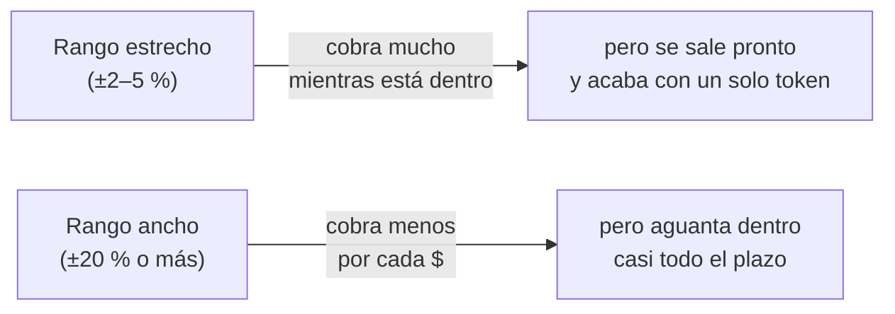
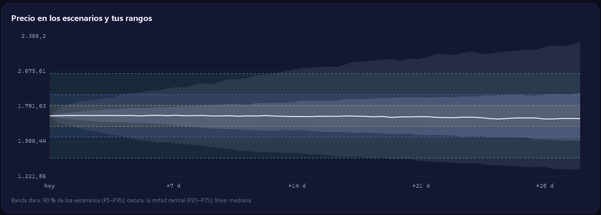
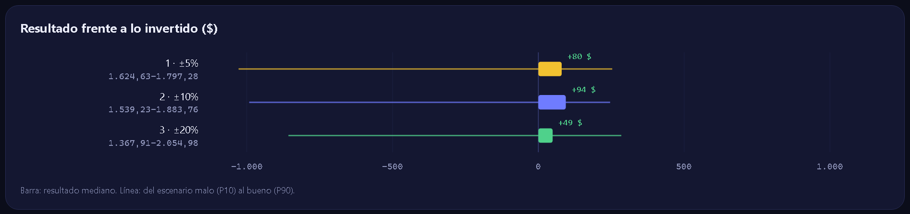
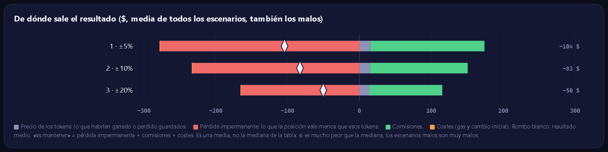
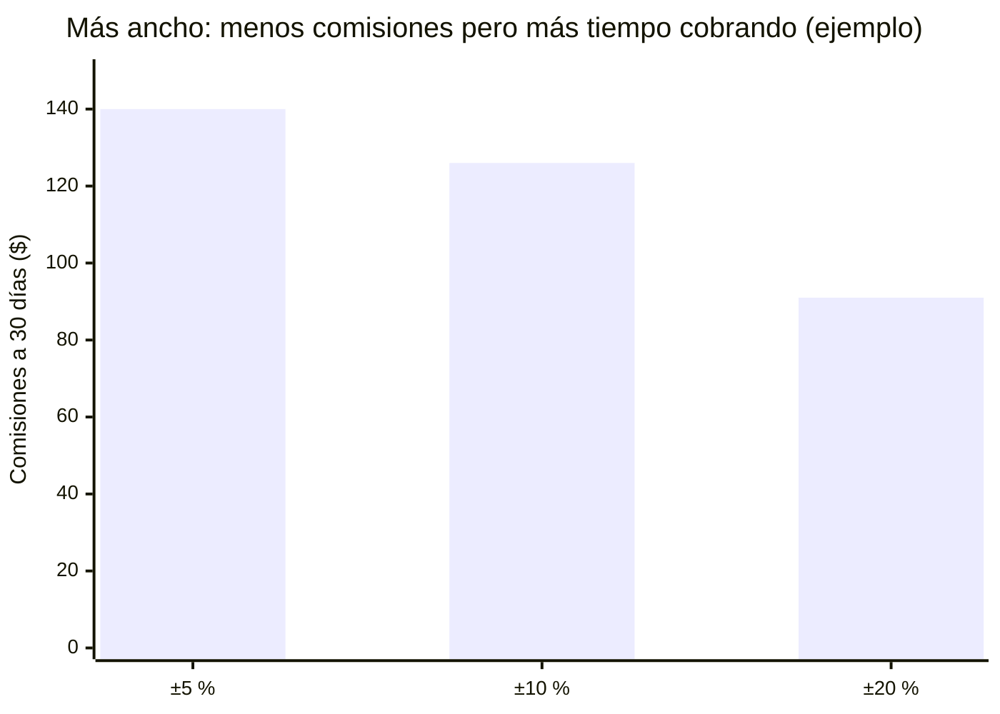
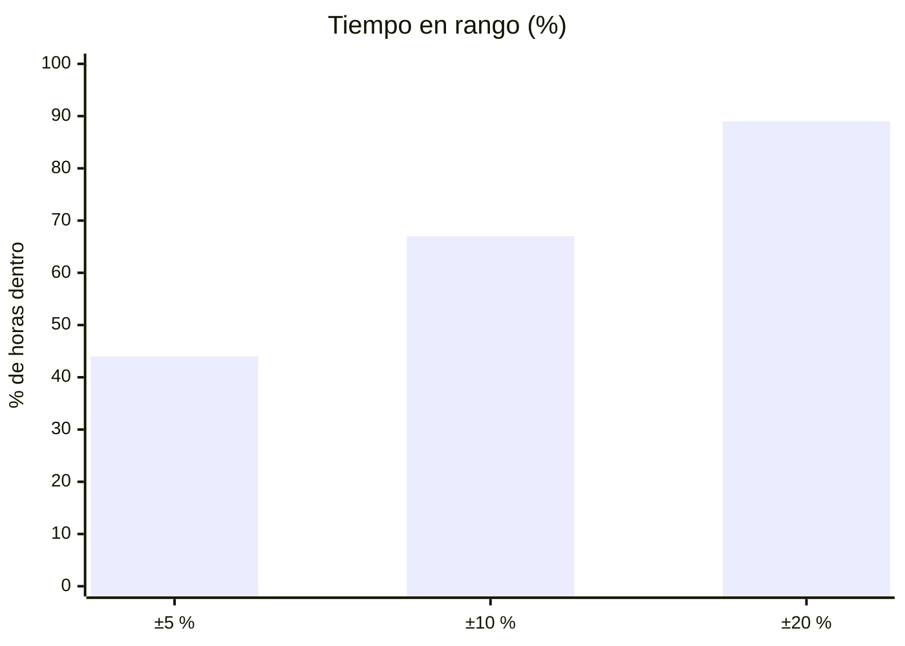
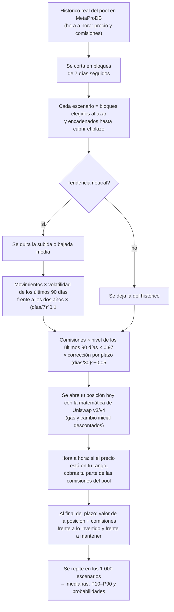
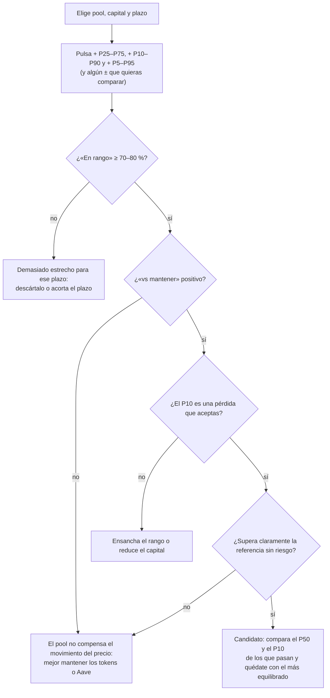
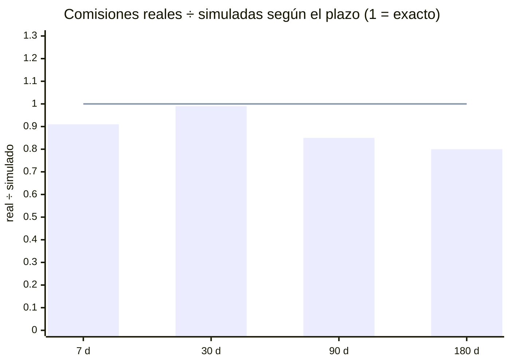

# Guía del Simulador de pools

Manual de uso de la pantalla **Simulador de pools**: qué hace, qué significa cada campo y cada columna, y
cómo leer los resultados para elegir un rango.

> **En una frase:** eliges un pool de MetaProDB, un capital y uno o varios rangos de precio; el simulador
> inventa 1.000 futuros posibles con el comportamiento real de ese pool y te dice qué habría pasado con tu
> posición en cada uno (comisiones, valor final, tiempo en rango, probabilidad de perder).
> Es **análisis de escenarios, no una predicción** ni una recomendación de inversión.

**Índice**

1. [Cómo abrirlo](#1-cómo-abrirlo)
2. [La pantalla de un vistazo](#2-la-pantalla-de-un-vistazo)
   - [2 b. Mis posiciones abiertas (Revert)](#2-b-mis-posiciones-abiertas-revert)
3. [Campos de entrada](#3-campos-de-entrada)
4. [Los rangos](#4-los-rangos)
5. [La línea de datos](#5-la-línea-de-datos)
   - [5 b. En resumen: conclusión y semáforo de fiabilidad](#5-b-en-resumen-conclusión-y-semáforo-de-fiabilidad)
6. [Gráfico 1: precio en los escenarios](#6-gráfico-1-precio-en-los-escenarios-y-tus-rangos)
7. [Gráfico 2: resultado frente a lo invertido](#7-gráfico-2-resultado-frente-a-lo-invertido)
   - [7 b. Gráfico 3: de dónde sale el resultado](#7-b-gráfico-3-de-dónde-sale-el-resultado)
8. [La tabla de detalle, columna a columna](#8-la-tabla-de-detalle-columna-a-columna)
   - [8 b. Buscar el mejor ancho](#8-b-buscar-el-mejor-ancho)
   - [8 c. Comparar con otros pools del mismo par](#8-c-comparar-con-otros-pools-del-mismo-par)
   - [8 d. Recomendación](#8-d-recomendación)
9. [Cómo funciona por dentro](#9-cómo-funciona-por-dentro)
10. [Cómo elegir un rango (receta)](#10-cómo-elegir-un-rango-receta)
11. [Fiabilidad y límites](#11-fiabilidad-y-límites)
12. [Problemas frecuentes](#12-problemas-frecuentes)
13. [Desde la consola](#13-desde-la-consola)

---

## 1. Cómo abrirlo

| Dónde | Cómo |
|---|---|
| En el navegador del PC | **http://localhost:8768** |
| Desde el panel Power4 | https://caiico1.github.io/power4-panel/ → pestaña **Simulador** |

- **Arranca solo** al iniciar sesión en Windows (tarea programada «Simulador web», unos 30 s después de entrar).
- **Solo funciona en el PC** donde corre, porque lee MetaProDB del disco `D:`. En el móvil o en otro
  ordenador la sección del panel sale vacía.
- Si no responde, arráncalo a mano desde la carpeta del proyecto y deja la ventana abierta:

```powershell
cd C:\Users\javie\Proyectos\etapas-weinstein
python -m etapas.simulador_web
```

---

## 2. La pantalla de un vistazo

La pantalla tiene estos bloques, de arriba abajo:

```mermaid
flowchart TB
    A["① Controles<br/>pool, capital, plazo, histórico,<br/>escenarios, tendencia, comisiones"] --> B["② Rangos<br/>uno o varios, cada uno con su color"]
    B --> M["Mis posiciones abiertas (Revert)<br/>(botón Cargar y simular)"]
    M --> R["③ En resumen<br/>conclusión en frases + semáforo de fiabilidad"]
    R --> C["④ Gráfico de precio<br/>abanico de escenarios y tus rangos"]
    C --> D["⑤ Gráfico de resultado<br/>ganancia o pérdida de cada rango"]
    D --> G["⑥ De dónde sale el resultado<br/>precio, pérdida impermanente, comisiones, costes"]
    G --> E["⑦ Tabla de detalle<br/>todas las cifras + referencia sin riesgo"]
    E --> RJ["¿Y si lo reajustas?<br/>dejarlo fijo frente a recentrarlo al salirse"]
    RJ --> ES["¿Y si sale mal?<br/>casos de estrés y dónde deja de cobrar"]
    ES --> CB["Cubrirlo con un préstamo en Aave<br/>sin cubrir, a medias, del todo"]
    CB --> O["⑧ Buscar el mejor ancho<br/>(botón Buscar)"]
    O --> P["⑨ Comparar con otros pools del mismo par<br/>(botón Comparar)"]
    P --> Q["⑩ Recomendación<br/>qué haría, qué no y cómo mejorarlo, en lenguaje llano"]
    Q --> HI["¿Cómo ha acertado con tus simulaciones?<br/>lo que dijo frente a lo que pasó"]
```



Los dos últimos y «Mis posiciones» no se calculan solos: pulsa su botón. Para abrir la página con ellos ya
lanzados: **http://localhost:8768/#posiciones,buscar,comparar** (o solo los que quieras).

Empieza por **③ En resumen**: dice en tres o cuatro frases lo que hay en los gráficos y en la tabla, y
cuánto fiarte.

Cada vez que cambias un campo o un rango, **vuelve a simular solo** (en menos de medio segundo). El
botón **Simular** fuerza una nueva simulación. Mientras calcula, la pantalla se atenúa.

---

## 2 b. Mis posiciones abiertas (Revert)

Pulsa **Cargar y simular**. El simulador:

1. **Lee tus posiciones abiertas de Revert**, solo lectura, con su MCP público. Usa las carteras de tu
   configuración local (`~/.cripto-renta/config.json`, «carteras»), que nunca se suben al repositorio.
2. **Busca su pool en MetaProDB.** Si no está, la fila lo dice.
3. **Simula lo que queda desde hoy** al plazo de arriba, con **su rango exacto** (sus ticks) y **su valor
   real**, sin gas ni cambio inicial, porque ya está abierta.

| Columna | Qué es |
|---|---|
| **Posición** | Número, pool, red, versión y días desde que se abrió. Debajo, la **lectura**: si mantenerla compensa frente a cerrarla. |
| **Valor / pendiente** | Lo que vale hoy según Revert y, debajo, las comisiones pendientes de cobrar. |
| **Rango · hoy** | Su rango en precios y el precio de hoy, en verde si está dentro y en rojo («FUERA») si no. |
| **Fiabilidad** | El semáforo del simulador para ese pool y ese plazo. |
| **Se sale alguna vez** | % de escenarios en que el precio sale del rango en algún momento del plazo. |
| **En rango** | % medio del tiempo dentro, es decir, cobrando. |
| **Acaba ↓ · = · ↑** | Dónde acaba el precio: por debajo, dentro o por encima del rango. |
| **Comisiones** | Lo que cabe esperar cobrar en el plazo (mediana), con su % sobre el valor. |
| **vs cerrar (media / mediana)** | Lo que gana o pierde **mantenerla** frente a **cerrarla hoy y guardar los tokens que tiene ahora**. La media cuenta los escenarios malos con su peso. |
| **Ver en detalle** | Carga ese pool y ese rango arriba, con el P10–P90 al lado para comparar. El capital mínimo de la pantalla es 100 $: las cifras escalan. |

**La lectura** sale de esas cifras:
- «Mantenerla compensa…»: gana a cerrar en la media.
- «Dudosa…»: gana en el caso típico pero pierde en la media (riesgo de que el precio se escape).
- «No compensa…»: pierde en la media y en el caso típico.
- «Fuera de rango: no cobra…»: solo recupera si el precio vuelve a entrar.

**Avisos de vigilancia:** cruza Revert con tu `posiciones.txt`, por número o, si la línea no lo lleva,
por rango de precios. Avisa si una posición abierta no está vigilada por la rutina, o si una vigilada ya no
está abierta.

Desde la consola: `python -m etapas.posiciones_lp --dias 30`.

> El simulador no prepara ni envía ninguna transacción: solo lee y simula. Cerrar, reajustar o abrir es
> cosa tuya, en Revert o en Uniswap.

---

## 3. Campos de entrada


| Campo | Valor por defecto | Qué es | Cuándo cambiarlo |
|---|---|---|---|
| **Pool** | WETH/USDC 0,05 % de Base | El pool donde abrirías la posición. La lista trae los pools de MetaProDB con datos de los últimos 3 días, agrupados por red y ordenados por TVL. Cada opción muestra par, comisión, versión (v3/v4) y TVL. | Siempre que quieras mirar otro pool. Solo están los de MetaProDB. |
| **Capital ($)** | 5.000 | Dinero que metes, en dólares (mínimo 100). El simulador reparte ese capital entre los dos tokens en la proporción que exige el rango. | Para ver tu caso real. Las cifras escalan casi en proporción; solo el gas pesa más con capitales pequeños. |
| **Plazo (días)** | 30 | Cuánto tiempo mantienes la posición **abierta sin tocarla**. Opciones: 7, 14, 30, 60, 90, 180. | Ajusta a tu marco: 7 semanal, 30 mensual, 90 trimestral. Ver [sección 10](#10-cómo-elegir-un-rango-receta). |
| **Histórico (días)** | 730 | Cuántos días del pasado del pool se usan como «material» para construir los escenarios. Opciones: 90, 180, 365, 730, 1.095. | Déjalo en 730 **para cualquier plazo**. Se comparó con 365 y 1.095 a 7, 60, 90 y 180 días (17–20 pools): 730 acertó igual o mejor en todos. Más histórico no ayuda: mete épocas que ya no se parecen al pool de hoy. |
| **Escenarios** | 1.000 | Cuántos futuros posibles se simulan. | 300 para probar rápido; 3.000 para una decisión final (afina los extremos, tarda ~3 veces más). No hace la simulación más «acertada», solo menos ruidosa. |
| **Tendencia** | Neutral | **Neutral:** quita la subida o bajada media del histórico; el simulador no apuesta por la dirección del precio, solo por cuánto se mueve. **La del histórico:** mantiene la tendencia que tuvo el pasado. | Déjalo en Neutral. «La del histórico» solo para ver qué pasaría si se repitiera la tendencia de los últimos años. |
| **Nivel comisiones** | Últimos 90 días | Reescala las comisiones de los escenarios al nivel reciente del pool. Si en los últimos 90 días el pool ha cobrado la mitad que su media, los escenarios cobran la mitad. Opciones: todo el histórico, 30 días, 90 días. | Déjalo en 90 días (es lo validado). 30 días reacciona más rápido pero es más ruidoso. «Todo el histórico» ignora si el pool se ha enfriado. |
| **Ajuste comisiones** | 0,97 | Factor común que multiplica todas las comisiones. Corrige que el reparto por horas tiende a sobrestimar algo lo cobrado. Sale de la validación con datos reales. | No lo toques salvo que el aviso mensual proponga otro valor; aquí puedes probarlo antes de cambiarlo en el código. |

Además, el simulador aplica solo dos correcciones que no se eligen en pantalla (ver
[sección 11](#11-fiabilidad-y-límites)):

- **Comisiones por plazo:** ×1,08 a 7 días, ×1 a 30, ×0,95 a 90 y ×0,91 a 180.
- **Volatilidad:** los movimientos del precio se escalan a la volatilidad de los **últimos 90 días** del
  pool frente a sus dos años, y se ensanchan con el plazo: ×1 a 7 días, ×1,16 a 30 y ×1,29 a partir de 90.

> **El efecto conjunto** aparece en la línea de datos: por ejemplo «comisiones ×0,54 (nivel 90 d ×0,55,
> ajuste 0,97, plazo ×1)» significa que los escenarios cobran el 54 % de la media histórica:
> 0,55 por el nivel reciente × 0,97 por el ajuste × 1 por el plazo de 30 días.

---

## 4. Los rangos

Puedes comparar **varios rangos del mismo pool a la vez**. Cada uno tiene un color que se repite en los
gráficos y en la tabla.

**Cómo se escriben:**

| Formato | Ejemplo | Significa |
|---|---|---|
| Porcentaje simétrico | `±10%` | De un 10 % por debajo a un 10 % por encima del precio de hoy |
| Porcentaje asimétrico | `-5/+15` | De un 5 % por debajo a un 15 % por encima |
| Precios | `1500-1900` | Entre esos dos precios exactos (decimales con punto: `1539.5-1883`) |
| Percentiles | `P10-P90` | Entre los precios en los que acaba el 10 % y el 90 % de los escenarios al final del plazo: el precio acaba dentro en 8 de cada 10. Se recalcula solo al cambiar el pool, el plazo o el histórico. |

- **Botones rápidos:** `+ ±2 %`, `+ ±5 %`, `+ ±10 %`, `+ ±20 %`, `+ −5/+15 %` añaden ese rango.
  **`+ rango en precio`** añade uno de ±10 % escrito en precios, para que lo edites.
- **Botones por percentil:** `+ P25–P75` (estrecho: cobra más y se sale más), **`+ P10–P90`** (el punto
  de partida más equilibrado) y `+ P5–P95` (ancho y prudente). Salen asimétricos (por ejemplo −24/+27 %),
  porque en porcentaje el precio puede subir más de lo que puede bajar.

> **Por qué P10–P90 como punto de partida.** Simulado en ETH y BTC a 7, 30 y 180 días (22-nov-2026):
> el precio está dentro ~90 % del tiempo, su «vs mantener» mediano está entre los mejores y su caso malo
> (P10) es bastante menos malo que el del P25–P75, que cobra un 30–40 % más de comisiones pero pierde
> más cuando el precio se escapa. No arregla un pool que cobra poco: ahí ningún ancho supera a mantener.
- **Editar:** haz clic en el texto del rango, cámbialo y pulsa Intro o sal del campo.
- **Quitar:** la ✕ de cada rango.
- **Ajuste a ticks:** Uniswap solo admite ciertos precios (los *ticks* del pool). El simulador mueve cada
  límite **hacia fuera** al tick válido más cercano, así que el rango real puede ser un poco más ancho que el
  escrito. La tabla muestra siempre los precios reales.
- Los precios se muestran como el par «natural» (ETH en USDC, BTC en USDC…), aunque el pool guarde los tokens
  al revés.



---

## 5. La línea de datos

Debajo de los rangos aparece una línea con el contexto de la simulación:

| Dato | Ejemplo | Significa |
|---|---|---|
| Precio de hoy | ETH/USDC hoy **1.711,05** | Último precio del pool en MetaProDB. Es el punto de partida de todos los escenarios. |
| Datos hasta | **2026-11-22 15:00** | Última hora registrada (UTC). Si es de hace más de un día, MetaProDB no se está actualizando. |
| Histórico desde | **2024-11-22** | Primer día usado para construir escenarios (según el campo Histórico). |
| Escenarios y plazo | **1000** escenarios a **30** días | Lo elegido arriba. |
| Comisiones | ×**0,54** (nivel 90 d ×0,55, ajuste 0,97, plazo ×1) | Cuánto cobran los escenarios frente a la media histórica del pool: nivel reciente × ajuste × corrección por plazo. Por debajo de 1: el pool cobra ahora menos que de media. |
| Volatilidad | ×**0,89** (últimos 90 d ×0,77, plazo ×1,16) | Cuánto se amplían los movimientos del precio de los escenarios frente al histórico: volatilidad de los últimos 90 días frente a la de los dos años × ensanche por plazo. Por encima de 1: escenarios más movidos. |
| Etapa | etapa **1** (Inicio (base)) de ETH/USDC en mensual · **apta** | La etapa de Weinstein del par, la misma lectura que usan `/pool`, el cribado y la rutina, en el marco que corresponde al plazo: **semanal** hasta 14 días y **mensual** desde 30. «Apta» o **«precaución»**: la etapa 2 (alcista), o la transición hacia ella, pide precaución en semanal y mensual. Pasa el ratón por encima para ver el motivo. |
| Gas | **0.05 $** | Coste de abrir la posición: 5 $ en Ethereum y 0,05 $ en Base y Arbitrum. Se resta al abrir. |
| Cambio inicial | **0,05 %** | Comisión del intercambio para repartir el capital entre los dos tokens (la del propio pool, aplicada a la parte que hay que cambiar). |
| Aviso (en rojo) | «hay huecos en el histórico…» | Solo si el pool tiene horas sin datos: se usa el tramo continuo más reciente. |

---

## 5 b. En resumen: conclusión y semáforo de fiabilidad


**La conclusión** son tres o cuatro frases calculadas a partir de la tabla:

| Frase | Cuándo sale | Qué responde |
|---|---|---|
| «El mejor frente a mantener es…» o «Ningún rango supera a mantener…» | Siempre | ¿Compensa el pool frente a guardar los tokens? Usa la mediana de «vs mantener». |
| «USDC en Aave da… más que cualquier rango» o «… supera a USDC en Aave, pero en el escenario malo…» | Si hay referencia sin riesgo | ¿Compensa el riesgo frente a no arriesgar? |
| «Ojo con ±5 %: la mediana gana…, pero la media pierde…» | Si la mediana gana y la media pierde | Riesgo de cola (ver [7 b](#7-b-gráfico-3-de-dónde-sale-el-resultado)). |
| «±5 %: dentro menos del 60 % del tiempo…» | Si algún rango se sale mucho | Rango demasiado estrecho para el plazo. |
| «Fiabilidad media: …» | Si la fiabilidad no es alta | Por qué fiarse menos. |

**El semáforo de fiabilidad** (junto al título) dice cuánto fiarte de las cifras **de este pool a este
plazo**. Debajo, en gris, aparecen los motivos (⚠ en contra, ✓ a favor):

| Nivel | Cuándo |
|---|---|
| 🟢 **Alta** | Pool como los validados (≥ 1 año de histórico y TVL > 2 M$), plazo de hasta 90 días y, si el pool está en la calibración mensual, con un resultado razonable (comisiones reales entre ×0,75 y ×1,33 de las simuladas y al menos el 60 % de los casos reales dentro del P10–P90). |
| 🟡 **Media** | Algo se sale de lo validado: entre 180 días y 1 año de histórico, TVL de 0,5 a 2 M$, plazo de 180 días, o su calibración algo desviada. |
| 🔴 **Baja** | Menos de 180 días de histórico, TVL < 0,5 M$, comisiones anómalas en MetaProDB, o su calibración muy desviada (comisiones fuera de ×0,5–×2 o menos del 40 % dentro del P10–P90). |

**¿Y los pools con poco histórico? (probado, nov-2026).** Se probó completar el histórico de un pool joven
con los días que le faltan de otro pool del mismo par: los movimientos del precio en dólares y el ritmo de
comisiones, reescalado al nivel del pool joven. Para medirlo se recortaron 13 pools veteranos a 180 y a 365
días y se compararon con su histórico completo de 730 días, en 901 aperturas reales del último año, a 7 y a
30 días. **Completar no mejoró nada, y recortar tampoco empeoró:** a 30 días, lo real cayó dentro del
P10–P90 el 67–69 % de las veces en todas las variantes, con el mismo error medio (242–246 $ por 5.000 $).
Por eso no se completa nada, y el semáforo ya no baja a «media» con un año o más de histórico. Entre 180 y
365 días baja a «media», porque cubre menos rachas distintas del mercado, y por debajo de 180, a «baja».

La calibración de cada pool la deja la tarea mensual en un archivo local
(`out/simulador_calibracion.jsonl`, no se sube a GitHub). Solo los ~21 pools de referencia la tienen;
los demás se juzgan por su histórico, su TVL y el plazo.

---

## 6. Gráfico 1: precio en los escenarios y tus rangos



Muestra **por dónde puede ir el precio** durante el plazo y **dónde quedan tus rangos**.

| Elemento | Qué es |
|---|---|
| **Línea blanca** | Precio mediano: la mitad de los escenarios va por encima y la otra mitad por debajo. Con tendencia neutral, es casi plana. |
| **Banda oscura** | La mitad central de los escenarios (del P25 al P75). |
| **Banda clara** | El 90 % de los escenarios (del P5 al P95). Solo 1 de cada 20 acaba por encima y 1 de cada 20 por debajo. |
| **Franjas de color con líneas discontinuas** | Tus rangos, cada uno con su color. |
| **Eje horizontal** | Días desde hoy. |

**Cómo leerlo:** si el abanico se sale de la franja de un rango pronto, ese rango pasará mucho tiempo fuera.
En el ejemplo, el abanico supera el ±5 % (amarillo) en pocos días, mientras que el ±20 % (verde) contiene casi
toda la banda oscura hasta el final.

---

## 7. Gráfico 2: resultado frente a lo invertido



Una fila por rango. Todo en dólares **respecto a lo invertido** (el 0 es «acabo con lo mismo que metí»).

| Elemento | Qué es |
|---|---|
| **Barra** | Resultado mediano (P50): lo que ganas o pierdes en el escenario de en medio. La cifra encima es ese valor. |
| **Línea fina** | Del escenario malo (P10, a la izquierda) al bueno (P90, a la derecha). |
| **Texto a la izquierda** | Número de rango, cómo lo escribiste y sus precios reales. |

**Cómo leerlo:** la barra dice lo típico, la línea dice el riesgo. Una línea muy larga hacia la izquierda
avisa de que en un mal escenario puedes perder bastante, aunque el mediano sea positivo.

> Ojo: el resultado incluye **lo que cambia el precio de los tokens**. Si ETH cae, pierdes aunque cobres
> comisiones. Para separar el efecto del pool del efecto del precio, mira la columna «vs mantener» o el
> gráfico siguiente.

---

## 7 b. Gráfico 3: de dónde sale el resultado



Descompone el resultado de cada rango en sus cuatro piezas. Las piezas suman exactamente el resultado:

| Pieza | Color | Qué es |
|---|---|---|
| **Precio de los tokens** | gris | Lo que habrían ganado o perdido los tokens que depositas si los hubieras guardado sin abrir posición. Con tendencia neutral, ronda el 0. |
| **Pérdida impermanente** | rojo | Lo que la posición vale **menos** que esos mismos tokens guardados. Siempre es ≤ 0: cuando el precio se mueve, el pool te deja con más del token que baja y menos del que sube. Cuanto más estrecho el rango y más se mueve el precio, mayor. |
| **Comisiones** | verde | Lo que cobras. |
| **Costes** | naranja | Gas y comisión del cambio inicial (casi invisible en Base y Arbitrum). |
| **Rombo blanco** | — | El resultado: la suma de las cuatro piezas. |

**«vs mantener» = pérdida impermanente + comisiones + costes.** Si la barra verde no llega a tapar la
roja, el pool no compensa frente a guardar los tokens.

> **Es una media, no la mediana de la tabla.** La media cuenta con su peso los escenarios malos, y en un
> pool los malos son muy malos: si el precio se escapa mucho, la pérdida impermanente crece sin límite
> mientras las comisiones se paran. En el ejemplo, el ±5 % gana 98 $ en la mediana, pero **pierde 123 $
> de media**. Cuando el rombo sale mucho peor que la mediana de la tabla, el rango tiene riesgo de cola:
> el resumen lo avisa con un «Ojo con…».

---

## 8. La tabla de detalle, columna a columna


Todas las cifras se calculan **en cada escenario** y luego se resumen. «Mediana» o «P50» es el valor del
escenario de en medio.

| Columna | Qué mide | Cómo se calcula | Cómo leerla |
|---|---|---|---|
| **Estrategia** | El rango | «Fijo» + precios reales tras ajustar a ticks + lo que escribiste. Si aparece **«· fuera de rango hoy»** en rojo, el precio actual no está dentro: abrirías con un solo token y no cobrarías nada hasta que el precio entre. | Comprueba que los precios son los que querías. |
| **Invertido** | Tu capital | El campo Capital. | — |
| **Valor final (mediana)** | Cuánto tienes al final del plazo en el escenario de en medio | Mediana de (valor de la posición + comisiones cobradas), con los precios del último día del escenario. Verde si supera lo invertido, rojo si no. | Lo «típico» que te quedaría. Puede salir verde aunque pierdas de media: las ganancias son pequeñas y frecuentes; las pérdidas, grandes y menos frecuentes. |
| **Valor final (media)** | Lo mismo, en la media de todos los escenarios | Media de los 1.000 valores finales: cuenta los escenarios malos con su peso. Es lo invertido + el «resultado» del gráfico «De dónde sale el resultado». | Lo que te quedaría «a la larga», si abrieras esta posición muchas veces. **Si está en rojo, la posición pierde dinero de media**, aunque la mediana salga verde. |
| **P10 – P90** | La horquilla de resultados | Valor final en el escenario malo (solo 1 de cada 10 sale peor) y en el bueno (solo 1 de cada 10 sale mejor). | Cuanto más ancha, más incertidumbre. Mira sobre todo el P10: ¿podrías asumir esa pérdida? |
| **vs mantener** | Si el pool compensa frente a no hacer nada | Mediana de (valor final − valor de **los mismos tokens que depositas**, guardados en la cartera sin abrir posición). Incluye el gas y el cambio inicial como coste. | **Es la columna clave.** Positivo: el pool te deja mejor que tener los tokens quietos. Negativo: las comisiones no compensan la pérdida por el movimiento del precio (la llamada pérdida impermanente). |
| **Comisiones** | Lo que cobras | Mediana de las comisiones cobradas en el plazo, en dólares, ya con nivel reciente, ajuste y la dilución por tu propia liquidez. | Lo que gana el pool en sí. Los rangos estrechos cobran más mientras están dentro. |
| **APR** | Comisiones anualizadas | Comisiones medianas ÷ capital × (365 ÷ días). Interés simple. | Comparable con el APR que muestran Uniswap, Revert o DefiLlama, pero **realista**: ya cuenta el tiempo fuera de rango. |
| **Rent** | Rentabilidad total del plazo | Mediana de (valor final ÷ capital − 1). Entre paréntesis, anualizada: × (365 ÷ días). | Incluye comisiones **y** el cambio de precio de los tokens. La anualización de plazos cortos exagera; úsala solo para comparar rangos entre sí. |
| **En rango** | Tiempo cobrando | Media, en todos los escenarios, de la fracción de horas con el precio dentro del rango. | Por debajo de 70–80 % el rango es estrecho para ese plazo. |
| **P(pérdida)** | Probabilidad de perder dinero | % de escenarios en los que el valor final es menor que lo invertido. En rojo si pasa del 50 %. | Con tendencia neutral, en pares volátiles suele rondar el 40–50 %: el precio puede caer, y eso pesa más que las comisiones. |
| **Acaba ↓ · = · ↑** | Dónde acaba el precio | % de escenarios que terminan **por debajo** del rango · **dentro** · **por encima**. | Por debajo: acabas con todo en el token volátil (p. ej. todo ETH). Por encima: todo en el estable (vendiste ETH por el camino). |

**Debajo de la tabla:**

- **Referencia en dólares:** lo que darían los mismos dólares en **USDC en Aave** de la misma red, con el
  interés de hoy y sin riesgo de precio (ejemplo: 5,21 % → 5.021 $ en 30 días, +21 $). Si el pool no supera
  claramente esta cifra en el escenario típico, no compensa el riesgo.
- **«Cómo se calcula y sus límites»:** resumen técnico desplegable.

### Ejemplo leído (WETH/USDC 0,05 % de Base, 5.000 $, 30 días)

| | ±5 % | ±10 % | ±20 % |
|---|---|---|---|
| Valor final (mediana) | 5.098 $ | 5.127 $ | 5.070 $ |
| Malo (P10) | 4.110 $ | 4.161 $ | 4.301 $ |
| vs mantener | −84 $ | −29 $ | +16 $ |
| Comisiones | 140 $ | 126 $ | 91 $ |
| En rango | 44 % | 67 % | 89 % |





**Lectura:** el ±5 % cobra más comisiones, pero solo está dentro el 44 % del tiempo y pierde 84 $ frente a
mantener los tokens. El ±20 % cobra menos, pero está dentro el 89 % del tiempo y gana algo a mantener
(+16 $). Con las comisiones actuales de este pool (×0,54 de su media) y unos últimos 90 días tranquilos
(volatilidad ×0,77), solo el rango ancho compensa el movimiento del precio a 30 días, y por poco. Si buscas solo renta en dólares, la
referencia de Aave (+21 $ sin riesgo) es competitiva.

---

## 8 a. ¿Y si lo reajustas cuando se sale?

Debajo de la tabla, cada rango aparece cuatro veces: **dejarlo fijo** (lo de la tabla) y **reajustarlo**
con tres reglas. Reajustar es recentrar el rango en el precio del momento, con el mismo ancho (y la misma
asimetría), cuando el precio lleva fuera:

| Regla | Cuándo recentra |
|---|---|
| **al salirse** | En cuanto pasa una hora fuera. |
| **fuera 24 h** | Si sigue fuera un día entero (no persigue los picos). |
| **fuera 72 h** | Si sigue fuera tres días. |

En cada reajuste se retira todo (posición y comisiones cobradas), se cambia lo necesario pagando la
comisión del pool y se vuelve a abrir, con un gas por reajuste. Es la misma mecánica que
`python -m etapas.backtest … --reajuste fuera`, y sobre el histórico real da lo mismo que el backtest (1–2 %).

| Columna | Qué es |
|---|---|
| **Frente a fijo (media)** | Lo que gana (+) o pierde (−) de media esa regla frente a no tocar el rango, en los mismos escenarios. Es la cifra que decide. |
| **Mejor que fijo** | En qué parte de los escenarios acaba mejor que fijo. Suele estar por debajo del 50 %: reajustar gana poco muchas veces y pierde mucho alguna. |
| **Reajustes (media)** | Cuántas veces recentra de media en el plazo. |
| **Gas y cambios** | Lo que cuestan esos reajustes en total. |
| **Comisiones, En rango** | Reajustar pasa más tiempo en rango y cobra más comisiones… |
| **Valor final (media)** | …pero cada reajuste **fija la pérdida impermanente**: vendes lo que ha subido o compras lo que ha bajado justo después del movimiento. Por eso, aunque cobre más, suele acabar valiendo menos. |

La regla con **«· mejor»** es la que más gana frente a fijo, solo si gana más del 0,5 % del capital. Si
ninguna llega, sale «Dejarlo fijo · mejor» y la Recomendación dice **«No persigas el precio»**.

**Por qué usa sus propios escenarios.** Los de la tabla principal ensanchan la volatilidad con el plazo
(×1,16 a 30 días) para acertar en el valor final. Eso hace los caminos más «rugosos», y el precio sale del
rango más veces de lo real. Se validó (24-nov-2026) con 16 pools de referencia, 1.113 aperturas reales del
último año, a ±5 % y ±10 %, comparando con lo que habría pasado de verdad con cada regla:

| 30 días, por 5.000 $ | Reajustes simulados / reales (±5 %) | Reajustar al salirse frente a fijo: simulado / real (±10 %) |
|---|---:|---:|
| Escenarios de la tabla | 8,4 / 6,0 | −79 $ / +20 $ |
| **Bloques de 14 días, sin ensanche (los que usa)** | **6,5 / 6,0** | **−14 $ / +20 $** |

A 7 días los dos coinciden: 1,4 reajustes simulados frente a 1,3 reales, a ±5 %. Aun así, la comparación
sale **algo prudente con el reajuste** (unos 20–35 $ por 5.000 $ peor que lo real a 30 días). Y a más de
30 días no está validada: la pantalla lo avisa.

**Qué dijo la historia del último año:** a 7 días, reajustar siempre fue peor que dejarlo fijo. A 30 días,
las diferencias fueron pequeñas: entre −23 $ y +28 $ por 5.000 $, según el ancho y la regla. Reajustar
no convierte en ganador un rango que pierde frente a mantener.

---

## 8 a b. ¿Y si sale mal? (casos de estrés)

Los escenarios no apuestan por una dirección y salen al azar de dos años de histórico. Por eso una caída
fuerte y sostenida aparece poco y repartida entre muchos escenarios normales. Esta sección la pone con
nombre y cifra. **No son previsiones**: son caminos fijos para ver la cola.

**Primero, dónde deja de cobrar cada rango.** Una línea por rango con el precio del borde de abajo y el de
arriba, y cuánto valdría la posición justo ahí: resultado y diferencia frente a guardar los tokens, sin
contar comisiones. **El precio de abajo es un buen sitio para el stop**: ahí la posición ya es todo
activo y deja de cobrar.

**Después, cuatro casos para cada rango:**

| Caso | Qué pasa |
|---|---|
| **Cae 30 %** | El precio del activo baja un 30 % de forma continua hasta el final del plazo. |
| **Sube 30 %** | Sube un 30 % de forma continua. Ganas, pero menos que guardando los tokens: la posición se queda en dólares al salir por arriba. |
| **Latigazo −20 %** | Cae un 20 % hasta la mitad del plazo y vuelve al precio de hoy. La pérdida impermanente se deshace; cuenta lo que dejó de cobrar mientras estaba fuera. |
| **Peor tramo real** | El peor tramo de ese plazo del **histórico del propio pool**, con sus movimientos y sus comisiones de verdad. Entre paréntesis, la fecha en que empezó. |

En los tres primeros cobra las comisiones medias del pool, con el mismo ajuste que la tabla. En pares de
dos activos volátiles (ETH/BTC…), el movimiento es en la moneda de cotización.

| Columna | Qué es |
|---|---|
| **Precio al final** | Donde acaba el precio en ese caso. |
| **Resultado** | Ganancia o pérdida frente a lo invertido (entre paréntesis, el valor final). |
| **vs mantener** | Frente a guardar los mismos tokens. |
| **Comisiones, En rango** | Lo que cobra y el tiempo que pasa dentro. |
| **Se sale** | El día y el precio en que sale del rango por primera vez (o «no se sale»). |

**Ejemplo (WETH/USDC de Base, 5.000 $, 30 días, nov-2026):** con ±20 %, deja de cobrar si ETH baja a
1.353 $, y la posición valdría 4.256 $ (−744 $). Si ETH cae un 30 %, el resultado es −1.213 $. En el peor
tramo real del pool (ETH −45 % desde el 7-ene-2026) sería −2.007 $.

La Recomendación lo resume en **«Ten clara tu salida»**: el precio del stop y lo que perderías en la caída
del 30 % y en el peor tramo real.

---

## 8 a c. Cubrirlo con un préstamo en Aave

Solo para pares de un activo con una estable (ETH/USDC, BTC/USDC…). La idea: no comprar el ETH que
pide el rango, sino **pedirlo prestado en Aave**. Si ETH cae, la deuda vale menos y compensa lo que pierde
la posición.

> **Hoy no se puede abrir.** Desde el 29-oct-2026, USDC y USDT tienen **LTV 0** en Aave (Ethereum, Base
> y Arbitrum): siguen contando para no ser liquidado, pero no dejan pedir prestado con ellas. Comprobado en
> la blockchain y en MetaProDB. La sección lo avisa en rojo y sus cifras dicen **si compensaría si Aave lo
> vuelve a permitir**.

**Cómo se monta.** Con el capital en la estable, una parte se deposita en Aave como garantía, se pide
prestado el activo que pide el rango y va al pool con el resto de la estable. Tres opciones:

| Opción | Qué es |
|---|---|
| **Sin cubrir** | El pool de la tabla, tal cual. |
| **Cubierto a medias** | Se pide prestada la mitad del activo; la otra mitad se compra. |
| **Cubierto del todo** | Se pide prestado todo el activo que pide el rango. |

Al cubrir, una parte del capital queda de garantía, así que la posición en el pool es más pequeña (con
5.000 $ y ±10 %: unos 2.870 $ en el pool, 3.550 $ de garantía y 1.385 $ de deuda).

**Factor de salud al abrir:** el de tu perfil para liquidez cubierta (≥ 2), o el que habría aguantado la
mayor subida del activo en ese plazo de todo el histórico del pool, más 0,1, el mayor de los dos. Tipos de
Aave: los de hoy (MetaProDB), fijos todo el plazo. Liquidación como en Aave V3.

| Columna | Qué es |
|---|---|
| **Valor final (media), P10–P90** | Como en la tabla. Al cubrir, la horquilla se estrecha mucho: menos riesgo de precio. |
| **vs sin cubrir** | Lo que gana o pierde de media frente a no cubrirlo. |
| **vs USDC en Aave** | Frente a dejar todo el capital depositado, sin riesgo de precio. Es la vara que decide. |
| **Cae 30 % / Sube 30 %** | Los casos de estrés de la sección anterior, ahora con la cobertura. Al subir, la deuda crece: cubierto, se gana menos o se pierde. |
| **HF mínimo (5 % peor)** | El factor de salud más bajo que se alcanza en el 5 % de escenarios peores. |
| **Liquidación** | En qué parte de los escenarios te liquidarían. |
| **Pool · garantía · deuda** | Cómo se reparte el capital al abrir. |

**Comprobado:**
- **Misma mecánica que el backtest de liquidez cubierta** (`aave_backtest cubierta`): sobre el histórico
  real coinciden a pocos dólares, también con liquidación.
- **Validado con 10 pools activo/estable y unas 680 aperturas reales** del último año a 7 y 30 días (con los
  tipos de Aave de la semana anterior). Cubierto del todo, el valor medio simulado quedó a ±4 $ del real y
  lo real cayó dentro del P10–P90 el 78–84 % de las veces. Con HF 2 no hubo ninguna liquidación real (el
  simulador daba un 0,2 %).
- **Lo que hace la cobertura de verdad:** a 30 días y ±10 %, la dispersión real del resultado bajó de
  712 $ a 239 $ por 5.000 $. En el último año, que fue bajista para ETH, cubrirse ganó de media unos
  110 $ en el primer semestre y entre 7 y 24 $ en el segundo. El simulador, que no apuesta por la dirección,
  esperaba entre −40 $ y 0 $.

**Ejemplo (WETH/USDC de Base, 5.000 $, 30 días, ±20 %, nov-2026):** cubierto del todo, de media +26 $ frente
a no cubrirlo. El escenario malo (P10) pasa de −682 $ a −247 $, y si ETH cae un 30 %, de −1.213 $ a −302 $.
Aun así, queda 60 $ por debajo de dejar el dinero en USDC en Aave.

---

## 8 b. Buscar el mejor ancho


Pulsa **Buscar**. Prueba rangos simétricos (±% del precio de hoy) con los mismos escenarios y dibuja
cuánto gana o pierde cada uno **frente a mantener los tokens**:

| Elemento | Qué es |
|---|---|
| **Línea verde** | «vs mantener» en la **media** de los escenarios: cuenta los malos con su peso. Es el criterio recomendado. |
| **Línea azul discontinua** | «vs mantener» en la **mediana**: el caso típico. Suele preferir rangos más estrechos, que en la media salen peor. |
| **Punto amarillo** | El mejor ancho según el criterio elegido. El botón **«+ añadir ±X % a mis rangos»** lo añade arriba para verlo en detalle. |
| **Eje horizontal** | Ancho del rango, de un **mínimo fiable** a ±70 %. |

**El ancho mínimo** es 3 × la volatilidad diaria del pool (unos ±10 % en ETH/USDC y ±0,1 % en un par de
estables). Con datos hora a hora el simulador sobrestima los rangos más estrechos. Sin ese mínimo, el
buscador elegía ±0,1 %, y en la realidad esos rangos perdían más que ninguno.

**Mensajes que puede dar:**
- «Ningún ancho gana a mantener en la media»: el pool no compensa ahora a ese plazo; mejor guardar los
  tokens o la referencia sin riesgo.
- «El mejor es el más ancho probado»: cuanto más ancho, mejor, es decir, cuanto más se parece a no estar
  en el pool. Es otra forma de decir que no compensa.

> **Qué dice la validación** (23-nov-2026; 15 pools, 3.587 aperturas de los dos últimos años, eligiendo el
> ancho con los datos de antes de cada fecha y midiendo lo que pasó después): en ese periodo **ninguna
> posición ganó de media a mantener los tokens**, y cuanto más ancha, menos perdió (a 30 días, −104 $ con
> ±5 % frente a −29 $ con ±70 %, por cada 5.000 $). El buscador acierta esa dirección. Úsalo para saber si
> un pool compensa y cuánto ancho necesita, no para exprimir un rango estrecho.

---

## 8 c. Comparar con otros pools del mismo par


Elige un rango (por defecto `P10-P90` o cualquiera de los tuyos) y pulsa **Comparar**. Simula **la misma
estrategia y el mismo plazo** en todos los pools del mismo par con TVL ≥ 0,1 M$:

- **Mismo par:** ETH = WETH, BTC = WBTC = cbBTC, y cualquier estable cuenta como USD. Así, WETH/USDC,
  WETH/USDT y DAI/WETH de Ethereum, Base y Arbitrum salen juntos.
- **Orden:** de más a menos «vs mantener» en la media. La fila de tu pool aparece marcada como «este».
- **Columnas:** TVL, semáforo de fiabilidad, comisiones, APR, «vs mantener» (media y mediana), valor final
  (P50 y P10), tiempo en rango y **su mejor ancho** según el buscador.
- **Haz clic en una fila** para abrir ese pool arriba.

Tarda unos 2 segundos por pool (unos 25 segundos para ETH/USD, con 14 pools).

**Cómo leerla:** con el mismo precio, lo que cambia entre pools son las comisiones por unidad de
liquidez, que dependen de su volumen, su comisión y cuánta liquidez compite. El pool más grande no
siempre es el mejor. En el ejemplo, con P10–P90 a 30 días, WETH/USDT 0,05 % de Ethereum queda primero
(140 $ de comisiones, −21 $ frente a mantener en la media) y WETH/USDC 0,05 % de Ethereum, con 70 M$ de
TVL, cobra 97 $ (−68 $).

---

## 8 d. Recomendación


Es la última sección de la pantalla y está escrita **para quien no quiere interpretar la tabla**. Traduce las
cifras a una decisión, con un sello: **compensa** (verde) o **no compensa** (rojo).

**Cómo decide:** mira la **media** de los escenarios, no la mediana, porque la media cuenta los escenarios
malos con su peso. Un rango «compensa» solo si cumple las dos cosas a la vez:

1. de media gana a **guardar los tokens** (no estar en el pool);
2. de media gana más que la **referencia sin riesgo** (USDC en Aave en la misma red).

| Bloque | Qué dice |
|---|---|
| **Frase principal** | El veredicto con sus números. Si compensa: qué rango abrir y cuánto ganaría de media. Si no: lo que pasa en el caso típico, lo que se pierde en un escenario malo y lo que se pierde de media. |
| **✅ Qué haría** | Si compensa: abrir ese rango con dinero que puedas ver caer (dice cuánto se pierde en un escenario malo) y vigilarlo con `posiciones.txt` y «Mis posiciones». Si no compensa: las alternativas, que son guardar el token si lo que quieres es tenerlo, la renta sin riesgo en dólares si lo que buscas es renta, y, si aun así quieres probar, el rango menos malo con poco dinero. |
| **⛔ Qué no recomiendo** | Los rangos que pasan mucho tiempo fuera, elegir por el APR más alto, fiarse solo del «Valor final (mediana)», abrir un rango que ya está fuera de rango hoy, y tomar las cifras al pie de la letra si la fiabilidad no es alta. |
| **🔧 Para intentar mejorarlo** | Probar el ancho que propone el buscador (o avisar de que ni el más ancho compensa), comparar el mismo par en otros pools, esperar a que suban las comisiones si están por debajo de su media, acortar el plazo si es largo, y volver a simular antes de abrir si los últimos meses han sido tranquilos. |

**Ejemplo** (WETH/USDC 0,05 % de Base, 5.000 $, 30 días, 24-nov-2026): «no compensa». Lo normal es ganar un
poco (+130 $ con ±10 % en el escenario de en medio), pero en un escenario malo se pierden unos 831 $ y de
media se acaba perdiendo 105 $. Recomienda guardar ETH si lo que quieres es tenerlo, o USDC en Aave (+17 $ sin
riesgo) si lo que buscas es renta. Desaconseja ±5 %, que está fuera de rango el 57 % del tiempo y tiene el APR
más alto con el peor resultado. Como mejora, propone comparar otros pools y esperar, porque las comisiones
están al 56 % de su media.

**La etapa también cuenta.** Los escenarios no apuestan por una dirección, así que el riesgo propio de
una tendencia no está en sus cifras. Por eso la Recomendación añade la etapa del par:
- **Etapa 2 (alcista) o transición hacia ella, en marco semanal o mensual («precaución»):** desaconseja
  un rango estrecho y centrado. En el histórico (unas 8.400 aperturas reales, oct-2026), los rangos abiertos
  en etapa 2 pasaron dentro solo el 70 % (semanal) y el 63 % (mensual) de los ciclos, frente al 85–97 % en
  las demás etapas, y perdieron más frente a mantener. Propone ensancharlo o desplazarlo hacia arriba
  (asimétrico, por ejemplo `-5/+15`). Si los números salen favorables, pide usar menos capital.
- **Etapa 1 o 3 (lateral), con números favorables:** lo dice como punto a favor; es la etapa en la que un
  rango cobra más sin salirse.
- **Sin datos de precio:** pide comprobar la etapa con `/pool` antes de abrir.

**¿Y si los escenarios se construyeran solo con semanas de la misma etapa?** Se probó (nov-2026) con 15
pools de referencia y 1.060 aperturas reales del último año a 7 y a 30 días. Se compararon cinco variantes:
semanas de la misma etapa semanal o mensual, con o sin su tendencia, y una mezcla al 50 %. **Ninguna mejora
al modelo actual.** A 30 días, lo real cae dentro del P10–P90 el 64–68 % de las veces, frente al 71 % del
modelo actual, y el error por cuantiles es un 6–15 % mayor. A 7 días pasa lo mismo, aunque con
menos diferencia (un 2–5 % más de error). Y se repite en las dos mitades del año: el modelo actual gana en
10–15 de los 15 pools según la variante. El motivo es que cada etapa deja pocas semanas en dos años de histórico:
los escenarios se repiten y la horquilla se estrecha justo cuando la etapa cambia. Solo en etapa 2 semanal a
30 días la mezcla al 50 % acertó algo más (un 3–5 %). Es demasiado poco, y está elegido después de ver los
datos, así que no se aplica. La etapa se queda como aviso en la Recomendación, no dentro de las cifras.

> Es un análisis de escenarios con el histórico real del pool, no una recomendación de inversión
> personalizada: el simulador no conoce tu situación ni sabe hacia dónde irá el precio.

---

## 8 e. ¿Cómo ha acertado con tus simulaciones?

La validación del simulador se hizo con aperturas «de laboratorio»: ±10 %, cada 7 días, en los pools de
referencia. Esta sección lo mide con **tus** consultas: tus pools, tus rangos, tus plazos y los días en que
de verdad te planteas abrir.

**Qué se guarda y dónde.** Cada rango que simulas en la pantalla se guarda **solo en este PC**, en la
carpeta `out` del proyecto, que no se sube a GitHub:

| Archivo | Qué contiene |
|---|---|
| `out\simulador_historial.jsonl` | Una línea por pool, plazo, capital, rango y día: el rango exacto (ticks), lo que dijo el simulador (media, P10, mediana, P90, frente a mantener) y el veredicto «compensa» / «no compensa». Si repites la misma simulación el mismo día, se sustituye. |
| `out\simulador_historial_res.jsonl` | Lo que pasó de verdad con cada una, cuando vence su plazo. |

**Cómo se evalúa.** Cuando vence el plazo, se rehace la posición con las horas reales del pool desde el día
en que simulaste (la misma matemática y la liquidez del pool de aquel día) y se compara. Se evalúa al abrir
la página y cada mes con la tarea de calibración.

**Qué muestra:**
- En cuántas simulaciones vencidas lo real cayó **dentro del P10–P90** (lo ideal, ~80 %).
- El **error medio**: lo real menos la media simulada, en % del capital.
- Si el **veredicto acertó**, por separado para «compensa» y para «no compensa». «Compensa» es el criterio de
  la Recomendación: gana de media a guardar los tokens y a la referencia sin riesgo.
- Las últimas, una a una, con «acertó» o «falló».

Al principio no hay nada que evaluar: la primera vence a los 7–30 días. Con pocas, el porcentaje bailará
mucho; empieza a significar algo a partir de unas 20.

**Aviso mensual.** Con 20 o más vencidas, si lo real cae dentro del P10–P90 menos del 65 % o más del 92 % de
las veces, la tarea «Simulador calibración» abre la issue de aviso. En la issue (el repositorio es público)
solo van el número de simulaciones y el porcentaje, nunca pools, rangos ni capital.

Desde la consola: `python -m etapas.simulador_historial` (evalúa las vencidas y da el resumen).

---

## 9. Cómo funciona por dentro



Claves:

- **Precio y comisiones van juntos.** Cada bloque trae el precio y las comisiones de la misma semana real,
  así que las semanas movidas traen su volumen y las tranquilas, el suyo.
- **Bloques de 7 días** para conservar rachas (días de mucha volatilidad seguidos, el ciclo de fin de semana).
- **Tu parte de las comisiones:** liquidez de tu posición × lo que el pool cobra por unidad de liquidez cada
  hora (`fee_growth` leído de la blockchain). Si el precio entra o sale del rango durante la hora, cuenta
  media hora.
- **Dilución:** tu liquidez se suma a la del pool, así que cobras un poco menos que si no estuvieras.
  Importa en pools pequeños.
- **Rango fijo:** nunca reajusta ni cierra antes. Si el precio se sale, la posición se queda parada
  esperando a que vuelva.
- **Misma matemática que el backtest** (`etapas.backtest`): sobre el histórico real dan el mismo resultado
  (comprobado en las pruebas automáticas).

---

## 10. Cómo elegir un rango (receta)



**Rangos orientativos para empezar** (pares volátiles tipo ETH/USDC; ajusta según lo que salga):

| Marco | Plazo | Rangos para comparar |
|---|---|---|
| Semanal | 7 | ±3 %, ±5 %, ±8 % |
| Quincenal | 14 | ±5 %, ±8 %, ±12 % |
| Mensual | 30 | ±8 %, ±10 %, ±15 %, ±20 % |
| Trimestral | 90 | ±15 %, ±25 %, ±35 % |

- **Si crees que el precio subirá**, prueba un rango asimétrico hacia arriba (`-5/+15`), pero deja la
  tendencia en **neutral**: el simulador no debe confirmar tu opinión, solo medir el riesgo.
- **Pares de dos estables** (USDC/USDT…): el precio apenas se mueve, así que manda la columna Comisiones; usa
  rangos muy estrechos.
- El ciclo **diario** no está cubierto: el plazo mínimo es 7 días. Para ver si te compensa recentrar el rango
  cuando se sale, mira la sección «¿Y si lo reajustas?» (8 a).

---

## 11. Fiabilidad y límites

**Cómo se ha comprobado:** se simularon aperturas reales del pasado y se compararon con lo que ocurrió de
verdad, en 23 pools y dos años, calculando el ajuste con un año y aplicándolo al otro (fuera de muestra).

| Método de comisiones | Real ÷ simulado | Pools dentro de ±20 % |
|---|---|---|
| Ajuste fijo 0,85 (primera versión) | 0,86–1,05 | 52–70 % |
| Nivel de 90 días × 0,88 (segunda versión, solo a 30 días) | 0,94–1,07 | 83–87 % |

**La corrección por plazo.** Con un factor igual para todos los plazos, las comisiones salían bajas a
7 días y muy altas a 90–180 días: el nivel de los últimos 90 días se arrastraba todo el plazo. Ahora
se multiplican por **(días / 30)^−e**. Se eligió probando cuatro modelos en 17 pools y 6.273 aperturas de
dos años (ajustando con un año y midiendo en el otro). Volver a la media del histórico empeoraba, porque
las comisiones no rebotan, y prolongar su tendencia no aportaba nada. El exponente salió 0,15 el 22-nov;
el 23-nov, al ajustar la volatilidad (abajo), se recuadró junto con el factor común: **e = 0,05 y 0,97**.

**La volatilidad (23-nov-2026).** Al validar el buscador apareció que «vs mantener» fallaba según el año:
en uno movido (nov-24 a nov-25) salía optimista y en uno tranquilo (nov-25 a nov-26), pesimista. La
volatilidad va por rachas, y al encadenar semanas al azar se pierden las tendencias que duran varias
semanas. Ahora los movimientos del precio se escalan a la **volatilidad de los últimos 90 días** frente a
la de los dos años (medida con rendimientos de 4 horas, para que el ruido horario de cada pool no
cuente), y se ensanchan con el plazo **× (días / 7)^0,1** (×1,16 a 30 días, ×1,29 desde 90).
Se probaron 18 variantes en 17 pools y 3.587 aperturas:

| «vs mantener» real − simulado, ±10 %, por 5.000 $ (año movido / tranquilo) | Antes | **Ahora** |
|---|---|---|
| 7 días | −15 / +15 $ | **−5 / −1 $** |
| 30 días | −107 / +26 $ | **−30 / +21 $** |
| 90 días | −323 / +59 $ | **−24 / +155 $** |
| Precio real dentro del P10–P90 a 30 días | 63 % / 82 % | **75 % / 79 %** |

A 90 días, en el año tranquilo, el simulador peca de prudente: es preferible a lo contrario.

**Calibración real** (aperturas del último año, 18–21 pools, 23-nov-2026):

| Plazo | Comisiones real ÷ simulado | Pools dentro de ±20 % | Real dentro del P10–P90 (ideal 80 %) |
|---|---|---|---|
| 7 días | 0,91 | 95 % | 80 % |
| 30 días | 0,99 | 95 % | 71 % |
| 90 días | 0,85 | 65 % | 91 % |
| 180 días | 0,80 | 39 % | 89 % |



**Conclusión:** de 7 a 90 días, el riesgo de precio y las comisiones son fiables, con un error típico del
±10 %. A 90–180 días el precio sale prudente, pero las comisiones salen un 15–20 % altas en este último año
(en el anterior salieron bajas) y a 180 días más de la mitad de los pools se desvían más de un 20 %: tómalo como orientación (el semáforo lo marca como fiabilidad media).

- **Vigilancia mensual:** el día 1 de cada mes una tarea de Windows («Simulador calibracion») repite la
  comprobación a **7, 30, 90 y 180 días**. Si algún plazo se desvía de su banda, abre una issue en
  GitHub, que llega por correo, con lo que hay que mirar: a 30 días, el ajuste propuesto; a los demás
  plazos, revisar el exponente de la corrección por plazo.
- **La horquilla P10–P90 se queda algo corta en años de tendencia fuerte** (72 % frente al 80 % ideal): con
  tendencia neutral, una caída sostenida como la de este año cae más a menudo por debajo del P10.
- **Lo que queda de error en «vs mantener»** depende del año: en uno movido sale unos 30 $ optimista a
  30 días (por 5.000 $); en uno tranquilo, algo pesimista. Si sale positivo pero pequeño, tómalo como un
  empate.

**Lo que NO modela:**

- Reajustar, cerrar antes o poner stop-loss (solo rango fijo).
- MEV y liquidez *just-in-time* (bots que entran y salen en un bloque y se llevan parte de las comisiones).
- Cambios bruscos de la liquidez del pool (llegada o salida de grandes LPs).
- Hechos que no estén en el histórico: un desanclaje de un estable, un hackeo, un cambio de comisión del pool.
- En rangos **muy estrechos** (±1–2 %), el reparto por horas sobrestima lo cobrado.
- Impuestos y el gas de cerrar la posición.

---

## 12. Problemas frecuentes

| Síntoma | Causa | Solución |
|---|---|---|
| La página no carga | El simulador no está arrancado | Espera 30 s tras iniciar sesión o arráncalo a mano (sección 1). Mira `out\simulador_web.log`. |
| La lista de pools está vacía al principio | La primera lectura de MetaProDB tarda unos segundos | Espera; aparece sola. |
| «No se pudo leer MetaProDB» | El disco `D:` no está conectado | Conecta el disco y recarga. |
| «Datos hasta» es de hace días | MetaProDB no se está actualizando | Revisa la tarea de actualización de MetaProDB. |
| Aviso rojo de «huecos en el histórico» | El pool tiene horas sin datos | Se usa el tramo continuo; los resultados valen, pero con menos histórico. |
| «Error: …» al escribir un rango | Formato no válido o límites iguales | Usa `±10%`, `-5/+15` o `1500-1900` (decimales con punto). |
| En el panel Power4 no se ve | Estás en otro dispositivo, o Chrome bloquea el acceso a la red local | Solo funciona en el PC. En Chrome, permite el acceso a la red local o usa el enlace «una pestaña nueva». |
| El puerto 8768 está ocupado | Ya hay otro simulador abierto | Usa el que ya está, o arranca con `--port 8770`. |

---

## 13. Desde la consola

Las mismas cifras, sin pantalla:

```powershell
python -m etapas.simulador "WETH/USDC 0.05%" --red base --capital 5000 --dias 30 --rangos "±5%,±10%,±20%"
```

| Opción | Por defecto | Equivale a |
|---|---|---|
| `--red` | — | Red del pool (ethereum, base, arbitrum) |
| `--capital` | 5000 | Capital ($) |
| `--dias` | 30 | Plazo (días) |
| `--rangos` | `±5%,±10%,±20%` | Los rangos, separados por comas |
| `--historia` | 730 | Histórico (días) |
| `--escenarios` | 1000 | Escenarios |
| `--tendencia` | neutral | Tendencia (`neutral` o `historica`) |
| `--nivel` | 90 | Nivel comisiones (0 = todo el histórico) |
| `--ajuste` | 0.97 | Ajuste comisiones |
| `--exponente` | 0.05 | Corrección de comisiones por plazo (0 = sin corrección) |
| `--escala` | automática | Escala de la volatilidad de los escenarios (1 = el histórico tal cual) |
| `--gas` | según red | Gas de apertura en $ |
| `--bloque` | 168 | Horas por bloque (solo para pruebas) |
| `--json` | — | Salida en JSON |

**Comprobar la calibración de un pool** (¿habría acertado en el pasado?):

```powershell
python -m etapas.simulador "WETH/USDC 0.05%" --red base --calibrar --ultimos 365
```

Más detalle técnico en el [README](README.md#simulador-de-pools-a-futuro-rango-fijo).
