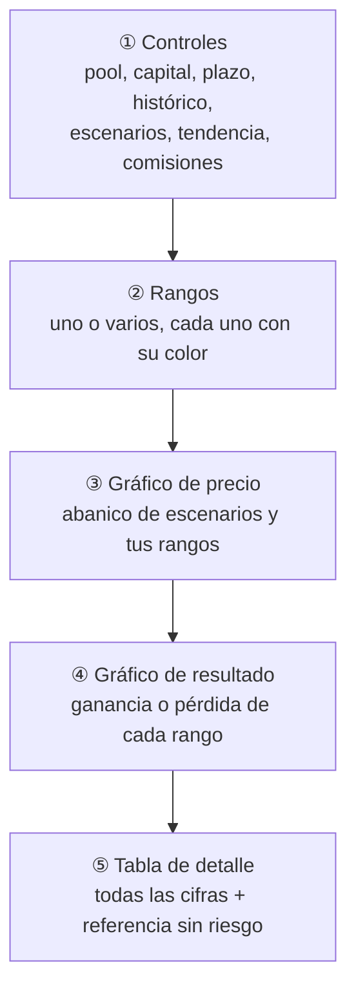
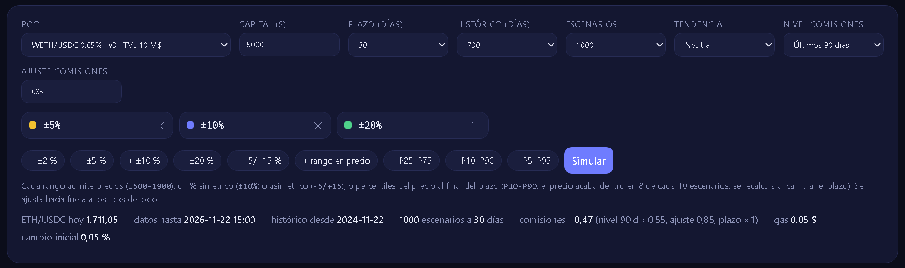
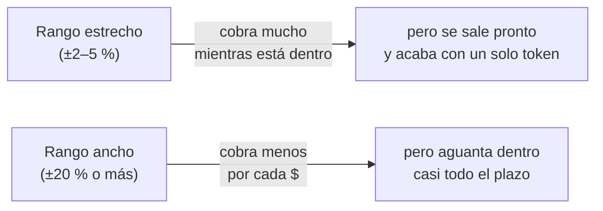
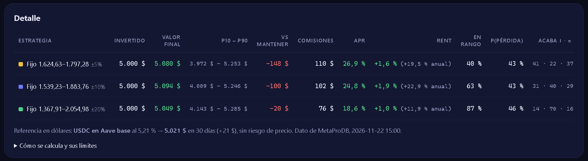
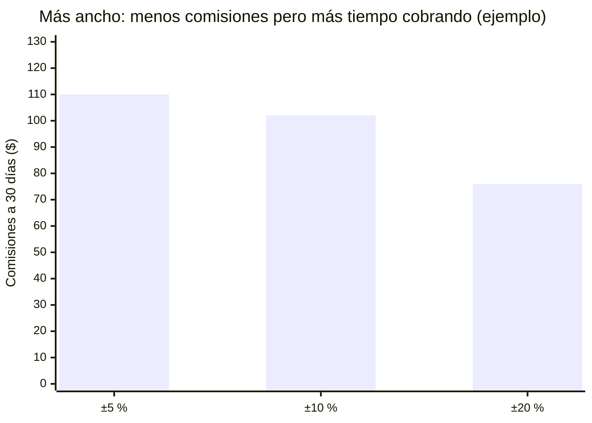
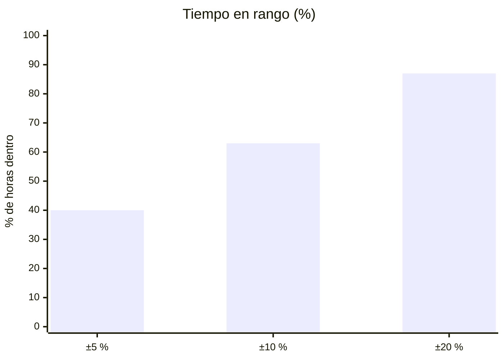
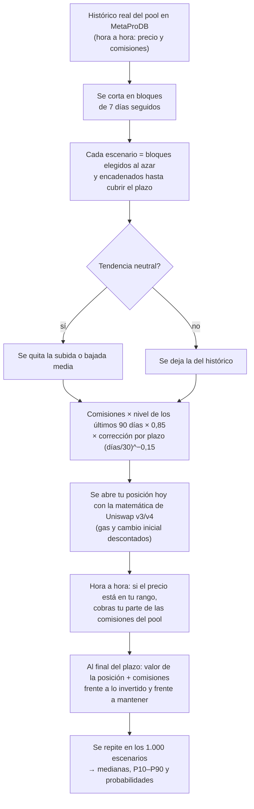
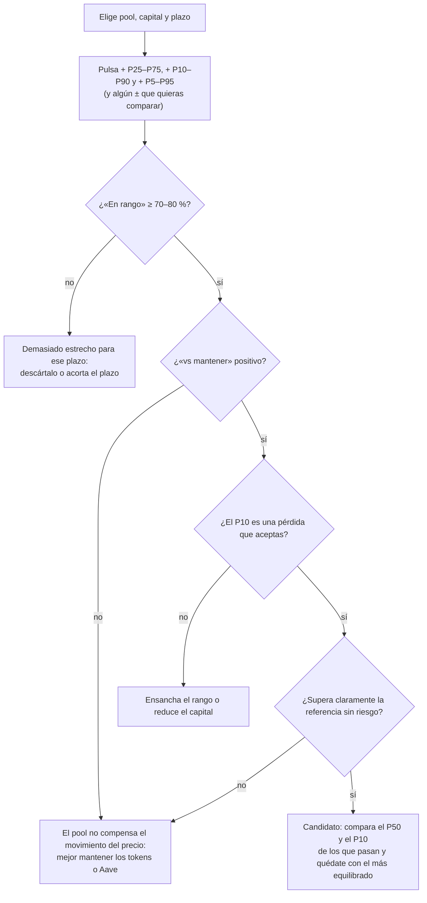
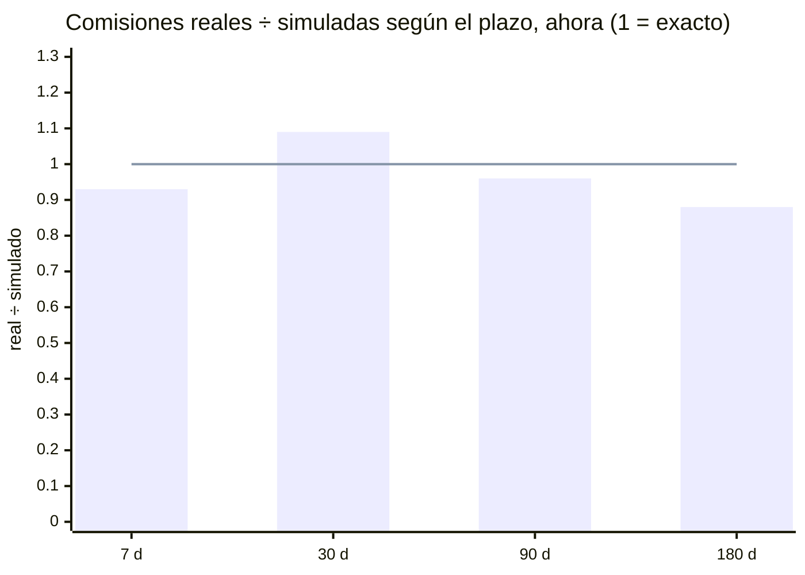

# Guía del Simulador de pools

Manual de uso de la pantalla **Simulador de pools**: qué hace, qué significa cada campo y cada columna, y
cómo leer los resultados para elegir un rango.

> **En una frase:** eliges un pool de MetaProDB, un capital y uno o varios rangos de precio; el simulador
> inventa 1.000 futuros posibles con el comportamiento real de ese pool y te dice qué habría pasado con tu
> posición en cada uno (comisiones, valor final, tiempo en rango, probabilidad de perder).
> Es **análisis de escenarios, no una predicción** ni una recomendación de inversión.

**Índice**

1. [Cómo abrirlo](#1-cómo-abrirlo)
2. [La pantalla de un vistazo](#2-la-pantalla-de-un-vistazo)
3. [Campos de entrada](#3-campos-de-entrada)
4. [Los rangos](#4-los-rangos)
5. [La línea de datos](#5-la-línea-de-datos)
6. [Gráfico 1: precio en los escenarios](#6-gráfico-1-precio-en-los-escenarios-y-tus-rangos)
7. [Gráfico 2: resultado frente a lo invertido](#7-gráfico-2-resultado-frente-a-lo-invertido)
8. [La tabla de detalle, columna a columna](#8-la-tabla-de-detalle-columna-a-columna)
9. [Cómo funciona por dentro](#9-cómo-funciona-por-dentro)
10. [Cómo elegir un rango (receta)](#10-cómo-elegir-un-rango-receta)
11. [Fiabilidad y límites](#11-fiabilidad-y-límites)
12. [Problemas frecuentes](#12-problemas-frecuentes)
13. [Desde la consola](#13-desde-la-consola)

---

## 1. Cómo abrirlo

| Dónde | Cómo |
|---|---|
| En el navegador del PC | **http://localhost:8768** |
| Desde el panel Power4 | https://caiico1.github.io/power4-panel/ → pestaña **Simulador** |

- **Arranca solo** al iniciar sesión en Windows (tarea programada «Simulador web», unos 30 s después de entrar).
- **Solo funciona en el PC** donde corre, porque lee MetaProDB del disco `D:`. En el móvil o en otro
  ordenador la sección del panel sale vacía.
- Si no responde, arráncalo a mano desde la carpeta del proyecto y deja la ventana abierta:

```powershell
cd C:\Users\javie\Proyectos\etapas-weinstein
python -m etapas.simulador_web
```

---

## 2. La pantalla de un vistazo

La pantalla tiene cuatro bloques, de arriba abajo:



Cada vez que cambias un campo o un rango, **vuelve a simular solo** (en menos de medio segundo). El
botón **Simular** fuerza una nueva simulación. Mientras calcula, la pantalla se atenúa.

---

## 3. Campos de entrada



| Campo | Valor por defecto | Qué es | Cuándo cambiarlo |
|---|---|---|---|
| **Pool** | WETH/USDC 0,05 % de Base | El pool donde abrirías la posición. La lista trae los pools de MetaProDB con datos de los últimos 3 días, agrupados por red y ordenados por TVL. Cada opción muestra par, comisión, versión (v3/v4) y TVL. | Siempre que quieras mirar otro pool. Solo están los de MetaProDB. |
| **Capital ($)** | 5.000 | Dinero que metes, en dólares (mínimo 100). El simulador reparte ese capital entre los dos tokens en la proporción que exige el rango. | Para ver tu caso real. Las cifras escalan casi en proporción; solo el gas pesa más con capitales pequeños. |
| **Plazo (días)** | 30 | Cuánto tiempo mantienes la posición **abierta sin tocarla**. Opciones: 7, 14, 30, 60, 90, 180. | Ajusta a tu marco: 7 semanal, 30 mensual, 90 trimestral. Ver [sección 10](#10-cómo-elegir-un-rango-receta). |
| **Histórico (días)** | 730 | Cuántos días del pasado del pool se usan como «material» para construir los escenarios. Opciones: 90, 180, 365, 730, 1.095. | Déjalo en 730 **para cualquier plazo**. Se comparó con 365 y 1.095 a 7, 60, 90 y 180 días (17–20 pools): 730 acertó igual o mejor en todos. Más histórico no ayuda: mete épocas que ya no se parecen al pool de hoy. |
| **Escenarios** | 1.000 | Cuántos futuros posibles se simulan. | 300 para probar rápido; 3.000 para una decisión final (afina los extremos, tarda ~3 veces más). No hace la simulación más «acertada», solo menos ruidosa. |
| **Tendencia** | Neutral | **Neutral:** quita la subida o bajada media del histórico; el simulador no apuesta por la dirección del precio, solo por cuánto se mueve. **La del histórico:** mantiene la tendencia que tuvo el pasado. | Déjalo en Neutral. «La del histórico» solo para ver qué pasaría si se repitiera la tendencia de los últimos años. |
| **Nivel comisiones** | Últimos 90 días | Reescala las comisiones de los escenarios al nivel reciente del pool. Si en los últimos 90 días el pool ha cobrado la mitad que su media, los escenarios cobran la mitad. Opciones: todo el histórico, 30 días, 90 días. | Déjalo en 90 días (es lo validado). 30 días reacciona más rápido pero es más ruidoso. «Todo el histórico» ignora si el pool se ha enfriado. |
| **Ajuste comisiones** | 0,85 | Factor común que multiplica todas las comisiones. Corrige que el reparto por horas tiende a sobrestimar algo lo cobrado. Sale de la validación con datos reales. | No lo toques salvo que el aviso mensual proponga otro valor; aquí puedes probarlo antes de cambiarlo en el código. |

Además, el simulador aplica solo una **corrección por plazo** que no se elige en pantalla: ×1,24 a 7 días,
×1 a 30, ×0,85 a 90 y ×0,76 a 180 (ver [sección 11](#11-fiabilidad-y-límites)).

> **El efecto conjunto** aparece en la línea de datos: por ejemplo «comisiones ×0,47 (nivel 90 d ×0,55,
> ajuste 0,85, plazo ×1)» significa que los escenarios cobran el 47 % de la media histórica:
> 0,55 por el nivel reciente × 0,85 por el ajuste × 1 por el plazo de 30 días.

---

## 4. Los rangos

Puedes comparar **varios rangos del mismo pool a la vez**. Cada uno tiene un color que se repite en los
gráficos y en la tabla.

**Cómo se escriben:**

| Formato | Ejemplo | Significa |
|---|---|---|
| Porcentaje simétrico | `±10%` | De un 10 % por debajo a un 10 % por encima del precio de hoy |
| Porcentaje asimétrico | `-5/+15` | De un 5 % por debajo a un 15 % por encima |
| Precios | `1500-1900` | Entre esos dos precios exactos (decimales con punto: `1539.5-1883`) |
| Percentiles | `P10-P90` | Entre los precios en los que acaba el 10 % y el 90 % de los escenarios al final del plazo: el precio acaba dentro en 8 de cada 10. Se recalcula solo al cambiar el pool, el plazo o el histórico. |

- **Botones rápidos:** `+ ±2 %`, `+ ±5 %`, `+ ±10 %`, `+ ±20 %`, `+ −5/+15 %` añaden ese rango.
  **`+ rango en precio`** añade uno de ±10 % escrito en precios, para que lo edites.
- **Botones por percentil:** `+ P25–P75` (estrecho: cobra más y se sale más), **`+ P10–P90`** (el punto
  de partida más equilibrado) y `+ P5–P95` (ancho y prudente). Salen asimétricos (por ejemplo −24/+27 %),
  porque en porcentaje el precio puede subir más de lo que puede bajar.

> **Por qué P10–P90 como punto de partida.** Simulado en ETH y BTC a 7, 30 y 180 días (22-nov-2026):
> el precio está dentro ~90 % del tiempo, su «vs mantener» mediano está entre los mejores y su caso malo
> (P10) es bastante menos malo que el del P25–P75, que cobra un 30–40 % más de comisiones pero pierde
> más cuando el precio se escapa. No arregla un pool que cobra poco: ahí ningún ancho supera a mantener.
- **Editar:** haz clic en el texto del rango, cámbialo y pulsa Intro o sal del campo.
- **Quitar:** la ✕ de cada rango.
- **Ajuste a ticks:** Uniswap solo admite ciertos precios (los *ticks* del pool). El simulador mueve cada
  límite **hacia fuera** al tick válido más cercano, así que el rango real puede ser un poco más ancho que el
  escrito. La tabla muestra siempre los precios reales.
- Los precios se muestran como el par «natural» (ETH en USDC, BTC en USDC…), aunque el pool guarde los tokens
  al revés.



---

## 5. La línea de datos

Debajo de los rangos aparece una línea con el contexto de la simulación:

| Dato | Ejemplo | Significa |
|---|---|---|
| Precio de hoy | ETH/USDC hoy **1.711,05** | Último precio del pool en MetaProDB. Es el punto de partida de todos los escenarios. |
| Datos hasta | **2026-11-22 15:00** | Última hora registrada (UTC). Si es de hace más de un día, MetaProDB no se está actualizando. |
| Histórico desde | **2024-11-22** | Primer día usado para construir escenarios (según el campo Histórico). |
| Escenarios y plazo | **1000** escenarios a **30** días | Lo elegido arriba. |
| Comisiones | ×**0,47** (nivel 90 d ×0,55, ajuste 0,85, plazo ×1) | Cuánto cobran los escenarios frente a la media histórica del pool: nivel reciente × ajuste × corrección por plazo. Por debajo de 1: el pool cobra ahora menos que de media. |
| Gas | **0.05 $** | Coste de abrir la posición: 5 $ en Ethereum y 0,05 $ en Base y Arbitrum. Se resta al abrir. |
| Cambio inicial | **0,05 %** | Comisión del intercambio para repartir el capital entre los dos tokens (la del propio pool, aplicada a la parte que hay que cambiar). |
| Aviso (en rojo) | «hay huecos en el histórico…» | Solo si el pool tiene horas sin datos: se usa el tramo continuo más reciente. |
---

## 6. Gráfico 1: precio en los escenarios y tus rangos


Muestra **por dónde puede ir el precio** durante el plazo y **dónde quedan tus rangos**.

| Elemento | Qué es |
|---|---|
| **Línea blanca** | Precio mediano: la mitad de los escenarios va por encima y la otra mitad por debajo. Con tendencia neutral, es casi plana. |
| **Banda oscura** | La mitad central de los escenarios (del P25 al P75). |
| **Banda clara** | El 90 % de los escenarios (del P5 al P95). Solo 1 de cada 20 acaba por encima y 1 de cada 20 por debajo. |
| **Franjas de color con líneas discontinuas** | Tus rangos, cada uno con su color. |
| **Eje horizontal** | Días desde hoy. |

**Cómo leerlo:** si el abanico se sale de la franja de un rango pronto, ese rango pasará mucho tiempo fuera.
En el ejemplo, el abanico supera el ±5 % (amarillo) en pocos días, mientras que el ±20 % (verde) contiene casi
toda la banda oscura hasta el final.

---

## 7. Gráfico 2: resultado frente a lo invertido


Una fila por rango. Todo en dólares **respecto a lo invertido** (el 0 es «acabo con lo mismo que metí»).

| Elemento | Qué es |
|---|---|
| **Barra** | Resultado mediano (P50): lo que ganas o pierdes en el escenario de en medio. La cifra encima es ese valor. |
| **Línea fina** | Del escenario malo (P10, a la izquierda) al bueno (P90, a la derecha). |
| **Texto a la izquierda** | Número de rango, cómo lo escribiste y sus precios reales. |

**Cómo leerlo:** la barra dice lo típico, la línea dice el riesgo. Una línea muy larga hacia la izquierda
avisa de que en un mal escenario puedes perder bastante, aunque el mediano sea positivo.

> Ojo: el resultado incluye **lo que cambia el precio de los tokens**. Si ETH cae, pierdes aunque cobres
> comisiones. Para separar el efecto del pool del efecto del precio, mira la columna «vs mantener».

---

## 8. La tabla de detalle, columna a columna



Todas las cifras se calculan **en cada escenario** y luego se resumen. «Mediana» o «P50» es el valor del
escenario de en medio.

| Columna | Qué mide | Cómo se calcula | Cómo leerla |
|---|---|---|---|
| **Estrategia** | El rango | «Fijo» + precios reales tras ajustar a ticks + lo que escribiste. Si aparece **«· fuera de rango hoy»** en rojo, el precio actual no está dentro: abrirías con un solo token y no cobrarías nada hasta que el precio entre. | Comprueba que los precios son los que querías. |
| **Invertido** | Tu capital | El campo Capital. | — |
| **Valor final** | Cuánto tienes al final del plazo | Mediana de (valor de la posición + comisiones cobradas), con los precios del último día del escenario. Verde si supera lo invertido, rojo si no. | Lo «típico» que te quedaría. |
| **P10 – P90** | La horquilla de resultados | Valor final en el escenario malo (solo 1 de cada 10 sale peor) y en el bueno (solo 1 de cada 10 sale mejor). | Cuanto más ancha, más incertidumbre. Mira sobre todo el P10: ¿podrías asumir esa pérdida? |
| **vs mantener** | Si el pool compensa frente a no hacer nada | Mediana de (valor final − valor de **los mismos tokens que depositas**, guardados en la cartera sin abrir posición). Incluye el gas y el cambio inicial como coste. | **Es la columna clave.** Positivo: el pool te deja mejor que tener los tokens quietos. Negativo: las comisiones no compensan la pérdida por el movimiento del precio (la llamada pérdida impermanente). |
| **Comisiones** | Lo que cobras | Mediana de las comisiones cobradas en el plazo, en dólares, ya con nivel reciente, ajuste y la dilución por tu propia liquidez. | Lo que gana el pool en sí. Los rangos estrechos cobran más mientras están dentro. |
| **APR** | Comisiones anualizadas | Comisiones medianas ÷ capital × (365 ÷ días). Interés simple. | Comparable con el APR que muestran Uniswap, Revert o DefiLlama, pero **realista**: ya cuenta el tiempo fuera de rango. |
| **Rent** | Rentabilidad total del plazo | Mediana de (valor final ÷ capital − 1). Entre paréntesis, anualizada: × (365 ÷ días). | Incluye comisiones **y** el cambio de precio de los tokens. La anualización de plazos cortos exagera; úsala solo para comparar rangos entre sí. |
| **En rango** | Tiempo cobrando | Media, en todos los escenarios, de la fracción de horas con el precio dentro del rango. | Por debajo de 70–80 % el rango es estrecho para ese plazo. |
| **P(pérdida)** | Probabilidad de perder dinero | % de escenarios en los que el valor final es menor que lo invertido. En rojo si pasa del 50 %. | Con tendencia neutral, en pares volátiles suele rondar el 40–50 %: el precio puede caer, y eso pesa más que las comisiones. |
| **Acaba ↓ · = · ↑** | Dónde acaba el precio | % de escenarios que terminan **por debajo** del rango · **dentro** · **por encima**. | Por debajo: acabas con todo en el token volátil (p. ej. todo ETH). Por encima: todo en el estable (vendiste ETH por el camino). |

**Debajo de la tabla:**

- **Referencia en dólares:** lo que darían los mismos dólares en **USDC en Aave** de la misma red, con el
  interés de hoy y sin riesgo de precio (ejemplo: 5,21 % → 5.021 $ en 30 días, +21 $). Si el pool no supera
  claramente esta cifra en el escenario típico, no compensa el riesgo.
- **«Cómo se calcula y sus límites»:** resumen técnico desplegable.

### Ejemplo leído (WETH/USDC 0,05 % de Base, 5.000 $, 30 días)

| | ±5 % | ±10 % | ±20 % |
|---|---|---|---|
| Valor final (mediana) | 5.080 $ | 5.094 $ | 5.049 $ |
| Malo (P10) | 3.972 $ | 4.009 $ | 4.143 $ |
| vs mantener | −148 $ | −100 $ | −20 $ |
| Comisiones | 110 $ | 102 $ | 76 $ |
| En rango | 40 % | 63 % | 87 % |





**Lectura:** el ±5 % cobra más comisiones, pero solo está dentro el 40 % del tiempo y pierde 148 $ frente a
mantener los tokens. El ±20 % cobra menos, pero está dentro el 87 % del tiempo y casi empata con mantener
(−20 $). Ninguno supera a mantener en la mediana: con las comisiones actuales de este pool (×0,47 de su
media), el pool no compensa el movimiento del precio a 30 días. Si buscas solo renta en dólares, la
referencia de Aave (+21 $ sin riesgo) es competitiva.

---

## 9. Cómo funciona por dentro



Claves:

- **Precio y comisiones van juntos.** Cada bloque trae el precio y las comisiones de la misma semana real,
  así que las semanas movidas traen su volumen y las tranquilas, el suyo.
- **Bloques de 7 días** para conservar rachas (días de mucha volatilidad seguidos, el ciclo de fin de semana).
- **Tu parte de las comisiones:** liquidez de tu posición × lo que el pool cobra por unidad de liquidez cada
  hora (`fee_growth` leído de la blockchain). Si el precio entra o sale del rango durante la hora, cuenta
  media hora.
- **Dilución:** tu liquidez se suma a la del pool, así que cobras un poco menos que si no estuvieras.
  Importa en pools pequeños.
- **Rango fijo:** nunca reajusta ni cierra antes. Si el precio se sale, la posición se queda parada
  esperando a que vuelva.
- **Misma matemática que el backtest** (`etapas.backtest`): sobre el histórico real dan el mismo resultado
  (comprobado en las pruebas automáticas).

---

## 10. Cómo elegir un rango (receta)



**Rangos orientativos para empezar** (pares volátiles tipo ETH/USDC; ajusta según lo que salga):

| Marco | Plazo | Rangos para comparar |
|---|---|---|
| Semanal | 7 | ±3 %, ±5 %, ±8 % |
| Quincenal | 14 | ±5 %, ±8 %, ±12 % |
| Mensual | 30 | ±8 %, ±10 %, ±15 %, ±20 % |
| Trimestral | 90 | ±15 %, ±25 %, ±35 % |

- **Si crees que el precio subirá**, prueba un rango asimétrico hacia arriba (`-5/+15`), pero deja la
  tendencia en **neutral**: el simulador no debe confirmar tu opinión, solo medir el riesgo.
- **Pares de dos estables** (USDC/USDT…): el precio apenas se mueve, así que manda la columna Comisiones; usa
  rangos muy estrechos.
- El ciclo **diario** no está cubierto: el plazo mínimo es 7 días y el simulador no reajusta.

---

## 11. Fiabilidad y límites

**Cómo se ha comprobado:** se simularon aperturas reales del pasado y se compararon con lo que ocurrió de
verdad, en 23 pools y dos años, calculando el ajuste con un año y aplicándolo al otro (fuera de muestra).

| Método de comisiones | Real ÷ simulado | Pools dentro de ±20 % |
|---|---|---|
| Ajuste fijo 0,85 (primera versión) | 0,86–1,05 | 52–70 % |
| Nivel de 90 días × 0,88 (segunda versión, solo a 30 días) | 0,94–1,07 | 83–87 % |

**La corrección por plazo.** Con un factor igual para todos los plazos, las comisiones salían bajas a
7 días y muy altas a 90–180 días: el nivel de los últimos 90 días se arrastraba todo el plazo. Ahora
se multiplican por **(días / 30)^−0,15**: ×1,24 a 7 días, ×1 a 30, ×0,85 a 90 y ×0,76 a 180. Se eligió
probando cuatro modelos en 17 pools y 6.273 aperturas de dos años (ajustando con un año y midiendo en el
otro). El exponente salió 0,15 con cualquiera de los dos años. Volver a la media del histórico empeoraba,
porque las comisiones no rebotan, y prolongar su tendencia no aportaba nada.

**Según el plazo** (calibración real con las aperturas del último año, 18–21 pools, 22-nov-2026):

| Plazo | Comisiones real ÷ simulado, antes | **Ahora** | Pools dentro de ±20 % | Real dentro del P10–P90 (ideal 80 %) |
|---|---|---|---|---|
| 7 días | 1,12 | **0,93** | 95 % | 84 % |
| 30 días | 1,05 | **1,09** | 86 % | 71 % |
| 90 días | 0,79 | **0,96** | 85 % | 87 % |
| 180 días | 0,64 | **0,88** | 72 % | 77 % |



**Conclusión:** el riesgo de precio (las bandas) y las comisiones son fiables de 7 a 180 días, con un
error típico del ±10 %. A 180 días, uno de cada cuatro pools se desvía más de un 20 %.

- **Vigilancia mensual:** el día 1 de cada mes una tarea de Windows («Simulador calibracion») repite la
  comprobación a **7, 30, 90 y 180 días**. Si algún plazo se desvía de su banda, abre una issue en
  GitHub, que llega por correo, con lo que hay que mirar: a 30 días, el ajuste propuesto; a los demás
  plazos, revisar el exponente de la corrección por plazo.
- **La horquilla P10–P90 se queda algo corta en años de tendencia fuerte** (72 % frente al 80 % ideal): con
  tendencia neutral, una caída sostenida como la de este año cae más a menudo por debajo del P10.

**Lo que NO modela:**

- Reajustar, cerrar antes o poner stop-loss (solo rango fijo).
- MEV y liquidez *just-in-time* (bots que entran y salen en un bloque y se llevan parte de las comisiones).
- Cambios bruscos de la liquidez del pool (llegada o salida de grandes LPs).
- Hechos que no estén en el histórico: un desanclaje de un estable, un hackeo, un cambio de comisión del pool.
- En rangos **muy estrechos** (±1–2 %), el reparto por horas sobrestima lo cobrado.
- Impuestos y el gas de cerrar la posición.

---

## 12. Problemas frecuentes

| Síntoma | Causa | Solución |
|---|---|---|
| La página no carga | El simulador no está arrancado | Espera 30 s tras iniciar sesión o arráncalo a mano (sección 1). Mira `out\simulador_web.log`. |
| La lista de pools está vacía al principio | La primera lectura de MetaProDB tarda unos segundos | Espera; aparece sola. |
| «No se pudo leer MetaProDB» | El disco `D:` no está conectado | Conecta el disco y recarga. |
| «Datos hasta» es de hace días | MetaProDB no se está actualizando | Revisa la tarea de actualización de MetaProDB. |
| Aviso rojo de «huecos en el histórico» | El pool tiene horas sin datos | Se usa el tramo continuo; los resultados valen, pero con menos histórico. |
| «Error: …» al escribir un rango | Formato no válido o límites iguales | Usa `±10%`, `-5/+15` o `1500-1900` (decimales con punto). |
| En el panel Power4 no se ve | Estás en otro dispositivo, o Chrome bloquea el acceso a la red local | Solo funciona en el PC. En Chrome, permite el acceso a la red local o usa el enlace «una pestaña nueva». |
| El puerto 8768 está ocupado | Ya hay otro simulador abierto | Usa el que ya está, o arranca con `--port 8770`. |

---

## 13. Desde la consola

Las mismas cifras, sin pantalla:

```powershell
python -m etapas.simulador "WETH/USDC 0.05%" --red base --capital 5000 --dias 30 --rangos "±5%,±10%,±20%"
```

| Opción | Por defecto | Equivale a |
|---|---|---|
| `--red` | — | Red del pool (ethereum, base, arbitrum) |
| `--capital` | 5000 | Capital ($) |
| `--dias` | 30 | Plazo (días) |
| `--rangos` | `±5%,±10%,±20%` | Los rangos, separados por comas |
| `--historia` | 730 | Histórico (días) |
| `--escenarios` | 1000 | Escenarios |
| `--tendencia` | neutral | Tendencia (`neutral` o `historica`) |
| `--nivel` | 90 | Nivel comisiones (0 = todo el histórico) |
| `--ajuste` | 0.85 | Ajuste comisiones |
| `--exponente` | 0.15 | Corrección de comisiones por plazo (0 = sin corrección) |
| `--gas` | según red | Gas de apertura en $ |
| `--bloque` | 168 | Horas por bloque (solo para pruebas) |
| `--json` | — | Salida en JSON |

**Comprobar la calibración de un pool** (¿habría acertado en el pasado?):

```powershell
python -m etapas.simulador "WETH/USDC 0.05%" --red base --calibrar --ultimos 365
```

Más detalle técnico en el [README](README.md#simulador-de-pools-a-futuro-rango-fijo).
