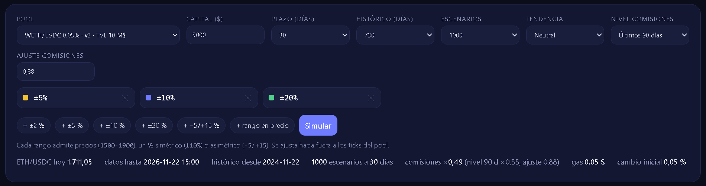
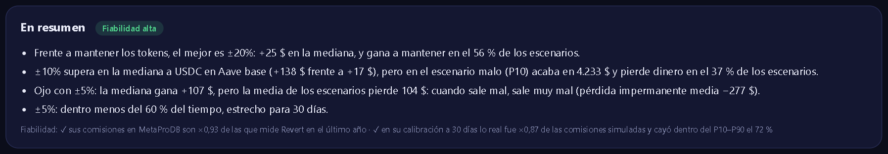
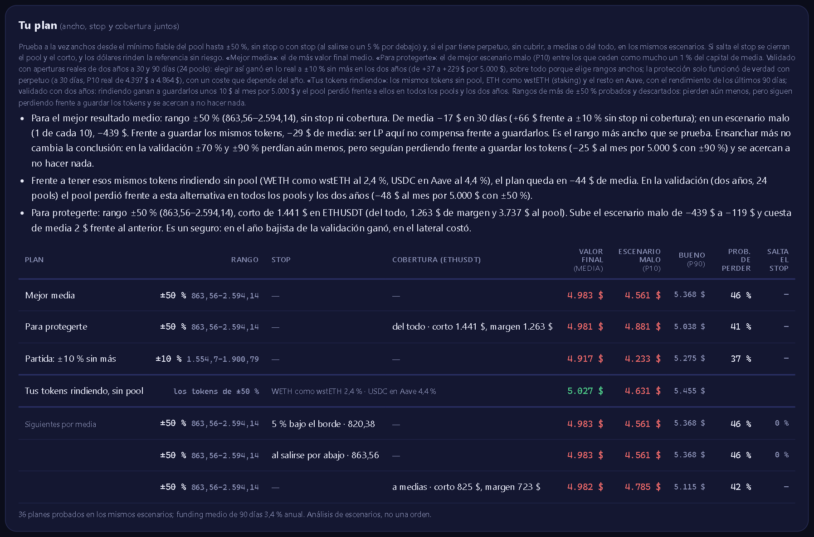
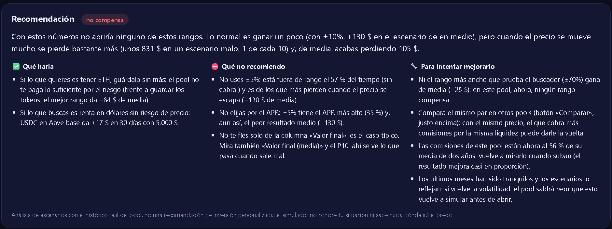
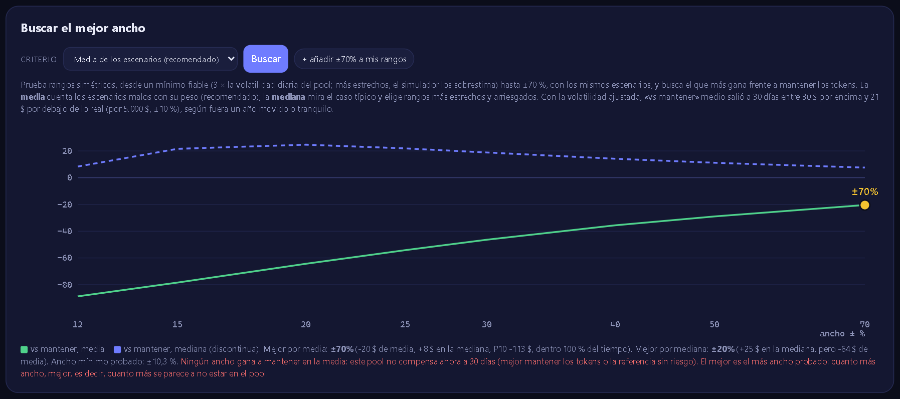
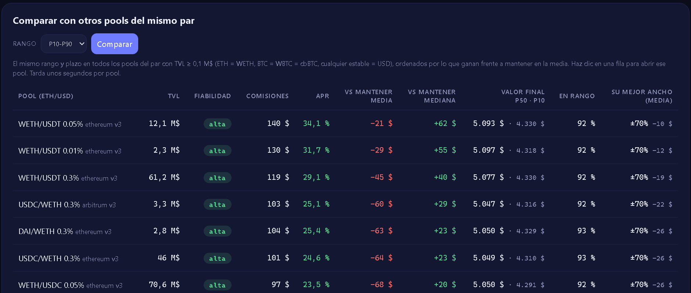
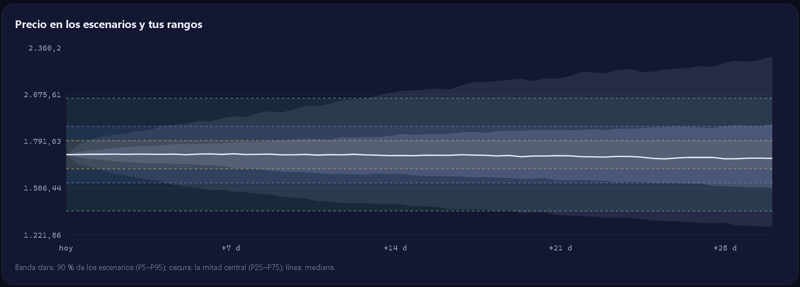
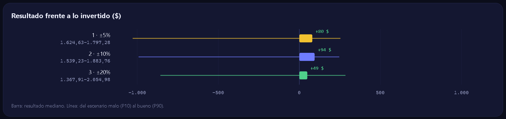
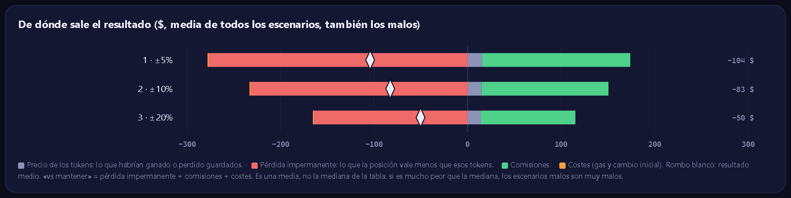
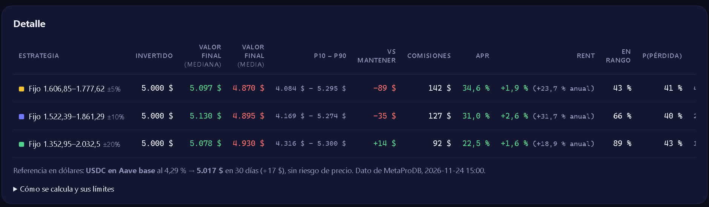

# Guía de Usuario del Simulador de pools

**Para quién es:** para cualquiera que quiera usar el simulador sin saber programar ni conocer los detalles
técnicos. Aquí no hay código ni fórmulas: solo qué hace cada cosa, cómo usarla y cómo leer lo que sale.

Si buscas el detalle técnico (cómo se calcula, cómo se validó, qué módulo hace qué), está en la
[Guía Simulador](Guia%20Simulador.md), que es el manual de referencia.

> **Aviso importante.** El simulador hace **análisis de escenarios**: te enseña qué podría pasar según cómo se
> ha comportado el pool en el pasado. **No adivina el precio** ni es una recomendación de inversión. La
> decisión es siempre tuya.

**Índice**

1. [Qué es el simulador y qué no es](#1-qué-es-el-simulador-y-qué-no-es)
2. [Lo mínimo que hay que entender antes de empezar](#2-lo-mínimo-que-hay-que-entender-antes-de-empezar)
3. [Tu primera simulación, paso a paso](#3-tu-primera-simulación-paso-a-paso)
4. [Cómo leer el resultado en cinco minutos](#4-cómo-leer-el-resultado-en-cinco-minutos)
5. [Recetas: qué hacer según lo que quieras saber](#5-recetas-qué-hacer-según-lo-que-quieras-saber)
6. [Todo lo que hay en la pantalla, de arriba abajo](#6-todo-lo-que-hay-en-la-pantalla-de-arriba-abajo)
7. [Los avisos que te pueden llegar](#7-los-avisos-que-te-pueden-llegar)
8. [Lo que dicen dos años de datos](#8-lo-que-dicen-dos-años-de-datos)
9. [Preguntas frecuentes](#9-preguntas-frecuentes)
10. [Glosario de términos](#10-glosario-de-términos)

---

## 1. Qué es el simulador y qué no es

### En una frase

Eliges un pool de liquidez, un capital (por ejemplo 5.000 $), un plazo (por ejemplo 30 días) y un rango de
precios; el simulador se inventa **1.000 futuros posibles** a partir de lo que ese pool ha hecho de verdad en
los dos últimos años, y te dice qué le habría pasado a tu dinero en cada uno.

### Qué te dice

- **Cuánto podrías ganar o perder**, en el caso típico, de media y en los casos malos.
- **Si te compensa frente a no hacer nada**: frente a guardar los mismos tokens en tu cartera, frente a
  tenerlos rindiendo (por ejemplo en Aave) y frente a dejar dólares en un sitio sin riesgo de precio.
- **Qué rango te conviene**, si merece la pena poner un stop o protegerte con un corto.
- **Qué pool tiene mejores números** entre todos los que conoce.
- **Qué hacer con una posición que ya tienes abierta.**
- **Cuánto fiarte** de cada cifra (el semáforo de fiabilidad).

### Qué NO te dice

- **Hacia dónde irá el precio.** Nadie lo sabe. El simulador, por defecto, supone que puede subir o bajar con
  la misma probabilidad.
- **Una garantía.** Son escenarios sacados del pasado; el futuro puede ser distinto.
- **Qué hacer con tu dinero.** Te da números para decidir mejor, no órdenes.

### De dónde saca los datos

De **MetaProDB**, una base de datos que guarda, hora a hora y leído directamente de la blockchain, el precio,
las comisiones y la liquidez de 168 pools de Uniswap en Ethereum, Base y Arbitrum desde octubre de 2024. Por
eso el simulador **solo funciona en el ordenador donde está esa base de datos** (el disco `D:`).

---

## 2. Lo mínimo que hay que entender antes de empezar

No hace falta saber mucho, pero estas seis ideas son imprescindibles. Las verás en todas partes.

### 2.1 Un pool y ser LP

Un **pool** es una bolsa con dos tokens (por ejemplo ETH y USDC) que la gente usa para cambiar uno por otro.
Quien pone sus tokens en esa bolsa es un **proveedor de liquidez (LP)**. A cambio, cobra una parte de las
**comisiones** que pagan los que cambian.

### 2.2 El rango

En los pools modernos (Uniswap v3 y v4) no pones tus tokens para cualquier precio, sino para un **rango**: por
ejemplo, ETH entre 1.550 $ y 1.900 $.

- **Mientras el precio está dentro del rango**, cobras comisiones.
- **Si el precio sale del rango**, dejas de cobrar y tu posición se queda entera en uno de los dos tokens.

Un rango **estrecho** cobra más mientras el precio está dentro, pero se sale antes. Uno **ancho** cobra menos,
pero aguanta más.

### 2.3 La pérdida impermanente

Es lo más importante y lo menos intuitivo. Cuando el precio se mueve, el pool va cambiando tus tokens
automáticamente: **vende el que sube y compra el que baja**. Resultado: acabas con menos valor del que tendrías
si simplemente hubieras guardado tus tokens. Esa diferencia es la **pérdida impermanente**.

Ejemplo: pones 2.500 $ en ETH y 2.500 $ en USDC. ETH sube un 30 %. Si los hubieras guardado, tendrías
3.250 $ + 2.500 $ = 5.750 $. En el pool, como ha ido vendiendo ETH al subir, tienes menos ETH y más USDC, y
valen, por ejemplo, 5.650 $. Has perdido 100 $ frente a guardarlos. Las comisiones tienen que compensar eso.

### 2.4 «Frente a mantener» (o «frente a guardar los tokens»)

Es la pregunta clave: **¿ser LP me deja más dinero que no haber hecho nada con mis tokens?**

- Si es **positivo**, las comisiones han compensado la pérdida impermanente: ser LP ha añadido algo.
- Si es **negativo**, habrías estado mejor guardando los tokens.

### 2.5 Escenarios, mediana, media y escenario malo

El simulador calcula 1.000 futuros posibles. Para resumirlos usa:

- **Mediana (P50):** el caso típico. La mitad de los escenarios salen mejor y la mitad peor.
- **Media:** el promedio de todos, **incluidos los malos con su peso**. Es la cifra más honesta para decidir.
- **Escenario malo (P10):** solo 1 de cada 10 escenarios sale peor. Es «lo que puede pasar si sale mal».
- **Escenario bueno (P90):** solo 1 de cada 10 sale mejor.

Si la mediana es buena pero la media es mala, quiere decir que lo normal es ganar un poco pero, cuando sale
mal, se pierde mucho. Fíjate siempre en la media y en el P10.

### 2.6 La referencia sin riesgo

Antes de arriesgarte, compara con lo que te daría el dinero **sin riesgo de precio**: el simulador usa
**USDC depositado en Aave** en la misma red (en noviembre de 2026, alrededor de un 4 % anual). Si un pool no
gana claramente a eso, no merece el riesgo.

### Un ejemplo completo

Con 5.000 $ en el pool WETH/USDC de Base, a 30 días y con un rango de ±10 %, el simulador dice (cifras de
noviembre de 2026):

| Qué | Cifra | Qué significa |
|---|---|---|
| Valor final típico (mediana) | 5.138 $ | En el caso normal ganarías 138 $ |
| Valor final medio | 4.917 $ | Contando los casos malos, de media perderías 83 $ |
| Escenario malo (P10) | 4.233 $ | En 1 de cada 10 casos perderías más de 767 $ |
| Frente a guardar los tokens | −10 $ | Las comisiones no compensan del todo la pérdida impermanente |
| USDC en Aave | +17 $ | Sin riesgo, ganarías 17 $ |

Lectura: lo normal es ganar algo, pero de media se pierde y el riesgo es alto. No compensa.

---

## 3. Tu primera simulación, paso a paso

### Paso 1. Abrir la pantalla

Abre en el navegador **<http://localhost:8768>**. El simulador arranca solo al encender el ordenador. También
está en el panel Power4, sección «Simulador» (solo funciona desde este ordenador, no desde el móvil).

Si no carga, mira la [pregunta frecuente](#no-carga-la-pantalla) correspondiente.

### Paso 2. Elegir pool, capital y plazo

1. **Pool:** despliega la lista y elige uno. Están agrupados por red (base, arbitrum, ethereum) y, dentro de
   cada red, por orden alfabético. Junto a cada uno ves su versión (v3 o v4) y su tamaño (TVL).
2. **Capital ($):** cuánto dinero pondrías.
3. **Plazo (días):** cuánto tiempo lo dejarías. **30 días es el plazo más fiable**; a 90 o más, las cifras son
   más orientativas.

Los demás campos (histórico, escenarios, tendencia, nivel y ajuste de comisiones) **déjalos como están** al
principio. Están explicados en la [sección 6](#61-los-controles).

### Paso 3. Elegir los rangos

Debajo verás unas fichas con rangos (por ejemplo ±5 %, ±10 %, ±20 %). Puedes:

- **Escribir** en una ficha: `±10%` (simétrico), `-5/+15` (5 % por debajo y 15 % por encima), `1500-1900`
  (precios exactos) o `P10-P90` (el rango donde el precio acabó en 8 de cada 10 escenarios).
- **Añadir** con los botones `+ ±2 %`, `+ ±10 %`, `+ P10–P90`…
- **Quitar** con la ✕ de cada ficha.

Consejo: compara siempre varios a la vez, por ejemplo uno estrecho, uno medio y uno ancho.

### Paso 4. Simular

Pulsa **Simular**. Tarda unos segundos. Cada vez que cambias un campo vuelve a simular solo.

### Paso 5. Leer el resultado

Ve a la [sección 4](#4-cómo-leer-el-resultado-en-cinco-minutos): con tres bloques tienes lo esencial.

---

## 4. Cómo leer el resultado en cinco minutos

La pantalla tiene muchos bloques, pero **para decidir bastan tres**, en este orden:

### 4.1 «En resumen» (un minuto)

Tres o cuatro frases con lo esencial y una etiqueta de **fiabilidad**:

- 🟢 **Alta:** las cifras son de fiar dentro de lo que puede un simulador.
- 🟡 **Media:** algo se sale de lo comprobado (pool pequeño, poco histórico, datos dudosos…). Tómalo con cautela.
- 🔴 **Baja:** no te fíes de las cifras de este pool.

Debajo dice **por qué** tiene esa fiabilidad.

### 4.2 «Tu plan» (dos minutos)

El simulador prueba a la vez **muchas combinaciones** (anchos de rango, con o sin stop, con o sin
protección) y te dice:

- **Mejor media:** la combinación que más dinero deja de media.
- **Tus tokens rindiendo, sin pool:** qué pasaría si no entras en el pool y dejas esos mismos tokens ganando
  intereses (por ejemplo en Aave). **Compáralo siempre con el plan**: en dos años de datos, esta alternativa
  ganó al pool casi siempre.
- **Para protegerte** (si existe): la combinación que mejor aguanta los casos malos sin costar mucho.

### 4.3 «Recomendación» (dos minutos)

Al final de la pantalla. Traduce todo a una decisión con un sello:

- **compensa** (verde): de media gana a guardar los tokens y a la referencia sin riesgo.
- **no compensa** (rojo): no lo hace.

Y tres listas: **✅ qué haría**, **⛔ qué no recomiendo** y **🔧 para intentar mejorarlo**.

> **Ojo con el «compensa».** En la validación con datos reales, las veces que el simulador decía que el pool
> ganaba a guardar los tokens, en la realidad siguió perdiendo de media. Léelo como «es de los menos malos»,
> no como «voy a ganar».

---

## 5. Recetas: qué hacer según lo que quieras saber

### 5.1 «¿Me compensa este pool?»

1. Elige el pool, tu capital y **30 días**.
2. Pon tres rangos: uno estrecho (±5 %), uno medio (±20 %) y uno ancho (±50 %).
3. Simula y mira la **Recomendación**: ¿dice «compensa»?
4. Mira **Tu plan**: ¿gana a «Tus tokens rindiendo»?
5. Mira el **P10** en «En resumen» o en la tabla: ¿podrías soportar perder eso?

Si las tres respuestas son sí, es un candidato. Si alguna es no, probablemente no merece la pena.

### 5.2 «¿Qué rango pongo?»

1. Mira primero **Tu plan → Mejor media**: ya te propone un ancho.
2. Si quieres explorar, baja hasta **Buscar el mejor ancho** y pulsa **Buscar**: prueba todos los anchos y te
   enseña una curva.
3. Regla general aprendida de dos años de datos: **cuanto más ancho, menos se pierde** frente a guardar los
   tokens. Los rangos estrechos cobran más comisiones, pero suelen perder más.

### 5.3 «¿Cómo me protejo si el precio cae?»

Tienes dos herramientas:

- **Un stop** (sección «¿Y si pones un stop?»): cerrar la posición y pasar a dólares si el precio cae por
  debajo de un nivel. Recorta las pérdidas grandes, pero aumenta las veces que pierdes un poco. El simulador
  sugiere uno solo si de verdad mejora el caso malo sin costar mucho.
- **Un corto en un perpetuo** (sección «Cubrirlo con un corto en un perpetuo»): apostar a la baja en un exchange
  (Bybit) por la parte de tu posición que está en el activo. Si el activo cae, el corto gana y compensa. **Es la
  protección que mejor funcionó con datos reales**, pero necesita cuenta en el exchange y vigilar el margen.

**Tu plan → Para protegerte** ya te dice cuál conviene.

### 5.4 «Tengo una posición abierta, ¿qué hago con ella?»

1. Sube a **Mis posiciones abiertas** y pulsa **Cargar y simular**. Lee tus posiciones de Revert (solo
   lectura, nunca toca nada).
2. Cada posición tiene una línea **Tu plan** que compara: mantenerla, ponerle stop, cubrirla con un corto,
   cerrarla y dejar sus tokens rindiendo, o cerrarla y pasar a USDC.
3. La columna **Stop vigilado** te dice el nivel de stop que se está vigilando y si estás lejos, cerca o lo has
   cruzado.
4. El botón **Ver en detalle** carga esa posición arriba para simularla con todo detalle.

### 5.5 «¿Qué pool miro?»

1. Arriba del todo, en **¿En qué pool añade más ser LP?**, pulsa **Calcular ranking** (menos de un minuto).
2. Te ordena todos los pools por lo que añade ser LP frente a guardar los tokens, con su mejor ancho.
3. Los primeros puestos **pierden menos**, pero en dos años **ninguno ganó de media**. Úsalo para elegir dónde
   perder menos, no para encontrar un chollo.

### 5.6 «¿Es mejor este mismo par en otra red o con otra comisión?»

Baja a **Comparar con otros pools del mismo par** y pulsa **Comparar**. Te enseña el mismo rango y plazo en
todos los pools de ese par (por ejemplo, todos los ETH/USD). Haz clic en una fila para abrir ese pool.

### 5.7 «¿Ha acertado el simulador conmigo?»

Al final, **¿Cómo ha acertado con tus simulaciones?** guarda cada simulación que haces y, cuando vence el
plazo, la compara con lo que pasó de verdad.

---

## 6. Todo lo que hay en la pantalla, de arriba abajo

### 6.1 Los controles

| Campo | Qué es | Qué poner |
|---|---|---|
| **Pool** | El pool que quieres simular | El que te interese |
| **Capital ($)** | El dinero que pondrías | Tu cantidad |
| **Plazo (días)** | Cuánto tiempo lo dejarías | 30 (lo más fiable); 7 a 90 está comprobado |
| **Histórico (días)** | Cuántos días del pasado usa para inventar los escenarios | 730 (dos años). No lo toques |
| **Escenarios** | Cuántos futuros posibles calcula | 1000. Con 3000 es más fino pero más lento |
| **Tendencia** | Si el precio puede subir o bajar por igual (Neutral) o sigue la tendencia del pasado | **Neutral** siempre: el simulador no debe apostar por ninguna dirección |
| **Nivel comisiones** | Qué periodo usa para estimar cuántas comisiones cobra el pool ahora | Últimos 90 días |
| **Ajuste comisiones** | Un factor de corrección calibrado con datos reales | 0,97. No lo toques |

Debajo de los controles hay una **línea de datos**: precio de hoy, hasta cuándo hay datos, cuánto cobra el pool
ahora frente a su media, cuánta volatilidad hay, la etapa de Weinstein del par, el gas y el coste de cambio.

### 6.2 ¿En qué pool añade más ser LP? (ranking)

La lista de pools ordenada por lo que añade ser LP. Ver [receta 5.5](#55-qué-pool-miro).

### 6.3 Mis posiciones abiertas

Tus posiciones reales en Revert, simuladas desde hoy. Ver [receta 5.4](#54-tengo-una-posición-abierta-qué-hago-con-ella).

### 6.4 En resumen y Tu plan

Lo esencial. Ver [sección 4](#4-cómo-leer-el-resultado-en-cinco-minutos).

### 6.5 Precio en los escenarios y tus rangos (gráfico)

Un **abanico**: cómo podría moverse el precio durante el plazo. La zona oscura es lo más probable; la clara,
lo menos. Tus rangos aparecen como bandas de color. Si el abanico se sale mucho de tu rango, tu posición
pasará mucho tiempo sin cobrar.

### 6.6 Resultado frente a lo invertido (gráfico)

Para cada rango, una barra con cuánto ganas o pierdes: el punto es el caso típico y la barra va del caso malo
(P10) al bueno (P90).

### 6.7 De dónde sale el resultado (gráfico)

Descompone el resultado medio en cuatro piezas:

- **Precio:** lo que ganas o pierdes porque los tokens suben o bajan (lo tendrías igual guardándolos).
- **Pérdida impermanente:** lo que pierdes por estar en el pool en vez de guardarlos.
- **Comisiones:** lo que cobras.
- **Costes:** gas y cambio al abrir.

Si las comisiones (verde) no superan a la pérdida impermanente (rojo), ser LP no compensa.

### 6.8 Detalle (tabla)

Todas las cifras de cada rango. Las columnas más útiles:

| Columna | Qué significa |
|---|---|
| **Valor final (mediana)** | Lo que tendrías al final en el caso típico |
| **Valor final (media)** | Lo que tendrías de media, contando los casos malos |
| **P10 – P90** | Del caso malo al bueno |
| **vs mantener** | Lo que añade ser LP frente a guardar los tokens |
| **Comisiones** | Lo que cobrarías |
| **APR** | Las comisiones en % anual |
| **Rent** | La rentabilidad total en el plazo (y anualizada) |
| **En rango** | % del tiempo que el precio está dentro de tu rango (cobrando) |
| **P(pérdida)** | Probabilidad de acabar con menos dinero del que pusiste |
| **Acaba ↓ · = · ↑** | En cuántos escenarios el precio acaba por debajo, dentro o por encima de tu rango |

Debajo, la **referencia sin riesgo** (USDC en Aave) para comparar.

### 6.9 ¿Y si lo reajustas cuando se sale?

Compara dejar el rango fijo con **recentrarlo** cuando el precio se sale (al momento, tras 24 h o tras 72 h).
Casi siempre sale mejor dejarlo fijo: cada reajuste paga gas y cambio y «fija» la pérdida.

### 6.10 ¿Y si sale mal? (casos de estrés)

Qué pasaría en caminos concretos y malos: el precio cae un 30 %, sube un 30 %, un latigazo (cae y vuelve) y el
**peor tramo real** que ha tenido el pool. También te dice a qué precio deja de cobrar tu rango por cada lado.

### 6.11 ¿Y si pones un stop?

Cada rango sin stop frente a cerrar y pasar a dólares si el precio cae al borde, un 5 % o un 10 % por debajo.
Marca en verde el **stop sugerido**, si lo hay.

### 6.12 Cubrirlo con un préstamo en Aave

Protegerte pidiendo prestado en Aave el activo del pool. **Hoy no se puede** (desde octubre de 2026 Aave no
deja usar USDC ni USDT como garantía); la pantalla lo avisa y las cifras son hipotéticas.

### 6.13 Cubrirlo con un corto en un perpetuo

Protegerte con un corto en Bybit. Te dice cuánto margen poner, cuánto cuesta (o cuánto cobras de
**funding**) y el riesgo de **liquidación**. Ver [receta 5.3](#53-cómo-me-protejo-si-el-precio-cae).

### 6.14 Buscar el mejor ancho y Comparar con otros pools

Ver recetas [5.2](#52-qué-rango-pongo) y [5.6](#56-es-mejor-este-mismo-par-en-otra-red-o-con-otra-comisión).

### 6.15 Recomendación y ¿Cómo ha acertado?

Ver [sección 4.3](#43-recomendación-dos-minutos) y [receta 5.7](#57-ha-acertado-el-simulador-conmigo).

### Atajo: abrir la pantalla con todo lanzado

**<http://localhost:8768/#ranking,posiciones,buscar,comparar>** abre la página y pulsa por ti esos cuatro
botones (puedes poner solo los que quieras).

---

## 7. Los avisos que te pueden llegar

El simulador tiene dos vigilantes que trabajan solos en el ordenador. Si no te llega nada, todo va bien.

### 7.1 El vigilante del stop (cada hora)

Si tienes posiciones abiertas, cada hora comprueba si el precio se acerca al nivel de stop de cada una.

- **Cuándo avisa:** solo cuando la situación empeora: de «lejos» a «cerca» (a menos de un 3 %) o de «cerca» a
  «cruzado».
- **Cómo avisa:** una notificación de Windows con el detalle y un aviso en GitHub (que llega por correo) sin
  datos personales.
- **Qué hacer:** abre «Mis posiciones», mira la posición y decide si la cierras. El vigilante **no cierra nada
  por ti**.
- **Elegir otro stop:** el que vigila es el que sugiere el simulador (o el borde de abajo si no sugiere ninguno).
  Si quieres otro, se puede fijar por posición en el archivo de configuración `stops.json`.

### 7.2 La comprobación mensual (el día 1 de cada mes)

Comprueba que el simulador sigue acertando: repite cientos de simulaciones del último año y las compara con lo
que pasó de verdad (comisiones, horquilla P10–P90, stop, cobertura con perpetuo, el plan y los datos frente a
Revert).

- **Cuándo avisa:** solo si algo se desvía de lo normal. Abre un aviso en GitHub que te llega por correo, con lo
  que hay que revisar. Se cierra solo cuando todo vuelve a estar bien.
- **Qué hacer:** nada inmediato. Significa que, hasta que se revise, las cifras del simulador son menos fiables.

---

## 8. Lo que dicen dos años de datos

El simulador no solo calcula: se ha comprobado con **miles de aperturas reales** de dos años en 24 pools
grandes. Esto es lo que se ha aprendido, en lenguaje llano:

1. **Ser LP perdió, de media, frente a guardar los mismos tokens.** Unos 23 $ al mes por cada 5.000 $.
2. **Y perdió más frente a tener esos tokens rindiendo** (ETH en staking, dólares en Aave): unos 48 $ al mes
   por cada 5.000 $ con un rango de ±50 %. En todos los pools y en los dos años.
3. **Cuanto más ancho el rango, menos se pierde.** Pero ningún ancho llegó a ganar de media.
4. **No hubo un momento fiable para entrar.** Ni con comisiones altas, ni con poca volatilidad, ni con el precio
   lateral: lo que funcionaba un año fallaba el otro.
5. **Lo que sí funciona:** elegir dónde y cómo perder menos (el ranking, el ancho) y **protegerse con un corto
   en el perpetuo**, que reduce de verdad las pérdidas grandes.
6. **El simulador acierta en lo que mide:** las comisiones, el rango de resultados posibles, cuántas veces salta
   un stop… Lo que no puede saber es hacia dónde irá el precio.

**En resumen:** el simulador te ayuda a no equivocarte y a medir el riesgo. Si lo que buscas es renta sin
riesgo de precio, la alternativa sencilla (dólares en Aave, Letras del Tesoro o letras de EE. UU.) suele ganar.

---

## 9. Preguntas frecuentes

### No carga la pantalla

El simulador arranca solo al encender el ordenador (tarea «Simulador web»). Si no responde:

- Comprueba que el disco **D:** está conectado (ahí están los datos).
- Reinicia el ordenador o arráncalo a mano con `python -m etapas.simulador_web` desde la carpeta del proyecto.

### ¿Por qué cada vez que simulo salen cifras un poco distintas?

Porque los 1.000 escenarios se inventan al azar cada vez. Las diferencias son pequeñas; si quieres más
estabilidad, sube **Escenarios** a 3000.

### ¿Por qué la mediana dice que gano y la media que pierdo?

Porque lo normal es ganar un poco, pero cuando el precio se mueve mucho se pierde bastante. La media cuenta
esos casos malos; la mediana no. **Decide por la media.**

### ¿Por qué el APR es tan alto y aun así no compensa?

Porque el APR solo cuenta las comisiones, no la pérdida impermanente. Un pool puede cobrar un 35 % anual y
perder más que eso por los movimientos del precio. **No elijas por el APR.**

### ¿Qué significa que la fiabilidad sea «media» o «baja»?

Que algo de ese pool se sale de lo comprobado: es pequeño, tiene poco histórico o sus datos tienen
irregularidades (por ejemplo, horas con comisiones imposibles). Debajo de «En resumen» se explica el motivo.

### ¿Puedo simular cualquier pool?

Solo los que están en MetaProDB (unos 170). Si falta uno, se puede añadir a la base de datos.

### ¿Hace algo el simulador con mi dinero?

**No.** Solo lee datos. Tus posiciones las lee de Revert en modo solo lectura y nunca firma ni mueve nada.

### ¿Por qué no está disponible la cobertura con Aave?

Porque desde el 29 de octubre de 2026 Aave no deja usar USDC ni USDT como garantía para pedir prestado. La
pantalla te enseña las cifras por si vuelve a permitirlo.

### ¿Sirve para plazos de un día?

No: el plazo mínimo es 7 días y lo más fiable es 30.

### ¿El simulador tiene en cuenta mi opinión sobre el precio?

Solo si cambias **Tendencia** a «La del histórico» o usas un rango asimétrico (por ejemplo `-5/+15`). No es
recomendable: el simulador está para medir el riesgo, no para confirmar lo que crees.

---

## 10. Glosario de términos

Cada término con su definición en lenguaje llano y, cuando ayuda, un ejemplo y dónde lo ves en la pantalla.

### A

**Aave.** Plataforma de préstamos en la blockchain. Puedes depositar tokens y cobrar intereses, o pedir
prestado dejando otros como garantía. *En pantalla:* la referencia sin riesgo (USDC en Aave), «Tus tokens
rindiendo» y «Cubrirlo con un préstamo en Aave».

**Abanico.** El gráfico que muestra todos los caminos posibles del precio durante el plazo, de más probable
(oscuro) a menos (claro).

**Acaba ↓ · = · ↑.** Columna del detalle: en qué % de escenarios el precio acaba por debajo, dentro o por
encima de tu rango. *Ejemplo:* «27 · 47 · 26 %» = en 27 de cada 100 acaba por debajo.

**Activo.** El token volátil del par (ETH, BTC, LINK…), frente a la **estable** (USDC, USDT…).

**Ajuste de comisiones.** Un factor (0,97) que corrige las comisiones estimadas para que cuadren con las reales.
Está calibrado; no hace falta tocarlo.

**Ancho del rango.** Cuánto se separan los extremos del rango del precio de hoy. *Ejemplo:* ±10 % con ETH a
1.700 $ va de 1.530 $ a 1.870 $.

**Ancho mínimo fiable.** El rango más estrecho que el simulador calcula bien en cada pool (unas tres veces lo
que se mueve el precio en un día). Por debajo, sobrestima lo que se gana.

**APR.** Rentabilidad anual de las comisiones, sin contar la pérdida impermanente ni el precio. *Ojo:* un APR
alto no significa que se gane dinero.

**Arbitrum.** Una de las tres redes del simulador. Es una red «de segunda capa» sobre Ethereum: más barata
(gas de céntimos).

### B

**Base.** Otra de las tres redes. También de segunda capa, con gas muy barato.

**Blockchain.** El registro público donde quedan todas las operaciones. De ahí salen los datos del simulador.

**Bloque (de escenarios).** Trozos de 7 días seguidos del pasado que el simulador encadena al azar para
inventar cada futuro. Así conserva las rachas reales (semanas movidas, semanas tranquilas).

**Borde (del rango).** Los dos extremos del rango. Al cruzarlos, la posición deja de cobrar.

**Bybit.** Exchange donde está el perpetuo que usa la cobertura con corto.

### C

**Calibración.** Comprobar el simulador con el pasado: lanzarlo desde muchas fechas antiguas con solo los datos
de entonces y comparar con lo que pasó. Se repite cada mes.

**Capital.** El dinero que pondrías, en dólares.

**cbBTC, WBTC, tBTC.** Versiones de bitcoin dentro de la blockchain de Ethereum. Valen prácticamente lo mismo
que un bitcoin.

**Cerrar la posición.** Retirar tus tokens (y las comisiones cobradas) del pool.

**Comisiones (fees).** Lo que pagan los que cambian tokens en el pool; una parte va a los LP que tienen el
precio dentro de su rango.

**Comisión del pool.** El % que cobra cada cambio (0,01 %, 0,05 %, 0,3 %, 1 %). Forma parte del nombre del
pool: «WETH/USDC 0.05%».

**Compensa / No compensa.** El sello de la Recomendación. «Compensa» = de media gana a guardar los tokens y a la
referencia sin riesgo (en pares sin estable, lo que añade el pool debe superar también lo que rendirían los
tokens sin pool).

**Contraste con Revert.** Comprobar las comisiones de MetaProDB con las que mide Revert, una fuente
independiente. Si no cuadran, baja la fiabilidad.

**Corto.** Una apuesta a que el precio baja: ganas si baja y pierdes si sube. Sirve para protegerte.

**Costes.** Lo que pagas al abrir: el **gas** y el **cambio** para tener los dos tokens en la proporción que pide
el rango.

**Cubrir (cobertura).** Protegerte de una caída del precio con una operación que gana cuando el precio baja (un
corto o un préstamo del activo).

### D

**Del todo / a medias.** En la cobertura: proteger toda la parte de la posición que está en el activo, o solo la
mitad.

**Depósito.** Los tokens que pones en el pool al abrir.

**Dilución.** Al entrar en el pool, tu liquidez se suma a la de los demás y te llevas tu parte. En pools
pequeños, entrar con mucho capital reparte las comisiones entre más.

**Dólar estable (estable, stablecoin).** Token que vale siempre 1 $: USDC, USDT, DAI… *Ejemplo:* en ETH/USDC,
USDC es la estable.

### E

**E-Mode.** Modo de Aave para préstamos entre tokens muy parecidos (por ejemplo wstETH y ETH). Aparece en otras
herramientas, no en el simulador.

**En rango.** Cuando el precio está entre los bordes de tu rango y cobras comisiones. *En pantalla:* columna «En
rango» = % del tiempo que cobras.

**Escenario.** Un futuro posible del precio y de las comisiones, inventado a partir del pasado del pool. El
simulador calcula 1.000.

**Escenario bueno (P90).** El resultado que solo 1 de cada 10 escenarios supera.

**Escenario malo (P10).** El resultado que solo 1 de cada 10 escenarios empeora. «Lo que puede pasar si sale
mal».

**Estrés (casos de).** Caminos del precio fijos y malos para ver la cola con nombre y cifra: cae un 30 %, sube un
30 %, latigazo y el peor tramo real del pool.

**Etapa de Weinstein.** Fase del precio de un activo según el método de Stan Weinstein: 1 base, 2 subida, 3 techo,
4 bajada. En etapa 2 el precio tiende a escaparse por arriba, así que un rango estrecho y centrado se sale antes.

**Ethereum.** La red principal, la más grande. El gas es caro (unos 5 $ por operación).

**Exchange.** Plataforma donde se compran y venden criptomonedas y derivados (por ejemplo Bybit).

### F

**Fiabilidad (semáforo).** Cuánto fiarte de las cifras de un pool: alta, media o baja, con el motivo.

**Fijo (rango fijo).** Un rango que no se mueve durante todo el plazo, aunque el precio se salga. Es lo que simula
la tabla principal.

**Funding.** Pago periódico entre quienes van largos y cortos en un perpetuo. Normalmente lo cobra el corto: es
un pequeño ingreso de la cobertura.

### G

**Gas.** Lo que cuesta cada operación en la blockchain. Unos 5 $ en Ethereum y céntimos en Base y Arbitrum.

**Guardar los tokens (mantener, HODL).** No hacer nada: quedarte con los mismos tokens que pondrías en el pool.
Es la comparación básica.

### H

**Histórico.** Los días del pasado que usa el simulador para inventar los escenarios. Por defecto, 730 (dos años).

**Horquilla P10–P90.** El intervalo donde caen 8 de cada 10 escenarios. Si el simulador está bien calibrado, lo
real cae dentro unas 8 de cada 10 veces.

### I

**Issue (de GitHub).** Un aviso que se abre en GitHub y te llega por correo. El simulador lo usa para avisarte de
la comprobación mensual o del stop, sin datos personales.

### L

**Latigazo.** Caso de estrés en el que el precio cae y luego vuelve. Castiga los stops y los reajustes.

**Liquidación.** En un préstamo o un corto con margen: si el precio va en tu contra y el margen no basta, la
plataforma cierra la operación y pierdes el margen.

**Liquidez.** El dinero que hay en el pool para atender cambios. Tu posición aporta liquidez.

**LP (proveedor de liquidez).** Quien pone sus tokens en un pool para cobrar comisiones.

**LTV.** En Aave, el % del valor de tu garantía que puedes pedir prestado. Desde octubre de 2026, el LTV de USDC
y USDT es 0: no sirven para pedir prestado.

### M

**Margen.** El dinero que dejas en el exchange para sostener un corto. Si las pérdidas del corto se lo comen,
te liquidan.

**Media.** El promedio de todos los escenarios, incluidos los malos. **La cifra para decidir.**

**Mediana (P50).** El caso típico: la mitad de los escenarios salen mejor y la otra mitad peor.

**MetaProDB.** La base de datos con el histórico hora a hora de 168 pools, leído de la blockchain. Es la fuente
del simulador.

**Mis posiciones.** El bloque que lee tus posiciones abiertas en Revert y las simula desde hoy.

### N

**Nivel de comisiones.** Lo que cobra el pool ahora (últimos 90 días) frente a su media de dos años. *Ejemplo:*
×0,57 = ahora cobra un 43 % menos de lo normal.

**Neutral (tendencia).** Los escenarios no apuestan por subidas ni bajadas: el precio puede ir a cualquier lado
con la misma probabilidad. Es lo recomendable.

### P

**P10, P50, P90.** Percentiles: el resultado por debajo del cual quedan el 10 %, el 50 % y el 90 % de los
escenarios. P10 = escenario malo, P50 = típico (mediana), P90 = bueno.

**P(pérdida) o probabilidad de perder.** % de escenarios en que acabas con menos dinero del que pusiste.

**Par.** Los dos tokens de un pool: ETH/USDC, WBTC/WETH… El precio es cuánto vale el primero en el segundo.

**Par pegado.** Dos tokens que valen casi lo mismo (cbBTC/WBTC, wstETH/WETH, USDC/USDT). El precio apenas se
mueve, así que se usan rangos muy estrechos.

**Pérdida impermanente.** Lo que pierdes por estar en el pool frente a guardar los tokens, porque el pool vende
el token que sube y compra el que baja. Ver [2.3](#23-la-pérdida-impermanente).

**Perpetuo.** Un contrato de un exchange que sigue el precio de un activo sin fecha de vencimiento. Permite ir
corto. *Ejemplo:* ETHUSDT en Bybit.

**Plan (Tu plan).** La combinación de ancho, stop y cobertura que el simulador propone tras probarlas todas a la
vez.

**Plazo.** Los días que dejarías la posición abierta.

**Pool.** La bolsa de dos tokens donde la gente cambia uno por otro y los LP cobran comisiones.

**Posición.** Tus tokens dentro de un pool con un rango concreto.

**Precio de hoy.** El último precio que tiene MetaProDB del pool (se actualiza cada hora).

**Prudente («Para protegerte»).** El plan con mejor escenario malo entre los que no cuestan más de un 1 % del
capital de media.

### R

**Rango.** Los precios entre los que tu posición cobra comisiones. Se escribe `±10%`, `-5/+15`, `1500-1900` o
`P10-P90`.

**Rango asimétrico.** Más amplio por un lado que por otro (por ejemplo `-5/+15`). Solo tiene sentido si crees
que el precio irá en una dirección.

**Ranking.** La lista de pools ordenada por lo que añade ser LP frente a guardar los tokens.

**Reajustar (recentrar).** Cerrar el rango y abrir otro centrado en el precio nuevo cuando el precio se sale.
Paga gas y cambio cada vez.

**Recomendación.** El bloque final que traduce todo a una decisión: compensa o no, qué haría, qué no y cómo
mejorarlo.

**Red.** La blockchain donde está el pool: Ethereum, Base o Arbitrum.

**Referencia sin riesgo.** Lo que daría el dinero sin riesgo de precio: USDC en Aave en la misma red.

**Rent (rentabilidad).** Lo que ganas o pierdes en total en el plazo, en % (y anualizado).

**Revert.** Plataforma que muestra y gestiona posiciones de liquidez. El simulador la usa en solo lectura para
leer tus posiciones y para contrastar las comisiones.

**Rindiendo (Tus tokens rindiendo).** La alternativa de no entrar en el pool y dejar esos mismos tokens ganando
intereses: ETH como wstETH (staking) y el resto en Aave.

### S

**Sesgo.** Cuando el simulador se equivoca siempre hacia el mismo lado (por ejemplo, prevé más comisiones de las
reales). Las comprobaciones mensuales lo vigilan.

**Staking.** Bloquear ETH para ayudar a la red a funcionar y cobrar un interés (unos 2,5 % al año). Se hace con
tokens como **wstETH**.

**Stop.** Cerrar la posición y pasar a dólares si el precio cae por debajo de un nivel. Recorta las pérdidas
grandes a cambio de perder un poco más a menudo.

**Stop sugerido.** El stop que el simulador propone porque mejora el escenario malo al menos un 2 % del capital
costando de media menos de un 1 %.

**Stop vigilado.** El stop de cada posición abierta que el vigilante revisa cada hora.

### T

**Tendencia.** Si los escenarios suben o bajan de media. Por defecto **neutral** (ni sube ni baja).

**Tick.** El escalón mínimo de precio que entiende un pool de Uniswap. Los rangos se ajustan a los ticks, por eso
los precios del rango salen con decimales «raros».

**Token.** Cualquier moneda dentro de la blockchain: ETH, USDC, WBTC…

**TVL.** El dinero total que hay en el pool. Un pool grande (más de 2 M$) tiene datos más fiables.

### U

**Uniswap (v3 y v4).** El intercambio descentralizado donde están los pools del simulador. Las versiones 3 y 4
permiten la liquidez por rangos.

**USDC, USDT, DAI.** Dólares estables: valen 1 $.

### V

**Valor final.** Lo que vale tu posición (con las comisiones) al final del plazo.

**Vigilante (del stop).** La tarea que cada hora comprueba si tus posiciones se acercan a su stop y te avisa.

**Volatilidad.** Cuánto se mueve el precio. Más volatilidad = más comisiones, pero más pérdida impermanente y más
salidas del rango.

**vs mantener.** Lo que añade (o quita) ser LP frente a guardar los tokens. La cifra clave.

### W

**WETH.** ETH «envuelto» para poder usarlo en los pools. Vale lo mismo que un ETH.

**wstETH.** ETH en staking de Lido: vale algo más que un ETH y su valor sube poco a poco con los intereses del
staking.
